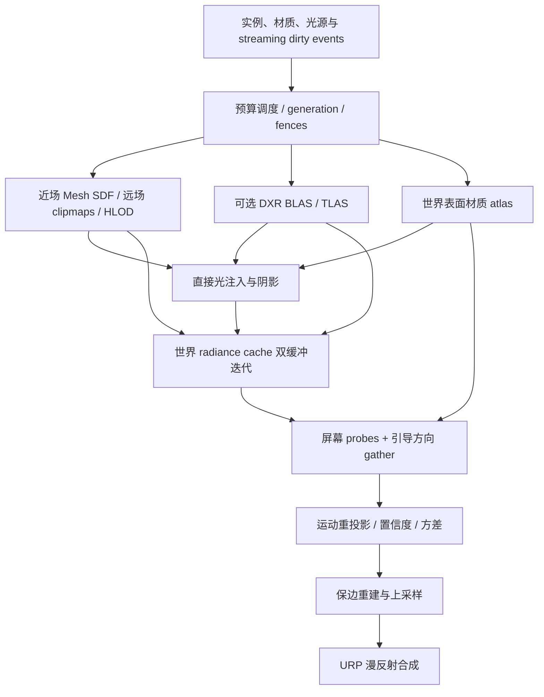

# 实时光传输架构与生产交付计划

Release106 关闭了中性两室的远景预热容量缺口。真实聚合网格重烘后用 18 张卡承载全部 36 个三角形，两室共用地板与顶棚后近景占用 174 张。在配置上限 192 张的普通 DXR Player 内，从两室近景直接请求远景能发布完整聚合体，切回后恢复三个细节。交接瞬间的实际占用峰值未采集。[中性两室的烘焙与交接](../LocalComparison/Review/neutral-room-chart-fit-01/result.md)

Release105 让用户可以在统一示例内连续穿过三个空间。三室布局将地板和侧墙改为连续表面后，192 张预算内的 Far 完整聚合与 Near 完整细节均已在该版普通 Player 观察到。[普通三室实走与完整近远表示](../LocalComparison/Review/three-room-passage-01/result.md)

Release104 关闭了 G4 首次只进入远场时的 HLOD 组识别缺口。细节全程未加载时，真实相机在根完成预热后取得完整发布回执，远景聚合体成为唯一可提交的表示。此前从零页连续穿入近场的路线完成了离场排空，但首次完整表示在回程才出现。[冷远场修复](../LocalComparison/Review/cold-far-root-01/result.md) · [高速穿行范围](../LocalComparison/Review/cold-crossing-01/result.md)

G2 在现有两室中取得了发光面完全被实墙遮住的地板对照。保持光源和相机不动，分隔门开／闭的间接亮度均值分别为 0.01979983／0.00007467。此观测限于隔墙后方的一处地板。[原始 HDR 与遮挡范围](../LocalComparison/Review/shaded-room-floor-01/result.md)

Release103 修复正强度、全黑 RGB 的解析灯仍占有效灯表名额的问题。最后一盏有效灯改为黑色后会留下空表，允许现有缓存清理解析光份额。普通两室版本及对应离线画册已发布。[实际准入与恢复](../LocalComparison/Review/black-light-admission-01/result.md) · [Windows 运行包](https://github.com/Ranko-sama/HybridLumenGI/releases/tag/release103-demo)

G1 的普通 Forward Lit 静态表面已有两组烘焙合成依据。非方向图替换后保留实时直射，两处内部区域与独立直射基准的最大绝对通道差为 5.96 × 10⁻⁸。独立的方向图场景中，暖、冷区域都响应法线倾斜，正倾角替换后与同法线直射基准的最大通道差为 0.000488。混合灯光和 APV 仍开放。[非方向贴图](../LocalComparison/Review/baked-lightmap-01/result.md) · [方向贴图](../LocalComparison/Review/directional-lightmap-01/result.md)

当前起始验收目标已由用户确认：960×540／30FPS，现有GI三个计时区间合计p95≤25ms，进程local有限采样峰值≤1GiB，nonlocal另列。[当前93优化后的静止窗口](../LocalComparison/Review/exact-no-fallback-traversal-01/result.md)为19.298ms／567.254MiB，满足两门槛；不代表运动／最坏情况或整体验收。后文历史“预算未定”以[当前口径](GpuBudget.md#当前已确认的起始验收目标)为准。

Release102 两室的实际关门过程已有 G3 读数。同一前室地板在闭门第 +59 帧降至开闭差的 9.38%，第 +119 帧仍有 6.34%。精确收敛时间仍未知。[同曝光过程与候选结果](../LocalComparison/Review/portal-close-response-01/result.md)

Release102 将连通两室整合进普通 Windows 入口。F3 进入或返回，O 开关分隔门；关闭解析灯后，前室固定地板随共用门洞的开闭呈现明确的暖色间接光差异。复杂多房间的完整验收仍开放。[实测与布局范围](../LocalComparison/Review/connected-rooms-01/result.md)

2026-11-02，G2 在已保存的有限墙／地板场景补齐离屏纹理依据。相机固定俯视，交换完整位于视锥外的墙纹理两色后，可见白地板左右区域的反弹色向均随之反转。[离屏纹理实机对照与原始 EXR](../LocalComparison/Review/offscreen-wall-texture-01/result.md)

2026-11-02，G5 普通门运动窗口已取得同帧 GI 与显存依据，三段合计 p95 为 16.984 ms，进程 local 峰值为 568.816 MiB。[逐帧配对、门位移及显存](../LocalComparison/Review/door-motion-budget-01/result.md)

2026-11-02，G4 的 30 分钟近场／离场流式使用取得实机结果，离场页与引用排空，返近完整组恢复，稳定端点的资源占用无累积。其余 G4/G5 负载继续开放。[实际路线与显存范围](../LocalComparison/Review/streaming-sustained-30m-01/result.md)

当前源码另已修复 Unity Editor 退出 Play 后保留两个隐藏回收宿主的问题。实测快照中两个宿主及组件合计由 6 个残留降至 0。[适用范围](../LocalComparison/Review/streaming-sustained-30m-01/result.md#editor-退出-play-后的原生对象)

Release101 修复了默认 Additive 相机材质捕获遗漏原生 LOD 淡变裁切的问题，已整合进统一示例。实际 LOD 过渡画面仍待观察。[修复范围与编译依据](DevelopmentProgress.md)

Release100 把 HLOD 已有读回的首个覆盖阻断接入 F2／编辑器相机诊断。作者可以定位对象和 chart，区分整张必需 chart 无可用覆盖与已覆盖 patch 的采样年龄不足。离线包同时收录 Release99 白炉原始 EXR 和历史 V209 零漫反射材质对照。G0 本机基线已锁定，完整 G1–G5 继续开放。[Release100 交付](../LocalComparison/Review/hlod-coverage-diagnostic-01/result.md)

完整解压后，使用 `Start-LocalRelease.cmd` 启动，使用 `PictureComparison/index.html` 离线看图。画质读数和不确定性按原采集版本注明。[Release102 Windows x64 实验性发布](https://github.com/Ranko-sama/HybridLumenGI/releases/tag/release102-demo)

[普通骨骼运动短历史候选](../LocalComparison/Review/skinned-motion-history-01/result.md)已按预定条件停止且未采用：功能路径可达，但实际A/B轨迹不同，未确认可见减颗粒收益。候选成果保留，产品恢复94，不新增G3通过项、不扩测，未为该撤回候选构建95；现有95只包含另外的直接反射率修复。

[Release93遍历优化](../LocalComparison/Review/exact-no-fallback-traversal-01/result.md)消除精确后端完整接管全部published owner后仍执行的空回退BVH遍历；混合／非exact路径及原命中资格保持。同配置有限静止GI合计中位23.921→18.393ms、p95 24.562→19.298ms，通过预定收益及预算门。运动画质依据保留92四图来源，不外推所有场景收益。

当前[Release93普通门运动Present](../LocalComparison/Review/release93-motion-present-01/result.md)已取得有限依据：960×540启动配置、2ray／filter4／默认DXR的一次固定30秒窗口平均52.688Hz，间隔p95／p99为21.966／23.567ms，最大25.991ms，全部观测间隔低于33.333ms。普通场景、门位移和两端实际DXR已确认；支持本机30FPS方向，不代表显示FPS、运动GI／显存、最坏负载或整体G5。普通93保持，本观察线结束。

当前另已取得[93／filter4／DXR静止119独立颜色估计](../LocalComparison/Review/release93-color-frame119-01/result.md)：Floor／White均值D亮度偏差−3.075%／−0.831%，Y-MAE 0.010529／0.018576。相较旧软件filter3，两处MAE约增10.1%／6.6%，均值色向偏差略增；保留92已授权减云斑取舍，同时报告颜色指标代价。单点限既有640×360参考网格、两个ROI及近似参考，不是整景／960×540颜色或动态验收；没有修改产品、补采或构建。

此前补齐[Release90／filter3的2射线DXR静止GI基线](../LocalComparison/Review/release90-dxr-baseline-01/result.md)：GI三区间合计中位21.667ms、p95 22.643ms、p99 23.938ms；进程local采样峰值565.441MiB。这是G0的当前预算决策输入，不是整应用GPU或冷／热／高速运动完整验收；该窗口满足随后确认的25ms／1GiB起始口径，普通Release90和画质配置保持。

用户已明确暂缓G5的CI接线；该条款保留未完成，不阻塞其他本机开发。当前有限采用[Release88本机2 ray配置](../LocalComparison/Review/two-ray-local-quality-01/result.md)：Runtime仍为e352921，只将本机示例构建的`raysPerPixel`从1改为2，通用默认值2保持。一次软件149／179／189／209四图有明确颗粒收益；平均Y分别增加7.892%／8.244%／23.112%／22.425%（约8–23%），不当作颜色更准确。四个时点不证明全过程无拖影，原720未完成状态保持。

独立的普通DXR 2 ray门运动成本窗口中，960×540启动配置的应用Present平均39.954935Hz，间隔p95为27.8123ms、p99为28.72332ms、最大30.7175ms，1197个间隔没有超过33.333ms。它支持本机30FPS方向，但成本余量较小；软件质量与DXR成本分别来自不同运行，不能合并为同后端的完整质量／性能放行。Present不是显示FPS或GI专项时间；该历史窗口采集时GI／显存预算未定，现以首页已确认的25ms／1GiB口径为准，完整G3／G4／G5保持开放。

此前[Release87](../LocalComparison/Review/short-history-spatial-filter-01/result.md)的短历史空间滤波改进保留：唯一软件239帧对照可见黑颗粒减少，已知点和时间统计保持；云状软斑与滤波增量成本未单独测量的边界保留。87的[1 ray门运动Present窗口](../LocalComparison/Review/release87-motion-present-01/result.md)仍属于原配置：960×540启动配置、默认DXR，平均70.85Hz，p95／p99间隔16.73／17.80ms，全部观测间隔低于33.33ms；不改标为88数据，也不据跨窗口差值归算某个滤波步骤成本。86空场资源修复与85本机DXR偏好继续保留。

状态：**持续本机开发；当前入口 Release102，完整生产验收尚未完成。** 更新：2026-11-01。[统一交互入口](<I:/Unity test/Comparison/Builds/LocalRelease102/Start-LocalRelease.cmd>)包含导航、分页/HLOD、软件/DXR、换色、灯、门和形变，包含可由K切换的[真实Skinned与可读网格形变](../LocalComparison/Review/skinned-unified-usage-01/result.md)，并保留默认关闭的[驱动进程显存观察](GpuBudget.md#驱动层进程显存观察)。[独立画面对照](../LocalComparison/Review/dynamic-picture-comparison-01/report.md)给出颜色、残留、拖影与收敛结论及其边界。Release78新增[来源分离缓存关灯响应](../LocalComparison/Review/cache-source-separation-01/result.md)，当前上传解析灯表为空时移除其旧贡献并保留自发光／环境；全局屏幕历史、缓存首次可信响应及面积光冗余计算优化已保留；约19.7%的[有限成本收益](../LocalComparison/Review/screen-endpoint-only-01/result.md)仍属于Release76来源。Release80修复[零漫反射已知辐射丢失](../LocalComparison/Review/zero-diffuse-known-radiance-01/result.md)：无关入射查询不再撤销已知Le／黑色；原资格、正漫反射和采样保持，仅有固定函数依据及普通构建，不增加整景画质或加速声明。Release81接通[普通GPU计时／反馈操作](../LocalComparison/Review/gpu-budget-controls-01/result.md)，一次实际Player完成测量、非法输入拒绝、显式目标启用反馈和关闭恢复；并整合零AO源码修复。临时20ms目标在最低配额下仍超出，不是生产预算或性能放行。修复前[35fddaa的frame119独立颜色对照](../LocalComparison/Review/current-color-frame119-01/result.md)确认Floor／White平均D仍比既有参考低28.9%／33.4%；仅有限ROI与时点，保留MC／模型局限，不是稳态或G1通过。默认多跳残留与整体颜色仍开放。完整目标由[原始计划](OriginalDevelopmentPlan.md)约束；后续源码提交不改变已构建EXE来源。不使用 Codex with ChatGPT，阶段下一步由独立 Astra Max 审查是否漂移，功能实现优先。

Release84新增[F2运行状态日志入口](../LocalComparison/Review/keyboard-ledger-01/result.md)，复用已有功能，GI与软件默认保持。同一普通Player请求DXR后，[应用Present窗口](../LocalComparison/Review/release84-dxr-present-01/result.md)为平均79.22Hz、间隔p95 14.33ms／p99 14.81ms，全部观测间隔小于33.33ms；前后CPU日志报告就绪DXR。该有限结果支持本机960×540／30FPS方向，不证明实际显示FPS、逐帧后端、等画质或完整G5，软件83结果保留原来源。

此前[Release83刚体历史修复](../LocalComparison/Review/rigid-pose-history-01/result.md)关闭同帧纯pose重传被Added污染的分类缺口：239帧门面2724／2739已知点恢复短历史，颗粒明显减少，仍有软斑驳；原新增、延迟上传和内容变化仍硬拒绝。只有一个正常产品时点，没有新的物理误差或无拖影／收敛结论。一次公开Release/None构建已将0181ef2整合到统一入口，未追加Player或性能运行。此线定位与验证结束，完整G1/G3保持开放。

此前[Release82静止重建修复](../LocalComparison/Review/stationary-history-01/result.md)有限关闭成熟同位置历史被稀疏raw邻域压暗的缺口：frame119 Floor/White平均D偏差由−28.9%/−33.4%降至−5.84%/−3.36%，MAE/色向改善，未知不增。仅在严格静止且无reactive条件采用；无标记真变黑32步仍留6.88%，动态239颗粒仍在。D240容量缺口及原失败保留，未补采；299偏差+0.144%/−18.06%，不证明收敛。源码5e714f6已通过公开Release/None构建并整合统一入口，无追加Player/性能/画质运行，G1/G3与完整G0–G5仍开放。

同场景来源包、合成和自动烘焙已接通，首批独立参考已交付。公开示例生成器另已接入普通交互并编译，尚未为这处接线重跑实机生成；其余历史版本记录保留各自来源与限制。

当前修复后的[有限关灯输出](../LocalComparison/Review/current-lightoff-prefix-01/result.md)已获得原场景0–299前缀的四张普通HDR：关灯后30与59帧仍有变化，完整收敛未证实。此处为间接漫反射出射贡献而非D；原720完成状态继续failed，不能把有限观察升级为G1/G3放行。

## 当前支持范围与证据层级

**基线后的用户决定：先以960×540／30 FPS为开发目标。** 整帧约33.33ms；随后确认的GI三区间合计p95≤25ms及进程local有限采样峰值≤1GiB见当前口径。当前半分辨率GI为开发起点；现有回调频率不是实际呈现FPS验收，完整G0／G5仍开放。

用户确认正常普通场景后，[Release83应用Present窗口](../LocalComparison/Review/release83-present-api-02/result.md)得到平均29.15Hz、间隔p95 38.58ms／p99 41.35ms，该有限窗口未达到30FPS。关闭显示跟踪，实际显示节奏仍未知；测量与UI/input关闭的起始基线口径不同，不据此归因性能回退。

用户要求的[Release83本机起始基线](../LocalComparison/Review/release83-local-baseline-01/result.md)已完成：960×540／480×270 GI／精确软件、反馈关闭，三GI区间合计中位28.017ms、p95 31.186ms、p99 31.447ms；相机回调平均34.505次／秒，非实际Present FPS。该源窗口进程local采样峰值577.449MiB、nonlocal280.664MiB，非GI独占或瞬时峰值。该阶段补齐当前起始数据，不自动选择生产目标或扩测配置；正式预算待据此确定，完整G0／G5保持开放。

后续一次[全局光暂态加权候选](../LocalComparison/Review/global-light-response-window-01/result.md)未满足既定响应筛选，已撤回并结束。Release78另采用来源分离功能：同一前缀240→299输出绝对变化降低92.2%，270→299降低80.0%，接收面反弹保留；该有限采用不证明物理误差或精确收敛。触发的是上传灯表为空，非所有场景光源关闭；缓存存储增加20%，实际带宽/时间增量未测。G1/G3整体收敛保持开放。

| 类别 | 当前合同 | 证据与边界 |
| --- | --- | --- |
| 当前本机已验证 | Unity6000.0.85f1 / URP17.0.4、Windows x64 / Mono / DX12 / Linear、RTX2080Ti；Release None | [Release73](ReviewBrief-CurrentLocalRelease73.md)在95a3213完成当前产品构建、显式后台120帧及HDR；[相机/TAA原序列](ReviewBrief-CameraMotionTaaResponse03.md)57事件／561持续点通过；并行游戏条件下不作性能比较；[Release69](ReviewBrief-ContinuousDeformationUsage01.md)在50b63c3完成可启停单网格、256帧原生发布与最终来源一致；[Release67](ReviewBrief-CurrentLocalRelease67.md)实际Feature静态Cube与Final HDR。历史[Release58](ReviewBrief-LocalReleaseNavigation01.md)普通键盘巡视、正常退出，产品7e387a5；[Release54](ReviewBrief-CurrentRepresentativeFinalImage01.md)静态120相机/GI帧及单次末帧HDR图像，产品a9292cb。[62固定移灯](ReviewBrief-LocalLightMoveResponse01.md)在7190c28完成180帧及五份IndirectOnly HDR，原FAIL与一次精确同数据补判并存；仅支持该事件的检测与空间响应。640×360仅为运行配置；58窗口图不替代54静态Final HDR，不构成完整动态GI/性能验收 |
| 已实现、有限验证 | 不变Skinned快照复用、Additive雾衰减、局部灯变化优先调度及现有架构能力 | 分别见[复用](ReviewBrief-SkinnedUnchangedSnapshotReuse01.md)、[原生捕获依赖](ReviewBrief-SkinnedNativeCaptureBoundary01.md)、[雾合成](ReviewBrief-AdditiveFogComposition01.md)、[调度](ReviewBrief-LocalLightSchedulingPriority01.md)；源码适配器、原生依赖与完整功能验收分开，54不补齐未触发条件 |
| 历史证据 | Release44稳态、早期软件/DXR图像、流式及动态专项 | [44的300秒窗口](ReviewBrief-LocalReleaseSteadyUse01.md)属于5120a8c；其他见[推进表](DevelopmentProgress.md)各自来源，不改旧FAIL、不改标为当前通过 |
| 代码明确限制/拒绝 | Feature跳过非DX12、非Linear、非Base或立体相机，以及无compute/必要资源的路径；仅Game及显式允许的SceneView、Tex2D目标可进入 | [实际准入代码](../Runtime/HybridLumenGIRendererFeature.cs)；替换原生漫反射还要求普通URP Lit、Forward/Forward+、有符号HDR及MSAA关闭等，失败保留原照明，见[完整替换合同](NativeDiffuseComposition.md)。这些限制不是单纯“尚未测试” |
| 尚未完成的验收 | 整体图像质量/动态收敛、各功能未覆盖的原生条件、目标规模、总VRAM、GPU p95/p99、完整G0–G5 | 目标已定为960×540／30FPS、GI三区间合计p95≤25ms及进程local有限采样峰值≤1GiB，nonlocal另列。未采集的资源/退休字段默认值不能当清零；首帧等待不是受控性能改善；不由120帧静态运行推导生产放行 |

以下架构与G0–G5条件继续保留。早期阶段叙述和朋友包只提供历史背景，不决定当前启动步骤。

此前13f31ec已采用并部署[引导与几何解耦修复](ReviewBrief-GuidingReceiverGeometry01.md)，同输入WARP和三后端完整编译通过，并已进入[Release72](ReviewBrief-CurrentLocalRelease72.md)普通Player构建及显式120帧整合。[首帧CPU分段诊断](ReviewBrief-StartupStageProfile01.md)沿用269241b完成12帧，旧长等待未复现；不构成GPU性能改善或生产验收。

当前源码另新增[静态线性HDR环境Cube](EnvironmentRadiance.md)，替代常量环境并为两条间接光miss路径提供方向性Li。[63真实compute结果](ReviewBrief-StaticHdrEnvironmentCubemap01.md)支持固定方向、旧常量兼容及未知语义；[67整合](ReviewBrief-CurrentLocalRelease67.md)已在完整Feature/场景中绑定此输入并取得Final HDR。固定六面工程输入不等于物理环境参考，也不扩大生产支持范围。

上一阶段已修复实际阻断、完成有限 Unity/Player 检查并交付来源一致的朋友测试包。用户后来已安装 Unity，本机已运行精确软件、SDF、DXR 与材质/历史/资源页场景。基线证据见 [Unity 功能接线检查](LocalRuntimeFunctionalAudit.md)，原计划对应关系见 [九项交接表](PreFriendReadiness.md)。后续在本机处理光照正确性、动态画质、性能与资源稳定性；朋友工程集成暂不作为当前任务。

integration-15 的73阶段与155项选定DXC是历史离线证据，详见 [OfflineValidation](OfflineValidation.md)。后续 Unity 修复降低了详细遍历的重复展开，精确软件及 DXR 已分别获得真实首帧；仍需记录首次构建/驱动初始化成本。新源码不冒用旧来源全绿报告，也不把编译秒数当 GPU 帧时间。

integration-14及更早归档保持不变，只代表当时来源。[早期独立审计](TaskBaselineAudit-2026-10-27.md)保留原文，其旧停点已由用户后续要求和本次九项交接取代。本候选不声称完整UE5 Lumen等价或最终生产放行。
材质页现在跨帧/相机复用，变化页独立分配代次并等待旧读者退出。`hardwareMaterialBudgetMiB`计入在途和退休页；`materialTextureUploadMiBPerFrame`限制实际复制，稳定大页逐段完成，未知动态来源不能拼接不同帧。alpha覆盖相关输入保留float32，其余符合条件的颜色可配对half存储。外部GPU写入仍须显式更新来源版本并建立生产者顺序。RTAS、软件几何和资产页另有独立准入，均不把CPU估计称作驱动VRAM硬上界。

纯可见性与完整材质查询已分离，普通可见性保留表面Cull/alpha而不套用shadow-caster排除。软件精确三角与DXR共用材质求值、空间足迹和命中身份；近场SDF/解析形状保留明确近似。当前候选的编译记录以统一报告为准，历史入口编译不能覆盖新增分支。

`HitMaterialPass` 和真实Feature的Execute清理方法进入实际源码适配器检查。空间足迹由完整像素深度差分或实际card patch生成，随近远场原点推进，并在命中后投影到方向/点光阴影连接；缓存插值的短线段仍是点可见性门控，不宣称整个patch可见。完整漫反射BRDF角度过滤不在当前支持范围；专项报告不能替代Unity集成或实体GPU验收。

用户长期目标是 UE5 Lumen 等价的生产 GI：真实网格 SDF、表面材质缓存、世界空间辐射度缓存、运动矢量重投影和可选 DXR。当前有限场景的测试候选不声称已经达到完全等价；源码包与可运行产物用于当前本机开发；朋友交付已取消，生产支持范围仍由后续实际验收决定。

## 1. 审查结论与本轮变更

旧版仅有屏幕追踪 + 最多 32 个 bounds 代理。主要缺陷是：把含镜面/已有 GI 的 scene color 当反弹源；接收面不乘漫反射反射率；历史按同一 UV 混合；离屏命中直接读取屏幕历史；多个相机共享历史；能量由 0.18/0.25 等系数控制；缺少时空滤波和真实网格路径。

当前代码采用分阶段传输：普通 URP Lit 属性捕获 → 有预算的场景/SDF 驻留与真实三角 chart 捕获 → 覆盖像素 anchor/发光统计构建 → 发光方向提议 → 双缓冲世界缓存更新 → 屏幕/网格 SDF/可选三角形 DXR gather → 运动矢量重投影及拒绝 → 方差与 à-trous 滤波 → 按接收材质合成。可变 chart 和发光方向提议已接入；是否完成某个候选的统一离线回归与打包，须以该候选的报告和清单为准。

Ng/Ns 分别用于几何与着色，屏幕历史要求成功记录的f-1来源。主线程相机边界刷新和共享Mesh版本触发局部失效。新形变组件捕获Skinned或显式可读网格，在后台生成同一快照的SDF/charts，完成后一起切换；旧资源在最终context fence后回收。见 [形变流程](DeformedGeometry.md) 与 [历史合同](GeometryHistoryContracts.md)。动态物体的整体URP运动/光栅/历史质量仍待本机验收；已有有限事件结果见推进表，不能扩写为整体动态质量通过。

命中链保留局部 `HLGIHit` 的source submesh、primitive、重心、UV、Ng/Ns和版本，并通过精确绑定查询对应chart。硬件三角命中的反射率/发光/法线来自新UV材质求值，card只提供缓存入射光；失效材质保留遮挡并拒绝未知辐射度，不再由常量近似变成已知。候选在提交前按来源Cull和覆盖筛选，保留后方合法命中。卡捕获不使用顶点Ns推断几何面向；屏幕历史的朝相机Ng与采样偏移独立。SDF/解析形状仍保留明确的近似路径。早期源码阶段尚未进行该链路的原生验收；后来已有各自来源的有限Unity/实体GPU记录。当前Release67只证明本轮静态工程输入的完整Feature与最终HDR目标图像链，完整链路质量和配置矩阵仍未验收，见上表与推进表。

共享 `MeshSource`、普通 Renderer `Discovery`、`Registry` 与每相机 `ReceiverHistory` CPU 来源快照已接入实际 Feature。新选项 `receiverObjectHistory=false` 默认关闭，开启会同时启用来源核验、像素身份/UAV冲突解析、GPU receiver表和独立 `CSTemporalIdentity` kernel。材质捕获、身份resolve和同相机f-1票据共同控制复用；未知覆盖或记录失败保留当前GI。支持范围及未验证边界见 [GeometryHistoryContracts.md](GeometryHistoryContracts.md)；不能据此宣称Unity中的移动物体历史已经验收通过。

| 用户要求 | 当前代码 | 达到生产目标前还缺什么 |
| --- | --- | --- |
| 直接光到间接漫反射、颜色反弹 | 分离Le、直接照明和rho；D=E/pi；方向/点/聚光及独立caster/layer查询；精确三角UV材质及cutout候选 | Unity灯光单位、层/阴影、材质与图像对照；软阴影、shadowmask/Mixed、cookie/IES不由当前硬阴影自动覆盖 |
| 材质表面缓存 | 真实chart、源指纹、可变卡池、UV/submesh/MPB、完整owner准入；形变生成匹配charts；稳定原纹理页共享、局部替换和fence退休 | GPU凹腔/薄层/贴图覆盖、规模和捕获成本；自适应分辨率/全表面积覆盖不作承诺；未通知GPU纹理更新无法推断 |
| 世界空间缓存、多次反弹 | 每卡默认4×4 patch，捕获后扫描真实覆盖 texel 作为 anchor；位置/法线/代际检查、短可见性射线、按卡池双缓冲、脏优先级及最旧项配额 | 方向性可见性统计、多分辨率/更密覆盖、完整依赖传播；渐进收敛和动态残留需实测 |
| 历史重投影/置信度/降噪 | motion vectors、双法线、实际采样中心、f-1票据与滤波；新增可选像素来源/primitive、冲突与未知覆盖拒绝、对象前帧变换和自身位姿域匹配 | 实际URP光栅覆盖、TAA/动态分辨率、多相机、量化残留；XR、任意相对仿射和形变历史扩展 |
| 重要性采样 | 余弦/旧缓存/atlas发光方向混合；真实三角面积CDF、立体角PDF、仅Le配对MIS；软件/DXR与最近屏幕分区一致 | 整帧GPU均值、方差与成本验收；离线积分不能证明最终画面 |
| 真实 mesh SDF | 共用Editor/后台数学核、RFloat体素、闭合/unsigned shell、atlas；global SDF dirty bricks；形变快照自动重建 | global SDF仍是保守空区加速，真实hit继续细化；有限分辨率薄壁质量、生成延迟和GPU时间待验收 |
| 动态几何 | 刚体独立更新；Skinned BakeMesh或可读producer快照；SDF/charts/三角共同来源、代次取消、后台/上传额度和旧资源退休 | 真实驱动build/refit与动态质量；私有GPU变形需提供已完成的可读快照；更新延迟须测 |
| 分块/近远场/HLOD | 原Additive路径及独立AssetBundle页；LZ4导出、依赖闭包整组准入、异步IO、完整绑定、自动context退休；HLOD完整ready后原子发布、保留旧覆盖 | 实际文件IO、双相机切换、取消和冷启动验收；HLOD代理需作者准备，首次无旧表示的可见覆盖须测 |
| GPU/显存预算 | 屏幕/atlas/纹理arena/软件几何/资产页额度；实际纹理复制额度；独立RTAS预留和公平build工作额度；GPU反馈缩放patch/capture/brick | 驱动分配和峰值、CPU/GPU p95/p99、Release长测、计时归属和设备重建；准入与估算不是硬毫秒/VRAM保证 |
| DXR | 可选inline RayQuery；真实UV/Ng/Ns/Cull/alpha候选；匹配材质页和chart绑定；形变快照及独立build额度；未知保留遮挡 | Unity/驱动完整路径和软件对照、真实GPU性能；不承诺任意材质图、透明/镜面GI或完整角度过滤 |

## 2. 目标数据模型

所有阶段共享 `InstanceID + GeometryGeneration + MaterialGeneration + LightingEpoch`。驻留地址不能充当身份。页/brick/slot 复用必须变更 generation；CPU 完成上传不代表 GPU 已可读取。资源状态为 `Unloaded → Requested → Uploading → Ready → Retiring`，只发布 Ready，回收等待 GPU fence。

三个独立的世界空间层：

1. **几何层**：原始实例与变换；每网格 SDF + mip/误差界；近场实例 BVH/网格，远场 global SDF clipmap 与 HLOD；DXR BLAS/TLAS 实现同一查询契约。返回 hit position、geometric/shading normal、material/surface ID、distance 和置信度，不能只返回 RGB。
2. **表面层**：离线 chart/card 建立与在线重捕获；保存位置/法线/材质覆盖、base reflectance、emission、opacity 和版本；按可见性、面积、距离选择纹理页精度。支持 URP Lit 的 property/keyword/UV 语义，ShaderGraph 要有独立 capture pass 合约。分离材质页与照明页，灯光变更不重采材质。
3. **传输层**：表面 direct irradiance + outgoing radiance；世界空间 radiance/irradiance probes 或 surfels；存方向信号、距离矩和样本量；把用于可见性检验的距离统计与颜色分开。Screen probes 查询该层，屏幕历史只重建最后的像素估计。

## 3. 帧图和光照方程



漫反射量采用 `D = E/pi`，`Lo = Le + rho_d * (D_direct + D_indirect)`。余弦半球采样 `p(w)=cos(theta)/pi` 时，`D_indirect = mean(Li)`。最终像素仅乘一次 `rho_d`，金属的 diffuse reflectance 应为零。直接光采用 URP 相对单位；对照渲染器必须匹配归一化约定。镜面、透明、体积不应混进漫反射信号；如果“Lumen 等价”还包括 Lumen reflections，需要单独的 specular ray/reconstruction 管线，当前没有实现。

多次反弹读旧世界缓存、写新缓存，不能在同一次 dispatch 读取正在写入的结果。物理材质反射率保留在`[0,1]`，直接反射使用`rho_d * D_direct`；实际缓存近似使用`min(rho_d,0.98) * AO * bounceFeedback * D_cache`，screen/world一致。0.98仅限制递归反馈，在反馈强度不超过1等理想条件下提供收缩余量，不应压低独立直接光源项；它仍会给高反射率的高阶反弹引入偏差，不是无偏物理解。此前直接项也受限的路径差异见[修复记录](../LocalComparison/Review/direct-reflectance-consistency-01/result.md)。可选radiance clamp同样有偏，必须作为质量设置报告。atlas发光方向提议与余弦/旧缓存引导共用完整混合PDF。独立面积样本来自当前prepared三角表，与方向命中Le按完整立体角密度配对；反射/cache项不乘这份Le权重。最近屏幕命中胜出的区域抑制面积项，未入表或近似端点保持方向估计。面积模式不分别非线性夹取两份估计。见[EmissiveSampling.md](EmissiveSampling.md)。

捕获、anchor/发光统计、提议构建和传输按同一 graphics queue 顺序记录，提议只接纳当前 ready 且 published 的 owner，warming 不进入当前发光集合。每帧提议重排不制造 lighting dirty 或新 epoch。默认发光采样权重 0.5、选择 top 16，最多 32；权重为零时有效预算为零，仍清表但跳过候选选择。CPU 采样积分与录制测试不能代替 GPU 图像、方差和时间测量。

默认Additive仍保留URP已有光照，不自动扣除baked GI。新增显式Replace Native Diffuse GI模式：通过stock Lit RendererList重算原生漫反射GI项，以有符号HDR delta替换，保留直接/镜面/发光及雾色；receiver SSAO与材质AO分离，避免把屏幕AO注入世界反弹。该模式仅接受Forward/Forward+、MSAA关闭、signed RGBA16/32F目标、逐帧stock Lit资格检查；Deferred/APV/Subtractive等拒绝或保留原画面。已烘焙的direct和indirect在lightmap里不能任意拆分，所以名称是“原生漫反射GI项”，不能承诺恢复Baked-only/Subtractive的直接光。实际override keyword映射和Player变体保留仍是生产关卡。见NativeDiffuseComposition.md。

## 4. 时间一致性与失效

历史坐标为 `previousUV = currentUV - motion + previousJitter - currentJitter`；运动矢量与 jitter 需按 URP 实际 GPU 投影约定核验。保存上一帧的深度、法线、漫反射材质、亮度一二阶矩和历史长度。拒绝屏外/镜头切换、深度或法线不一致、材质变化、覆盖与分辨率变化；对有效历史做局部颜色/方差夹取。薄壁和移动物体要使用对象身份/速度/上一帧对象变换增强判定。

生产失效应是局部依赖传播：旧/新 bounds 影响的 SDF bricks、相交 surface cards、可见性探针和照明页变为 dirty；材料变更不重建几何；局部灯光只更新其影响域。当前已将普通几何/灯光/材质变化从全局epoch重置拆出：身份/页改变清自身patch，几何变化域拒绝历史，附近影响域缩短历史并优先更新。方向光等全局变化标记世界缓存待替换：预算等待或新估计未知时保留旧测量，首次可信更新直接使用当前估计，不再混入旧时间平均；仍保留原 reactive 成功提交后的年龄2及HLOD就绪语义。该年龄是截断的历史权重，不是独立样本数量。容量/后端/设置变化仍保守全重置。这是局部域近似，尚非完整路径依赖图；当前估计仍读取旧Jacobi缓存，长距离多次反弹残留和消隐时间仍须实测。

世界材质页现在与 receiver registry 共用 `MaterialSource` 精确观察：原始引用、shader/keywords、属性存在位与值、纹理引用/更新计数/sampler 均参与比较。SurfaceCache 的 32 位签名只作变更提示，同 hash 仍须验证 owner 的逐槽快照。非空 per-material MPB 整体优先，不与 renderer block 合并；MPB 不能改变 render state，capture 和硬件 Cull 均取来源 Material。RenderTexture/CustomRenderTexture 保留当前捕获，但下一次 Prepare 要求更新，不能把旧就绪票据当稳定内容证明。普通 Texture2D 的 GPU/native 写入若未通知 `IncrementUpdateCount` 仍不可检测；全局 shader/probe 等变化另有失效责任。

## 5. Streaming 与预算

按照 near/far clipmap 的连续覆盖范围请求资产，保留重叠与滞回。细节 → HLOD 切换必须等候 HLOD 的几何、材质、照明全部 ready；同一事务中发布新表示并退休旧表示，避免丢洞或重复遮挡。相机高速移动时有可控降级，同时记录 missing coverage。HLOD 是 GI 材质与遮挡代理，不能只用场景包围盒替代。

已有[当前统一示例的热态连续近远路线](../LocalComparison/Review/continuous-near-far-01/result.md)：途中不等ready，真实页IO与目标／发布推进，完整CPU可提交组与发布组保持，回近后细节恢复。路线位于驻留域内，不等于像素无洞、高速穿越未驻留冷区、长时压力或完整G4；不因该有限结果降低上述要求。

完整生产调度目标是以 `可见影响 × 误差 × 变更紧急度 + 等待年龄` 排序，覆盖 CPU 准备、上传字节、SDF brick 合并、RTAS build/refit、射线、材质捕获、滤波与显存，并给任务设置防饥饿保障。当前实现尚未对所有阶段分别施加时间预算；GPU 反馈以滞后观测、平滑和滞回调整三类更新数量，不动态改变 probe 密度或资源分辨率。验收需要记录冷启动和最坏情况，不能只展示稳定相机的平均 FPS。

形变快照已增加默认关闭的[同步捕获经过时间准入](DeformedGeometry.md)：达到本帧额度后不再开始下一份捕获，保留下一对象轮次；失败和未变内容的捕获也计时，已完成作业发布／清理仍正常执行。它不能抢占单次BakeMesh，也不覆盖发布、后台任务或其他CPU准备；是上述CPU准备调度的一项具体能力，不代表全阶段时间预算完成。

已完成的形变作业按捕获入队顺序争用上传额度，关闭持续新任务反复抢先的发布饥饿机制；未完成、失效和清理失败按原资格处理。该保证限合格且适配当帧额度的ready任务，不承诺永久大于整帧额度或无法完成的作业有固定等待上限。

当前 [GPU 反馈](GpuBudget.md)只缩放 patch/capture/brick 每帧工作量，不修改 Settings、容量或资源尺寸。`adaptiveGpuBudget=false`、`measureGpuCost=false`、`targetGpuMilliseconds=0` 为默认值，两种用途均关闭时不探测或加载计时 DLL。只测量可在零目标下保持静态配额，反馈目标应按设备基线填写。启用后，`preferNativeGpuTiming=true` 优先选择可选 [原生 DX12 后端](NativeGpuTiming.md)：128 个共享提交槽按实际 fence 完成回收，每帧的六个时间戳绑定 owner、配置/设备代次和 source frame。三个范围结束后在独立 Unsafe pass 中 resolve，不能放入 native raster render pass。托管端每相机最多跟踪 32 个在途提交；反馈只取最新有效结果，独立有界队列可导出所有完整校验的完成记录。

原生不可用时回退 Recorder；Recorder 仍不提供 query 身份或跨范围原子快照，32 个生命周期通道不复用。原生 ring 暂满不触发提供器切换。缺测不会视为零成本；短缺测保持配额，持续缺测恢复静态上限。提供器或原生设备代次变化会重置反馈，真实 source frame 还用于拒绝旧配额的迟到观测。范围外准备上传、末尾 resolve 和整个应用的 GPU 成本不在三个范围之和内。e1aa6356已有一次实体DXR Development Player的512源帧只测量基线；原生C++/WARP和这次有限窗口均不能关闭完整G4/G5。

屏幕纹理估算计入8B/pixel整数接收面策略与两张RGBA32F moments：Additive为 `24 × fullWidth × fullHeight + 112 × giWidth × giHeight` 字节/相机，原生替换为 `36 × fullWidth × fullHeight + 112 × giWidth × giHeight`。1920×1080、960×540 GI分别为107,827,200B（102.83203125 MiB）和132,710,400B（126.5625 MiB）。这是分配估算而非GPU测量。owner策略另计16B/scene slot，默认128槽为2KiB；灯记录80B，固定32项buffer为每相机2,560B。

世界表面资源独立于屏幕预算。当前每卡 metadata 为 128 字节，owner 范围为每 scene slot 16 字节，卡间接索引每池项 4 字节，anchor 每 patch 8 字节，发光描述符每卡 32 字节：

```text
surfaceBytes = 40 × atlasWidth × atlasHeight
             + cardCapacity × (128 + 4 + grid² × 8 + 32)
             + sceneSlotCapacity × 16
irradianceBytes = cardCapacity × grid² × 80 × 2
emissiveProposalBytesPerCamera = 33 × 32 = 1056
```

默认384卡、32×32 tile的材质纹理约15.6MiB；表面预算默认64MiB，包含metadata/索引/anchor和12KiB发光描述符。grid=4的照明双缓存约0.94MiB，按物理卡池容量分配。另计每相机1,056B提议表、update mask、BVH、object SDF默认8MiB、global bricks、源Texture3D、capture mesh和CPU数组。DXR现在每三角为80B法线/UV+96B位置/切线+16B chart绑定，共192B；250k三角约45.8MiB，另有128B/instance与slot标志，不含BLAS/TLAS和驱动分配。CPU triangle→chart表每相机有效负载上限16MiB，不计入GPU atlas预算。`hardwareBindingUploads`区分绑定和三角属性上传，`surfaceTriangleMappingCpuBytes`给出CPU表估算。改变patch grid重建atlas/anchors和照明缓存；这些计数不是GPU测量。

命中材质预算默认256MiB，包含240B材质、32B绑定/实例、64B纹理metadata以及页arena。稳定页跨帧/相机共享；只替换变化页，待上传、在途读者和隔离/退休页继续计账。符合格式条件的颜色为8B/texel配对half，alpha覆盖相关输入和未知HDR格式为16B/texel float32；单页缩小SRV仍保守预留完整链。实际复制受 `materialTextureUploadMiBPerFrame` 限制，稳定大页逐段续传，动态RT需完整同帧捕获。页ready要求完整复制和实际GPU读回；准入/录制并不等于ready。记录实际后端和 `hardwareMaterialStatus`，不能仅用请求开关声称实际运行。

可选 CPU receiver 跟踪默认最多 1,024 条 submesh 记录，每次来源准备或 capture 前复核各有 16 MiB 完整 Mesh 指纹逻辑字节预算；共享 Mesh 在一次操作内只检查一次。超预算标记未知，不能复用旧指纹宣称成功。首次成功观察也通知共享 Mesh 版本，使此前可能过期的 SDF/chart 来源检查重做。这些上限不是 CPU 耗时、峰值内存或全部扫描工作的硬预算；发现、完整指纹与材质快照分配均须单独 profiling。工作区已增加可选 receiver 像素身份与 GPU 对象表：身份增量为16B/full pixel、32B/GI pixel双历史及80B/对象row；独立变化域buffer为1,088×48B。身份预算不足时先关闭对象history并重算基础当前GI预算，基础GI也放不下才跳过相机；详见第10节。

可选原生计时池另有 `128 × 6 × 8 = 6,144` 字节逻辑 readback 数据和 768 项 query heap，跨相机共享；这不含资源分配粒度、驱动开销或待退休设备池，也不是总显存实测。异常退休有界保留及设备重建仍须按 NativeGpuTiming.md 的条件验收。

## 6. 按依赖交付的关卡

当前交付为 Release107。统一示例包含退出时取消形变 CPU 任务的清理修复和方向光照贴图对照。颜色误差、残留、拖影、恢复时间及世界空间遮挡的独立画面对照随包提供。**G0 本机基线锁定完成，G1–G5 继续开放。** 各项测量保留原采集版本及适用范围。[Release107](https://github.com/Ranko-sama/HybridLumenGI/releases/tag/release107-demo) · [退出清理范围](../LocalComparison/Review/cancelled-worker-shutdown-01/result.md) · [离线画册入口](../LocalComparison/Review/picture-comparison.html)

| 阶段 | 必须交付 | 放行条件 |
| --- | --- | --- |
| G0：基线锁定 | Unity/URP 精确版本、设备矩阵、目标分辨率/FPS、GI GPU/显存预算、参考场景与图 | 本机导入/Player build及来源一致基线。**已完成本机基线锁定**：版本、设备、目标、预算、保存场景及参考图已明确，93基线与普通构建使用同一Runtime；依据见下表。后续完整负载／平台验收仍归G4/G5 |
| G1：传输正确性 | 灯光单位/阴影/材质合约、真实 hit 材质、白炉/黑室/金属/色墙对照 | 线性 HDR 与匹配参考比对；无重复环境/烘焙贡献；能量/关灯衰减通过 |
| G2：世界表面与几何 | cards/atlas、mesh SDF 资产管线、实例空间加速、global SDF clipmaps、dirty bricks | 复杂多房间、薄壁、凹物体、离屏纹理与材质正确；覆盖 debug 可解释 |
| G3：动态稳定性 | 局部失效、运动/形变一致性、可见性缓存、引导/MIS、时域重建 | 规定 camera/light/door 序列通过；误差、拖影、收敛时间量化 |
| G4：规模与后端 | 异步 streaming、原子 HLOD 切换、反馈预算；DXR refit/alpha/纹理支持 | 冷/热/高速移动与长时压力通过，软件/DXR 视觉偏差可解释；无残留引用/增长 |
| G5：发布 | CI 导入和构建、回归图、GPU/显存报告、支持矩阵、版本迁移、打包清单 | 每一承诺平台完成 p95/p99 与峰值内存验收；无未关闭阻断缺陷 |

### G0已锁定的本机基线

| 原要求 | 锁定内容与已有来源 |
| --- | --- |
| 版本／设备矩阵 | 本机基线行：Unity6000.0.85f1、URP17.0.4、Windows x64／Mono／DX12／Linear、RTX2080Ti；[已有构建环境](ReviewBrief-CurrentLocalRelease73.md)及[93实际运行environment](../LocalComparison/Review/exact-no-fallback-traversal-01/result.json)相符。其它设备／平台未据此放行，原承诺平台验收条件保留在G5 |
| 目标与预算 | 用户已确认960×540／30FPS、GI三个区间合计p95≤25ms、进程local有限采样峰值≤1GiB，nonlocal另列；[口径](GpuBudget.md#当前已确认的起始验收目标)固定，测量不会自动启用预算反馈 |
| 场景／配置／图 | 保存的`Assets/UnifiedRelease74/Generated/Variant/UnifiedSample.unity`；960×540／半GI／2ray／filter4／DXR基线配置见[构建输入](../LocalComparison/Review/exact-no-fallback-traversal-01/build-attempt.json)。[93的119参考对照图与输入范围](../LocalComparison/Review/release93-color-frame119-01/result.md)采用640×360参考网格，是明确范围的基线图，未冒充960×540整景G1真值 |
| 导入／构建／同源测量 | [93测量构建](../LocalComparison/Review/exact-no-fallback-traversal-01/build-attempt.json)来源aeb6ba2，[普通93构建](../LocalComparison/Review/exact-no-fallback-traversal-01/release-build-attempt.json)来源818b1e2，两者Runtime无差异；[原测量](../LocalComparison/Review/exact-no-fallback-traversal-01/result.json)记录实际DXR、有限完整区间及local峰值。普通[94构建与产品来源](../LocalComparison/Review/skinned-stopped-history-01/result.md)另列，不修改93测量归属 |

93静止GI合计p95为19.298ms、local采样峰567.254MiB；[独立普通门运动Present](../LocalComparison/Review/release93-motion-present-01/result.md)平均52.69Hz、p95间隔21.97ms。它们分别支持已锁定的本机起点，不能合并成同负载验收。G0关闭不要求这些有限基线先证明显示FPS、最坏负载、长期无增长或整景颜色；这些原要求仍分别保留在G1–G5。本次只核对已有来源，没有新增运行、图像、哈希或重建。

当前G1/G3新增[有限单次颜色参考](ReviewBrief-FiniteWallColorReference02.md)、[变色与关灯](ReviewBrief-FiniteWallDynamicResponse01.md)、[真实有限缓存反馈](ReviewBrief-CacheFeedbackFinite02.md)和[刚体遮挡恢复](ReviewBrief-FiniteWallOcclusionResponse01.md)的来源绑定证据，各自限制见原报告；不合并成默认配置或整景质量认证。

完整当前进度见[推进表](DevelopmentProgress.md)。G5已有本地普通构建、启动与可下载演示，CI按用户决定暂缓，承诺平台矩阵、完整负载性能／内存及生产验收仍未完成。G0的逐项关闭依据是上表所列完整基线输入，而非仅一次构建成功；**不能跳过G1–G5后标注为“完整生产交付”**。开发不再依赖朋友工程反馈。

## 7. 历史朋友工程接入步骤

以下保留早期朋友工程接入流程，**不作为当前本机使用或继续开发的前置条件**。当前可从 [README](../README.md) 下载统一示例；无需重复下列旧阶段采集来获得本轮采用结论。

1. 将源码功能包放到 Unity 6 / URP 17、DX12、Linear color 工程的 `Assets/HybridLumenGI`，等待导入。不要同时保留旧同名源码。当前 FXC 兼容检查未通过，其他 API 路径明确禁用。
2. 按 `Implementation.md` 添加 feature、设材质 layer mask，运行 `Tools > Hybrid Lumen GI > Create Validation Scene Assets`。
3. 用 `Tools > Hybrid Lumen GI > Bake Mesh Distance Field` 给测试网格生成 SDF；运行 `Tools > Hybrid Lumen GI > Validate Mesh SDF Numerics`。
4. 对启用 Read/Write 的静态 MeshRenderer，运行 `Tools > Hybrid Lumen GI > Bake Surface Charts`，点击 `Bake selected source and assign proxy`，保存到新资产路径并确认代理已引用。网格内容改变后重烘焙；没有 chart 资产的六面 fallback 需单独标明为近似。
5. 先在软件路径取得导入/运行的首个结果，有阻断就先回传日志。基础通过后运行 `ValidationSequence.md` 的固定采集，逐步补齐 `Validation.md` 的生产项目，检查必需 chart 的实际覆盖与 HLOD 初始化，再启用 hardware tracing 并记录实际后端与 fallback。
6. 保存 Editor/Player logs、场景/烘焙资产版本、固定曝光 HDR 对照及 GPU profiler capture；没有证据的项保持“未验证”。
7. 使用 `Tools > Hybrid Lumen GI > Validation > Log Runtime Diagnostics` 记录 published/warming、charted/approximate owners、卡需求与预算、回读失败、clipmap 积压和 DXR 属性上传。可选 GPU 反馈另报告提供器、状态、原生待回读数及真实 source frame；使用前按 NativeGpuTiming.md 单独安装原生 DLL，或验证 Recorder 回退。该菜单不提供逐 chart 的表面积覆盖率，逐卡覆盖还需检查实际 atlas/anchor/cache 输出；CPU 预算计数并非 GPU 毫秒或图像收敛证据。

研究依据、论文链接和采用范围见 [Research.md](Research.md)。离线测试记录见 [OfflineValidation.md](OfflineValidation.md)。

## 8. 真实可变表面 charts：已接入与剩余验收

当前源码已贯通烘焙、专属三角捕获、可变寻址、照明缓存和 HLOD 初始化门控：

- `HybridLumenGISurfaceCharts` 保存完整源内容指纹、稳定 chart ID、原 submesh/三角索引、局部投影/bounds 及 CaptureMesh。确定性邻接分组限制法线变化、拒绝投影内部重叠，并检查最终 float 投影。预算提示不删除有效三角；无法表示的输入必须失败或明确报告。
- 捕获仅绘制当前 chart 的三角，保留原 UV/法线/切线及材质/MPB。配置无效/过期资产或不支持的 chart 材质时整 owner 拒绝；容量不足不部分接纳。只有未配置资产才使用六面近似。
- SurfaceCache、HLSL 查询、Scheduler、Feature 双缓存和 HlodReadback 已使用可变卡池、owner 范围及间接索引。身份、卡代次、布局和 atlas 变更使旧样本/回读失效。
- 每次捕获后的 compute 扫描 patch cell，选择真实覆盖 texel；空 cell 显式无效。HLOD 真 chart 模式逐张要求覆盖，所有已覆盖 patch 须达到初始化计数；fallback 仍只有对象级非空判断。极小或 alpha 全空 chart 不能放行。

这些接线不证明所有三角在有限纹理分辨率下都有覆盖，更不证明照明已收敛。静态资产原地变化需要重烘焙；持续形变由 `HybridLumenGIDeformedMesh` 捕获Skinned或显式可读快照，在后台生成匹配的SDF/charts，完整后原子切换。私有GPU顶点缓冲必须由生产者提供已完成的可读快照。

剩余验收包含：Unity 导入与 Player API/变体检查；凹房间、壳内壁、平行薄层、材质/UV 接缝、负/非均匀缩放的 atlas 与 anchor 图像检查；极小/全裁剪 chart 的阻塞和恢复；可变 owner 增删、池复用、旧回读、HLOD 容量压力；后台形变与大网格烘焙时间、capture mesh 内存、每帧查卡/捕获成本；真实 GPU 同队列资源顺序和耗时。自适应分辨率与任意GPU私有形变不属于当前支持范围。

离线检查的具体结果以 `Tests/Validate-Offline.ps1` 生成、与源码哈希一致的统一 JSON 报告为准，不沿用上一候选的测试总数。交付源码归档由 `SOURCE-MANIFEST.json` 绑定实际报告；可选原生计时归档由 `NATIVE-MANIFEST.json` 绑定同一源码包及已测试 DLL。任何统一离线回归或归档完整性结果都不改变 G0–G5 的放行条件。

## 9. 命中身份、背面策略与面积光 NEE 的边界

直接光策略另外见 [DirectLighting.md](DirectLighting.md)：owner三项策略变化只提升传输版本并局部reactive，纯Lighting不触发mesh内容重建；shadow查询独立于普通GI可见性，Off投影者仍能成为GI表面，DXR TwoSided只改变shadow候选Cull。屏幕GameObject层由最多32个互斥RendererList传递，rendering mask保持uint。Light引用每渲染引擎帧扫描一次并包含inactive，既有灯同帧激活可见、新创建灯最晚下次渲染帧发现。扫描、打包及多RendererList成本必须纳入G0/G1测量。精确材质与 CPU 来源跟踪已由本轮统一离线报告绑定；Unity、Player及实体GPU验收仍未执行，G0–G5条件不变。

- **已接入的身份与层选择。** `HLGIHit` 保留距离/位置、rawNg/Ns、owner/stableId/revision/geometryRevision、submesh/primitive、重心/UV、表示类型及各身份有效位。GPU triangle→chart表以当前owner几何版本、chart ID和layout代次验证唯一卡片。原先“前层texel偏移0.02、相隔0.001的后层反而得分更高”的跨卡选择已由直接绑定替代；缺失/过期绑定不能回到全owner搜索。精确的是chart身份，有限纹素覆盖、UV接缝及常量近似误差仍须实测。
- **已接入的面向规则。** 硬件使用non-opaque candidate查询，在提交前按来源 Material 的子网格 Cull 策略筛选；真实材质 Cull 和有效 uniform/MPB 变化更新对应策略或常量，不重传几何属性。MPB `_Cull` 不改变原 raster state，也不再改变卡捕获副本的 Cull。rawNg不朝射线翻转，Ns遵循stock Lit约定；偏移按实际采样或阴影方向另算。真实chart用原始chart几何方向定向facet，反向vertex Ns不再裁空它。六面fallback依赖当前DX12默认raster绕序，任意外部未恢复的invert-culling状态不在已支持合同内。真实Unity光栅化、RayQuery调用与镜像实例行为尚未验收。
- **仍近似的软件身份。** signed SDF只给体表面梯度，unsigned shell没有稳定源朝向；解析体也不等于源网格三角。它们携带当前owner/几何版本但不制造primitive、源front-face或UV。有效unsigned梯度允许双向近似材质搜索，confidence降低；无有效梯度仍保留几何遮挡并使用明确常量近似。它们与精确DXR材质/侧面行为的差异仍须逐场景解释。
- **面积光NEE已进入精确命中链。** 同一prepared世界三角构建面积CDF并绑定本图材质代次，软件精确BVH和DXR共用来源UV材质、alpha/Cull及唯一primitive。只对方向命中Le施加配对权重，反射/cache项保持原估计。屏幕最近命中区域抑制面积项；SDF/解析及未入表端点的面积PDF为零，保留原方向估计。见 [配对公式与验证范围](EmissiveSampling.md)。

这些项仍归入G1/G2/G4验收：背面单/双面发光、薄层不同材质、submesh接缝、负/非均匀缩放、卡池复用及软件/DXR切换都需要参考图与实机回归。物理双面翻转Ns模式还需按侧区分照明缓存；当前未将一份正面半球缓存冒充该模式。设计依据为PBRT第四版的[几何/着色法线与身份分离](https://pbr-book.org/4ed/Geometry_and_Transformations/Interactions)和[Area Lights的面积采样合同](https://pbr-book.org/4ed/Light_Sources/Area_Lights)。

## 10. 对象运动历史：工作区已接入，按依赖完成验收

Feature已连接CPU来源发现/注册表/相机票据、显式像素身份捕获、冲突解析与独立CSTemporalIdentity。receiverObjectHistory默认false，开启时自动启用CPU来源跟踪；现阶段限定DX12、非XR、single-sample、完整归一化viewport及所需整数纹理/UAV能力。该模块在封存integration-13中有统一离线证据，见 [OfflineValidation.md](OfflineValidation.md)；这些历史报告不证明当前新增材质工作树通过。Unity/Player/实体GPU验收仍待完成。

依赖关系与当前完成范围如下，详细公式、GPU ABI和固定源码依据见 [GeometryHistoryContracts.md](GeometryHistoryContracts.md)。

1. **CPU 来源与 f-1 快照已接入。** MeshSource、Discovery、Registry、ReceiverHistory 对普通 Renderer/source submesh 保留共享几何版本、精确材质快照和同相机成功完成的来源记录。准备及 capture 前重新核验同帧 source set、矩阵、材质和预算内完整网格指纹；首次成功 Mesh 观察也通知共享版本。未知、过期、超预算或记录失败撤销对象历史资格，保留当前GI。GeometryGeneration和MaterialGeneration按注册表全局单调分配、不复用，不能把驻留槽或批次 instance ID 当跨帧身份。
2. **显式像素身份已接入，实际栅格覆盖待验收。** ReceiverIdentityFrame冻结80B对象row和每submesh draw，ReceiverIdentityPass使用单一私有Material、固定Cull Off/Front/Back三个pass与draw-owned MPB，原 Renderer/Material/MPB不被修改。Coverage仅从冻结的BaseMap、ST、alpha、cutoff、Cull与关键词派生，不重新读取live材质。原 Lit RendererList仍负责材质/原生GI。身份PS要求fragment/camera/material-capture深度精确相等且有限、alpha通过后才CAS；任何第二个有效fragment都sticky conflict，包括同owner自重叠。未知Renderer保守投影域写unknown mask，无法界定或容量耗尽则全屏未知。GPU端另拒绝_AlphaToMaskAvailable非零，DEBUG_DISPLAY变体只discard且无claim；CPU global状态检查不能代替GPU检查。独立resolve在资源依赖后输出uint4(keyLow,keyHigh,primitivePlusOne,valid)，其中key=max两代次，draw-local primitive由该submesh独立key限定。来源不支持、歧义或缺失不丢当前GI。
3. **身份、前帧变换与 temporal 已接入，端到端图像待验收。** 新CSTemporalIdentity核对当前候选、key+primitive、previousEligible与同相机f-1 receipt，使用A=Mprev×inverse(Mcur)预测旧位置，旧raw depth仍从其真实full采样中心重建。初版只允许相对平移/旋转/正统一缩放；相对非均匀缩放、剪切、反射变化和完整形变仍拒绝，不能从当前最终Ns猜出任意前帧TBN。Ns、无向Ng平面、位置与材质分别检查；URP motion+jitter只有在每轴与pose预测相差≤1 full pixel时才采用，否则保留pose预测。身份或历史检查失败直接保留当前GI。自身pose豁免按当前Renderer group匹配：48B Region.receiver.x与80B row的offset76 group一致且整条历史验证有效时才豁免，同Renderer跨submesh共用group；其他遮挡、未知归属、内容/拓扑强变化仍hard reject。SDF TransformChanges保留冻结Renderer引用用于归属解析，世界光照缓存仍响应变化。
4. **新候选需来源一致的回归，朋友端执行仍待验收。** 封装时核对归档字节、报告和实际来源，不能复用旧归档的通过状态。朋友端检查真实depth/alpha/Cull、GPU全局状态、整数UAV绑定、raster→resolve屏障、共面/自重叠、LOD/未知遮罩、移动门、强normal map、相机与物体同时运动、多相机/跳帧/失败恢复及资源退休，并记录图像与成本。离线源码、DXC和WARP helper均不能关闭这些实机关卡。

身份预算增量为16B/full pixel（12B candidate+4B dummy RT）、32B/GI pixel（两张16B整数identity history）、80B×max(1,rowCount)对象表；配置预算预留row容量。独立世界变化域buffer为1,088×48B=52,224B，不混入屏幕纹理预算。ScreenBudget先包含全部身份资源选择可容纳的GI尺寸；到质量下限仍不足时关闭对象history并重新规划基础当前GI。只有基础GI也无法容纳才跳过该相机。这些是逻辑字节，不是driver/RTAS额外分配或峰值显存实测；CPU发现、指纹与显式draw成本仍须单独测量。身份四pass已纳入GPU反馈：原生ABI1保留三个范围，ReceiverCapture跨材质捕获至身份resolve；Recorder按实际identity开关使用3/7个逐pass成对范围。计时故障只撤销反馈，不改变当前GI或有效历史；来源失败/空draw仍按实际执行范围闭合，部分建图、重复/迟到回调不能产生有效测量。未知marker命令结果退役Recorder通道，实际identity开关变化重置控制器。范围外准备/上传、query resolve及驱动成本仍未覆盖，不是整个应用的硬毫秒上限。

目前模块证据包括[12个选定身份DXC入口](../Tests/Validate-ReceiverIdentityShaders.ps1)、[31,861项身份数值/竞争顺序检查](../Tests/Validate-ReceiverIdentity.mjs)，以及[实际时域helper的D3D12 WARP执行](../Tests/Validate-ReceiverTemporal.ps1)：2,179用例/46,841断言，由独立double源几何oracle核对。本轮还执行实际IdentityPass的17场景/439断言、Recorder的15场景/9,583断言、FrameTiming的7场景/1,048断言及HistoryLifecycle的17场景/749,179断言；计时命令使用明确的录制替身，末项源码检查不等于C#语义或Unity执行证明。这不包含完整CSTemporalIdentity图像、Unity raster覆盖、真实RenderGraph屏障或实体GPU。归档完整性以对应Delivery审计为准；生产关卡不因离线结果而关闭。

固定公开API边界不变：UnityCsReference/Graphics基线没有已证实的rendererUserValue公开路径，URP ObjectIdRequest不能当Player身份方案；DrawMesh/DrawRenderer也没有完整Lit照明上下文。显式身份draw因此与原材质RendererList分离，成功receipt仍表示命令记录完成而非GPU fence。任意来源/身份/历史失败均保持当前GI，G0–G5的生产放行条件不因本轮接线或模块测试而降低。
