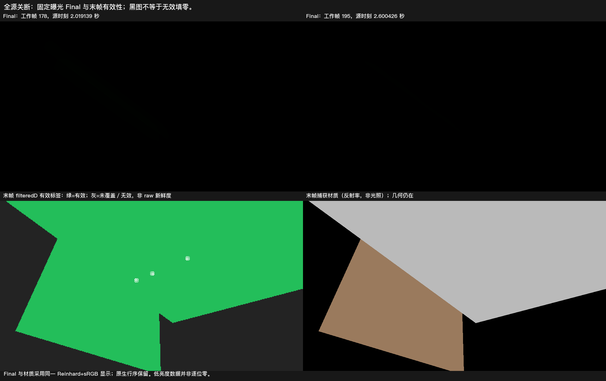

# 实际固定光路的全源关断

**实际棕墙／白地板配置已取得旧光衰减及末端有效性的有限依据。** 1 秒前 0.985461 秒，固定白地板域的旧绿均值剩 0.277411%；2 秒前 1.984781 秒剩 0.0252869%。后续已观测源帧保持对应目标，末帧实际过滤数据有效。没有据此修改产品，完整 G1／G3 仍开放。

**输入描述偏差：**冻结文本把墙写成白色；保留的实际执行源码始终给墙设置 MPB BaseColor=(0.5,0.25,0.125,1)，地板为白色。棕墙影响多跳能量和衰减，结果只归属于这组实际输入，**不能称完全符合原冻结白墙输入、高反射率或最坏情况通过**。原合同、源码、数值不改写，`fullFrozenInputVerified=false`；没有把墙改白补跑。

上排是首次约 2 秒和末帧的 Final，统一曝光1、Reinhard 后转 sRGB，原生行序保留；很弱的绿色在这个显示尺度下接近黑。下排左图来自末帧实际 `filteredD` 的 alpha／有效掩码，绿色表示有效，灰色表示未覆盖／无效；右图是实际材质捕获，不是照明。固定点以白圈标记。没有提高曝光或把无效零当测得黑色。

## 残留和有效性

所有比例均按关断前第 119 帧的同域旧绿归一化，不除以零目标、不计算零目标色向。27 个事前固定点全部保留。

| 实际源时刻 | 旧绿均值剩余 | 最差点相对自身关断前值 | 时域无效点 |
| --- | ---: | ---: | ---: |
| 0.985461 秒，1 秒前 | 0.277411% | 0.527104% | 0 |
| 1.020041 秒，1 秒后 | 0.255574% | 0.484690% | 0 |
| 1.984781 秒，2 秒前 | 0.0252869% | 0.0464337% | 0 |
| 2.019139 秒，2 秒后 | 0.0232645% | 0.0426712% | 0 |
| 2.600426 秒，末帧 | 0.00555685% | 0.0100906% | 0 |

1／2 秒前已有样点低于预定的 5%／1% 残留幅度目标，此后观察帧保持对应目标；不把晚到点冒充截止前数据。首个“区域均值残留≤1%且时域存储有效”的至少 0.5 秒观测窗口为 0.473351–0.985461 秒，跨度 0.512110 秒。它不是精确首次收敛时间，更不是每帧过滤结果或原始射线均新鲜有效的证明。

末帧 logical/work=195、engine=205，Final、时域存储与完整 Capture 属于同一源帧。实际 `filteredD` 在全部固定 GI 点均有限、alpha>0 且有效掩码通过，未知数为 0，最小 alpha=0.138672。平均 `filteredD` RGB=(0,0.0000165833,0)，平均 Final RGB=(0,0.0000159330,0)。因此是**有效的极低残留值，不是逐位归零**。两种量不同，不直接把 D 数值当作出射亮度。

响应期全部预定时域点均有限且 alpha>0。这只表明有效的时域存储，可能包含按原合同保留的旧测量；**没有观察当前 raw 的新鲜有效性，也没有直接逐帧读取中间 filteredD 的有效掩码**。最终有效性只按末帧实际 Capture 认定，不能由历史 alpha 向前补造过滤资格。

## 输入和实际节奏

Unity 6000.0.85f1／URP 17.0.4，Windows D3D12，Release122 发行质量：960×540、GI 480×270、2 射线、4 级滤波，时间积累和多跳反馈开启。接收面漫反射非零；棕墙／白地板采用精确 DXR，唯一隐藏不可读发光板采用既有解析回退。环境 Cube 为 null、常量环境／SH／反射／烘焙光及原生灯均为零。事件前只有发光板的纯绿贡献，第 119 帧后同一引擎帧将其 MPB 发光写零，分类为局部有界发光源编辑，采用 1／2 秒目标。

**这与统一示例 L 键只关闭解析灯、保留发光面的情况不同。** 末端排空后，对最后一次源提交的 GPU 场景缓冲确认板、墙、地板的 emission RGB 全零，灯表入选数为 0；该 CPU 读取时间独立记录，没有新增渲染或借其完成时刻计算响应。

点位沿既有 27 个区域归一化到新分辨率，再事先对齐实际 GI 采样中心；未按有效性筛点。第 0 帧完整支持确认全部点落在白地板，原生合成前 RGB 为零；末帧再次确认，地板反投影最大 |y| 均约 0.00000839。0→1 的支持排空准备间隔为 6 个空转引擎帧／2.852 秒；其后 1–119 连续预热，响应期引擎帧连续。

实际响应源频率为 29.1327Hz；间隔中位 34.226ms、p95 35.335ms、最大 35.854ms，均未跨过预定 2/30 秒窗口间隙上限。每个源帧的 Final 和借用时域纹理均通过标准异步读回完成；完成延迟中位约 41.4／41.5ms，最多 4 个在途请求。时间判定使用提交渲染前的源时钟，窗口内没有文件写入或同步 GPU 来源读取。末帧 Capture 的排空约 0.946 秒单列，不计入此前响应节奏。

这是带观测负载、实际约 29.13Hz 的显式请求，不能用作普通 Player、Present 30FPS、GPU 时间或显存放行依据。没有新的运动或形变事件。

## 采用范围与交付

唯一实际观察正常退出 0，所有已提交读回真实排空，原场景与 Quality 设置恢复。Astra Max 复核同意按**实际棕墙配置**采用有限全源关断子结论；全白墙冻结条件未验证，不能借此关闭原白炉、高反射率或整体 G1／G3。没有产品修复依据，不补采、不改曝光或调参、不构建新版本，成品仍为 Release122。

[原冻结合同及其白墙描述](contract.md) · [逐源帧结果](result.json) · [固定点 Final／时域／末帧过滤数据](signals.npz) · [复算脚本](analyze.py) · [复算数据和观察入口](observation-data.zip) · [完整原生输出](<I:/Unity test/Comparison/LightsOff127>) · [退出、恢复及实际执行源码](<I:/Unity test/Comparison/LightsOff127Setup>)

数据 ZIP 保留必要支持纹理、末帧 filteredD／mask、帧记录及两张 Final 原图；其他完整支持仍在原生目录。解压后可执行 `python analyze.py LightsOff127 <新的输出目录>`，只读取已有数据，不需要启动 Unity。
