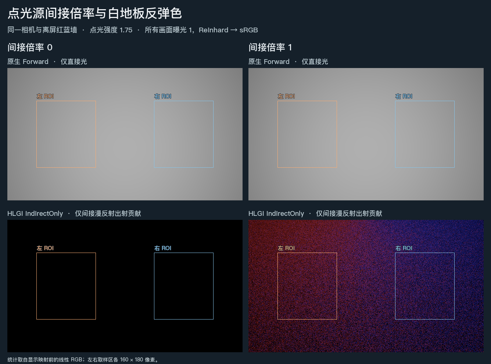

# 同一盏点光可以只保留直射

相机看向白地板，旁边的红蓝色墙完全位于视锥外。Release111 将 Unity 的逐灯间接倍率接入 HLGI。把点光的倍率设为 0 后，地板上来自色墙的反弹消失，整张原生直射图与倍率 1 时逐像素一致。

| 固定区域的平均线性 RGB | 左侧白地板 | 右侧白地板 |
| --- | --- | --- |
| 原生直射，倍率 0 或 1 | 0.5676312，三通道相同 | 0.5676313，三通道相同 |
| 仅间接，倍率 0 | (0, 0, 0) | (0, 0, 0) |
| 仅间接，倍率 1 | (0.09388, 0.00817, 0.04236) | (0.04259, 0.00817, 0.09373) |

原生直射由关闭 HLGI Feature 的 URP Forward 相机输出。两端在 640×360 全图的 RGB 最大绝对差为 0。间接图取独立冷启动后第 30 帧的 IndirectOnly 输出，包含白地板反射率。左右各取 160×180 像素，在曝光映射前求均值。[详细读数与相机条件](result.json)

实际 Unity 灯表中，倍率 0 不占灯槽，白点光强度为 1.75 时，倍率 1 和 2 上传的每个 RGB 通道分别为 1.75 和 3.5。此前收集器完全忽略这个属性。另一处修复去掉了点光记录中无用的朝向。同一盏无 cookie 点光原地转动产生 0 条照明变化记录，改为聚光再转向会产生旧、新两条记录。

**适用范围**　Unity 6000.0.85f1、URP 17.0.4、D3D12／DXR，单盏白色实时点光、静态不透明 Lit 墙与地板、黑环境、无发光。为隔离一次反弹，GI 使用全分辨率、8 条射线，关闭屏幕追踪、递归反馈、时间累积和空间滤波。两次运行的相机、GI 帧序列及两个网格的 DXR 驻留一致。这组图能判断该灯是否贡献了反弹。运行中改倍率后的残留时长、普通配置的运动颗粒及整景物理颜色误差仍按各自的观测范围报告。[动态与颜色的分项画册](../picture-comparison.html)

原始浮点 EXR：[直射 0](bounce-0-native-direct.exr) · [直射 1](bounce-1-native-direct.exr) · [间接 0](bounce-0-indirect.exr) · [间接 1](bounce-1-indirect.exr)
