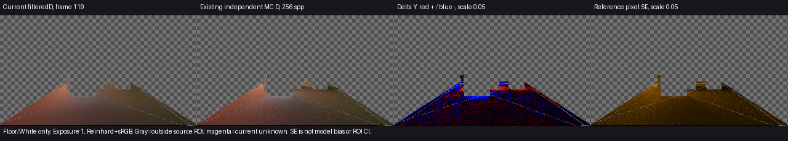

# 当前 Runtime 在原归档119场景的颜色依据

**当前Runtime在原归档场景、第119帧的两个固定已知接收域，名义满足既定颜色工程目标。** Astra Max同意采用并结束本线。关闭的是此前只有93来源、没有当前Runtime同量依据的有限缺口；没有产品修改、调参或新公开版本。

比较量为`filteredD=E_indirect/pi`，未乘接收面反射率／AO／合成强度。统一曝光1、Reinhard+sRGB，PNG只垂直翻转；灰棋盘为源ROI之外、洋红为当前unknown。当前较参考平滑，仍有局部正负差；平滑不证明物理正确。右图像素SE不是误差上界或ROI均值置信区间。

## 原输入与本次观察

2026-11-04，使用当前公开Release122同源Runtime（产品来源`7c08327`），Unity6000.0.85f1／URP17.0.4、RTX2080Ti／D3D12／Linear。**直接复用V209完整归档物理场景**：20个原owner、5盏原实时灯、原相机／材质／网格／SDF／charts，黑环境、无lightmap，原Sequence的0–119前史；119时门仍在原静止位置。没有把旧ROI套到当前中性三室，也未重新生成、重烘或修补旧物理夹具。

原Generated资产及GUID直接复制，导入路径检查通过；这个检查仅防导入时GUID冲突，不是全源自动证明。原资产不写回；临时观察scene副本禁用旧Host，使用现有Sequence和Capture。原Renderer只在Play内改2ray／filter4／DXR偏好，其他原参数保留：640×360／半GI320×180、cache8、bounceFeedback1、Additive、计时／反馈关闭。原归档debug为Final，93观察为IndirectOnly；**定量依据是同量filteredD，不把这两个普通输出直接当画面对照**。

一次Editor Play完成120个连续逻辑／引擎／GI收据，实际均reported-hardware，failures0／backendMismatches0。唯一新增Capture在logical119、engine123、work119，实际读回全部终止；原Sequence固有的0／119普通HDR保留。原720完成协议仍为`failed`前缀，不能称整段通过。观察适配器退出0，原场景、Quality和Feature设置恢复，没有重试。

## 同量结果

沿用既有256spp／8反弹有限CPU参考、独立源几何Floor／White ROI、compare.py和像素MAE helper，没有生成新参考或扩大范围。比较器核对invVP、GI尺寸、强度和ROI的RGB／AO；物理场景来源由原归档直接复用，不能把这些有限检查说成核对了全部灯／几何／前史。

| 固定源域 | 已知／总点数 | unknown | 平均D-Y／参考 | 平均Y偏差 | 均值色向L1 | 像素Y-MAE／参考平均Y |
| --- | ---: | ---: | --- | ---: | ---: | ---: |
| Floor | 13,328／13,330 | 2 | .06948465／.07168874 | −3.07452% | .00797576 | 14.6874% |
| White receiver | 86／86 | 0 | .22507223／.22695730 | −.83058% | .03341473 | 8.1847% |

名义值满足事前确定的亮度偏差≤10%、色向L1≤.05和MAE比≤20%；同曝光图没有给出值得新增修改的明显结构／串色问题。unknown单列，不填黑、不删源域。White仅86点，不能代表整景。上述报告指标与93相同，**不等于全部像素或所有运行行为相同**；未追加逐位／哈希核对。

参考保留有限MC采样、8层截断、源几何／射线偏移、产品距离截断／缓存／滤波和硬可见性vsURP PCF等模型差异。平均像素保守亮度SE约Floor .010990／White .017631，不用它把误差说成可忽略。本项不是严格绝对误差证明、稳态或收敛时间。

## 原计划进度与边界

T2／G1新增关闭：**当前Runtime在原归档119场景、原两个ROI的有限静态颜色依据**。当前普通三室、960×540、普通Player、其他接收域、完整支持域及完整G1继续开放；不据此新增时点、后端、参考或调参任务。

换色／关灯残留、运动拖影、收敛时间本次均无新事件证据，继续按[当前换色恢复](../final-state-response-01/result.md)、[全源关断](../all-source-off-response-01/result.md)、[封闭室点光关断](../sealed-room-decay-01/result.md)及[已有门运动四时点](../four-pass-local-quality-01/result.md)的各自场景和版本范围报告。静态119不能扩大这些结论。

数值见[comparison.json](comparison.json)及[pixel-mae.json](pixel-mae.json)；[数据与源码](data-and-source.zip)保留原始读回、旧参考、来源资产、执行入口和既有解释器的离线重放。原始目录`I:/Unity test/Comparison/ArchivedColor133`，准备和归档资产为同级`ArchivedColor133Setup`，日志`I:/Unity test/Logs/ArchivedColor133.log`。本线到此结束，整体G0–G5未完成，Release122保持。
