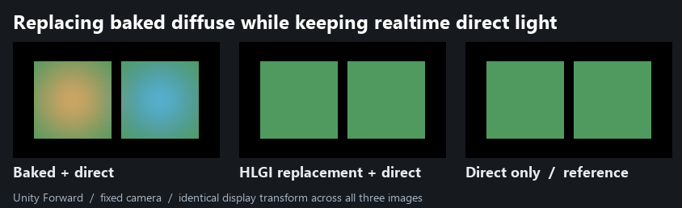

# 烘焙贴图替换后，实时直射是否保留？

普通 URP Lit 的两块白色地面使用同一张实际烘焙的非方向光照贴图。左侧由暖色点光源烘焙，右侧由冷色点光源烘焙。运行时关闭这两盏灯，另加一盏绿色的实时方向灯。固定场景和机位，分别观察启用替换前、启用替换后，以及解除贴图绑定且关闭 HLGI 的独立基准。将 HLGI 间接强度设为零，可以直接检查它从原生画面中减去了什么。

| 32×32 内部区域 | 原生烘焙加直射，平均线性 RGB | 替换后，平均线性 RGB | 仅直射基准，平均线性 RGB | 替换与基准最大单通道绝对差 |
| --- | --- | --- | --- | --- |
| 暖侧 `[58,90) × [56,88)` | 1.160623, 0.580467, 0.140489 | 0.088391, 0.472447, 0.134048 | 0.088391, 0.472447, 0.134048 | 2.98 × 10⁻⁸ |
| 冷侧 `[166,198) × [56,88)` | 0.097591, 0.682662, 1.205373 | 0.088391, 0.472447, 0.134048 | 0.088391, 0.472447, 0.134048 | 5.96 × 10⁻⁸ |

数值来自 Unity 相机 256×144 线性 RGBA32F 的原始读回。三张图使用同一 `x/(1+x)` 映射及 sRGB 显示转换。可分别下载[原生 EXR](native.exr)、[替换 EXR](replaced.exr)和[仅直射 EXR](unbound.exr)。

**适用范围。** Unity 6000.0.85f1、URP 17.0.4、Windows D3D12、Forward、软件 GI、无 MSAA、无后处理、黑色环境、无雾。两块静态接收面均使用 UV2 和图集索引 0，Unity 记录的 scale/offset 分别为 `(0.29688, 0.29688, 0.31250, 0)` 和 `(0.29688, 0.29688, 0, 0)`。在基准帧将两者的贴图索引都设为 −1。比较限于表面内部，未测边缘、动态物体、方向贴图、混合灯光或 APV。被替换的是完整原生烘焙漫反射项，包含这次烘入的点光贡献。此项不衡量 HLGI 自己的反弹估计误差。

初次采集的自发光控制在解绑后读为零，无法据此确认其他光照保留。表中结论采用同一份烘焙数据加上可独立测得的非零实时直射。
