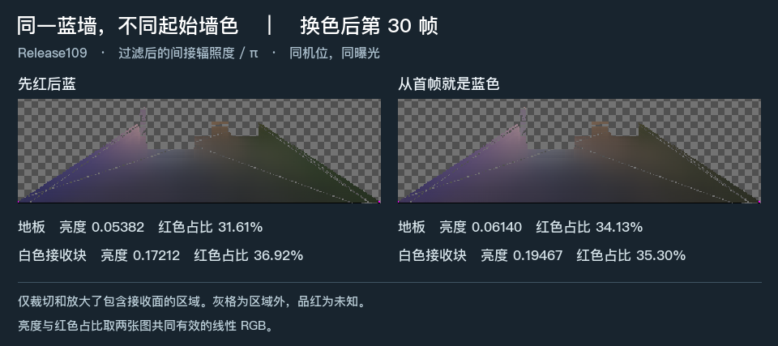

# 同一蓝墙，两种起始墙色

在 Release109 的固定色墙场景，把原本的红墙改蓝后第 30 帧，与从首帧就是蓝墙的独立运行相比，地板和白色接收块的平均间接亮度分别低 **12.34%** 和 **11.59%**。两处的绝对红通道均较低。红色占比则在地板降低、在白色接收块升高。这个时点有前史留下的亮度差，两处接收面没有一致的旧红色偏向。

| 接收面与前史 | 共同有效点 | 平均线性 R、G、B | 平均亮度 Y | 红色占比 |
| --- | ---: | --- | ---: | ---: |
| 地板，先红后蓝 | 13,328 | 0.05623, 0.05145, 0.07022 | 0.05382 | 31.61% |
| 地板，首帧蓝墙 | 13,328 | 0.07035, 0.05699, 0.07878 | 0.06140 | 34.13% |
| 白色接收块，先红后蓝 | 86 | 0.21614, 0.15476, 0.21447 | 0.17212 | 36.92% |
| 白色接收块，首帧蓝墙 | 86 | 0.23034, 0.17920, 0.24293 | 0.19467 | 35.30% |

红色占比取区域平均 RGB 的 R/(R+G+B)。两条路径在地板各有 2 个未知点，白色接收块均为 0。亮度、色向和图中数值都取乘接收材质之前的过滤后间接辐照度除以 π。

**配对条件**　两次独立启动 Unity 6000.0.85f1 Editor Play，均使用 Release109 渲染源码、同一保存场景、相机、门位姿和灯。分辨率为 640×360，GI 为 320×180，每像素 2 条射线，4 级滤波，两程实际后端均为 DXR。第一程在逻辑 119 渲染后，以普通材质属性块将红墙改蓝。第二程在首帧前设为同一蓝色。采集时实读两面墙的 RGB 均为约 (0.05, 0.15, 0.8)。两程的逻辑帧与 GI 工作帧均为 150，使用同一采样帧号，每程的 151 帧都有渲染回执。此次只运行到所需时点，原 720 帧序列的完整验收保持未完成。

**适用范围**　两组世界缓存、引导分布和屏幕历史可按各自前史自然演化。区域使用同一保存场景的既有几何掩码，与固定机位、投影和 GI 网格对齐。本次仅采集过滤后的量及其有效性。白色接收块区域很小。单时点和单条采样序列不能分离世界缓存与屏幕历史各自的贡献，也不能据此给出旧红光的物理份额、绝对颜色误差或差异消失的时刻。

原始读回按 `[180,320,4]` 保留在 `RedToBlue_filteredD` 和 `BlueFromStart_filteredD` 中，另附两程的有效性字节及相同网格上的 `Floor`、`White` 掩码。数值计算使用原始行序，显示图单独作上下翻转、同曝光 Reinhard 和 sRGB 转换。[原始线性数据和掩码](signals.npz) · [完整读数与采集设置](result.json)
