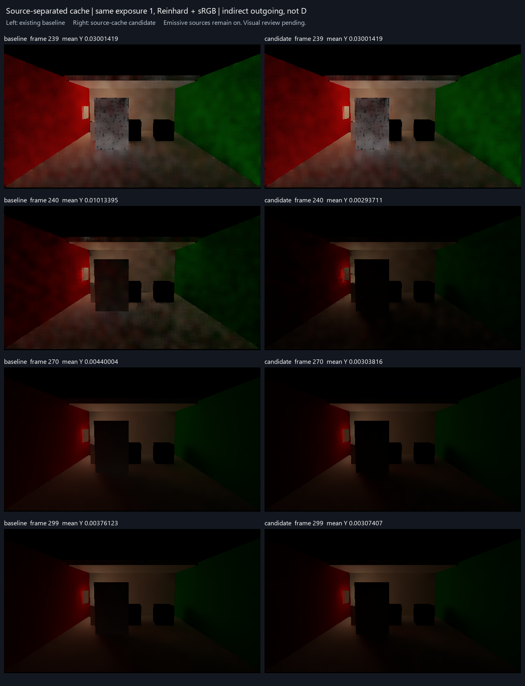

# 空解析灯表后的缓存来源分离

本候选关闭了一个具体缺口：当前上传的解析灯表已经为空时，世界缓存仍可能经预算等待和多跳反馈继续消费关灯前的解析灯贡献。现在缓存同时保存总 D 与发光材质/环境来源的 D；空灯表时消费并持久写回后者，避免旧解析份额在等待更新或重新开灯后复活。发光与环境贡献保留，不将未知材质、覆盖或冷缓存当作已知黑。

两个通道沿用相同射线、PDF/MIS、AO、反弹系数、有效性、混合权重和年龄，全部成功后共同提交；guide 仍取总 D，不增加射线。这不是逐灯分解。触发条件是**当前相机上传的解析灯表为空**，不等于场景中全部光源关闭：选灯范围与支持规则也会影响灯表。

## 四帧实际对照

复用保存的 V209 物理场景及原逻辑帧 0–299 前史，仅在 239、240、270、299 捕获普通 IndirectOnly HDR。240 为解析灯关闭当帧，发光材质仍亮。比较量为经过滤波和上采样的 `D × 漫反射率 × 材质AO × intensity`，不是 D，也不是物理参考误差。

| 逻辑帧 | 状态 | 原版本全图平均 Y | 候选全图平均 Y |
| --- | --- | ---: | ---: |
| 239 | 关灯前 | 0.030014188 | 0.030014188 |
| 240 | 关灯当帧 | 0.010133951 | 0.002937110 |
| 270 | 关灯后30帧 | 0.004400040 | 0.003038159 |
| 299 | 关灯后59帧 | 0.003761234 | 0.003074068 |

下表是两张图逐像素亮度差绝对值的全图均值，并非上表两个均值相减。

| 图像间变化 | 原版本 | 候选 | 降低 |
| --- | ---: | ---: | ---: |
| 240 → 299 | 0.006378774 | 0.000499121 | **92.18%** |
| 270 → 299 | 0.000651640 | 0.000130586 | **79.96%** |

数值筛选通过。主线程在生成数值记录后完成视觉检查：239 未见明显新增颜色或空间缺陷；关灯后红墙、后墙、地面和顶棚仍有可见间接反弹，不是仅保留发光物体本身。Astra 随后查看同曝光图，同意在该范围内采用；[comparison.json](comparison.json) 已记录最终决定。PNG保留首次生成时的待审标题，最终判定以此报告与JSON为准。

显示统一曝光1、Reinhard+sRGB，仅为观看垂直翻转；数值使用原始行。所有原始 RGBA 数值有限，但本次没有独立逐像素有效域或物理参考。旧299帧不是真值；上述变化降低不是误差降低，也不是收敛速度证明。

## 四项用户问题

- **颜色误差：**239 全图平均 Y 相同，主线程未见明显新缺陷；这不等于颜色精度通过。[旧独立参考报告](../dynamic-picture-comparison-01/report.md)的偏差仍需按其来源与局限理解，本次没有重新评估。
- **换色与关灯残留：**本次空解析灯表范围内，关灯后的持续变化明显减小，同时保留接收面发光反弹。局部换色尚未由此解决；未知屏幕历史仍按原合同保留。
- **运动拖影：**本次没有新结论，沿用[旧运动专项的限定结论](../dynamic-picture-comparison-01/report.md#3-运动拖影)。
- **收敛时间：**只有四个捕获点，且没有新参考，不能给统一帧数或把较稳定晚帧当作正确解。

单条缓存由80增至96字节，缓存存储增加20%；不是总显存增加20%。实际带宽和耗时增量未测，不能据布局变化推称带宽也增加20%。

本次有意在300帧前缀结束，四个捕获和前缀收据完整；原720帧完成门未改，`sequenceStatus=failed`、`completeSequence=false` 与原生退出码1保留。它不是一次720帧通过，也不据此扩展画质或性能结论。

## 可运行版本整合

[Release78启动入口](<I:/Unity test/Comparison/Builds/LocalRelease78/Start-LocalRelease.cmd>)已通过既有公开构建入口生成，复用原统一场景与Release77显存观察能力。Release/None、0错误/23条warning，见[构建结果](<I:/Unity test/Comparison/Builds/LocalRelease78/build-result.json>)；临时质量设置和工程初始化脚本已恢复。

本功能的真实运行依据是上面的完整Unity Feature前缀；新Player未另行启动，未重复图像或性能运行。普通场景和入口接线未改变，本条验证到此结束。旧Release76性能、Release77显存结果不改称Release78测量。
