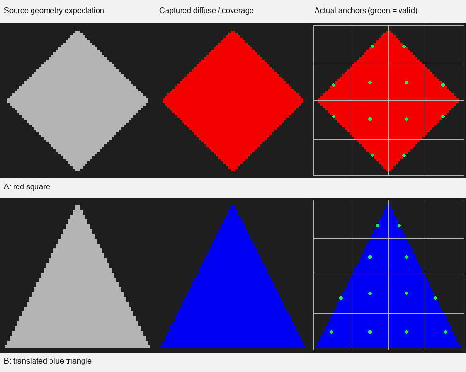

# 同一图集页的两源复用

**本单页、两源窗口的身份／代次、覆盖、binding和旧锚点清除符合预期；完整冻结合同未通过。** 已测位置误差超过事先固定的2e−5世界单位容差，不是缺少记录。Astra Max同意采用这些子项并结束本项，没有产品改动、追加GPU运行或新公开版本。

左列为源几何独立投影的预期覆盖，中列为图集实际diffuse及覆盖，右列叠加实际4×4锚点（绿点）。图像放大并垂直翻转，数值仍用原生读回地址；这是材质图集示意，未渲染照明。覆盖取emission.a已打包几何法线标记，不把存投影深度的position.w当布尔。未读NormalAtlas，不声称执行了所有consumer资格检查。

## 原缺口与固定输入

原Validation要求复用页不能保持旧owner或旧anchor。125只有首次捕获，既有流式循环只有账目，均不能代替本次实际GPU页换来源。沿用产品Scene／SurfaceCharts／SurfaceCache和普通capture／anchor kernel，没有修改产品或另造GPU检查器。

2026-11-04，Unity6000.0.85f1、RTX2080Ti、D3D12、Linear，单Editor进程Edit模式。物理card容量1，tile64、patchGrid4、每次capture1、atlas预算1MiB。红A为局部XY±1的正方形，z=0；蓝B为(-1,-1)、(-1,1)、(1,-1)的直角三角，平移至(3,0,1)。法线−Z、UV=(xy+1)/2；普通Lit、M0／Workflow1／CullBack／AO1，纯色alpha1，无贴图、裁剪、发光或MPB。每源的真实chart由现有Bake／CreateCaptureMesh生成并保存；没有声称双进程重开资产验收。

A先Prepare／Record／ExecuteCommandBuffer，随后立即请求三张图集、metadata和anchors的异步读回；再切换到B，完成其Prepare／Record／Execute及五个读回。不在未提交A时改写它依赖的准备数据，也没有强制等待A完成或人为加GPU延迟。所有实际回调和提交栅栏终止后才落盘及清理。单次运行退出0，十个请求完成，设置恢复，无重试。

## 结果与未通过项

| 判断 | 实际结果 |
| --- | --- |
| 同一物理页 | card0、atlas代次／尺寸／rect及三张纹理实际InstanceID相同 |
| 身份与代次 | 源stableId 1→2；layout及capture generation均1→2；每次Prepare后尚未ready，GPU metadata捕获后ready1 |
| 实际三角binding | A两条、B一条的四个uint齐全，均与本源和GPU metadata相符；切B后旧A mesh查询被拒绝 |
| 独立覆盖 | A 1,740、B 1,800个严格内部纹素，均被覆盖，严格外部无泄漏；实际位置均在所属平面和形状内 |
| 旧锚点清除 | 两次的16格均符合本源覆盖；A曾有效而B确定空的同格(0,2)、(3,2)都写为(-1,-1) |
| 材质来源 | 最大通道差0.00078438，低于固定2/255；发光RGB为0；B有效覆盖没有旧红材质 |
| 位置精度 | A最大误差2.95063e−5，B为4.53117e−5，**均超过固定2e−5：未通过** |

几何预期从冻结的chart.localToCard和source.worldToLocal计算，按像素中心／rect反解源平面；没有用图集位置或颜色选择预期。边界带不作精确raster覆盖判定，但每个实际覆盖纹素都核对所属源。无覆盖标记下的残留RGB位不算可见污染，也不作为通过证据。

切换B前，A五个请求均仍pending。这只证明实际请求状态，**不证明GPU读写实际重叠，也不证明任意并发同步安全**。位置偏差已有数据，不能用“点还在形状内”替代精度合格；本次也不足以归因产品错误。保留原阈值及`reuse-contract-not-observed`状态，不为此展开严格精度证明、调阈值或采更多形状。

## 既有位置读回的参考复核

对旧归档做一次后验参考复核。用 `result.json` 中的源顶点、`localToWorld`、实际 GPU `worldToCard` 和 `atlasRect`，按原图集行序把顶点投影为 `s = (W × (rect.x + rect.z × card.x), H × (rect.y + rect.w × card.y))`。模型将每个投影分量取整为 `round(256 × s) / 256`，在原纹素中心 `(x + 0.5, y + 0.5)` 按重心权重插值世界位置。捕获顶点的 `clip.w` 为 1，片元写入插值后的世界位置。亚像素步长取自 Direct3D 的 8 位小数坐标约定。[捕获 shader](../../../Runtime/Resources/HybridLumenGI/HybridLumenGICardCapture.shader) · [Microsoft DirectX 光栅规范](https://microsoft.github.io/DirectX-Specs/d3d/ConservativeRasterization.html) · [D3D12 常量](https://github.com/microsoft/DirectX-Headers/blob/main/include/directx/d3d12.h#L1453)

直接读原 `A/B-position.rgba32f` 的 XYZ，按同源 `A/B-emissionValidity.rgba32f` 的有效标记选择覆盖点。采用量化模型后，A 的 1,740 个点和 B 的 1,800 个点最大分量残差分别为 **8.57×10⁻⁸** 和 **3.91×10⁻⁷** 世界单位。以 B 的原生纹素 `(61, 2)` 为例，读回 X 为 `3.9844708443`。同一 GPU 矩阵的连续坐标预测为 `3.9845161715`，量化后为 `3.9844712357`。[原始图集、几何和矩阵](data-and-source.zip)

Astra Max 采用这项后验解释。结果支持原连续参考遗漏光栅采样量化，适用范围为原两源覆盖点。驱动实际取整细节仍未经独立测量。原连续参考的 **2×10⁻⁵ FAIL** 和各身份子项裁决保留，整体 T4 继续开放。

## 原计划进度与交付

关闭T4中这个单页两源条件的owner／generation、完整binding、独立覆盖和旧anchor清除子缺口。没有关闭位置精度合同、整体池复用、HLOD／transport消费、任意并发、负缩放或完整T4／G2专项。T4继续开放，Release122不变。

[原始分析](analysis.json)和[data-and-source.zip](data-and-source.zip)保留实际输入／十份原始读回、冻结合同与解释器、执行入口和退出记录。包内README给出离线重放方法。原始目录为`I:/Unity test/Comparison/CardReuse132`，准备与归档资产在同级`CardReuse132Setup`，日志`I:/Unity test/Logs/CardReuse132.log`。本项到此结束。
