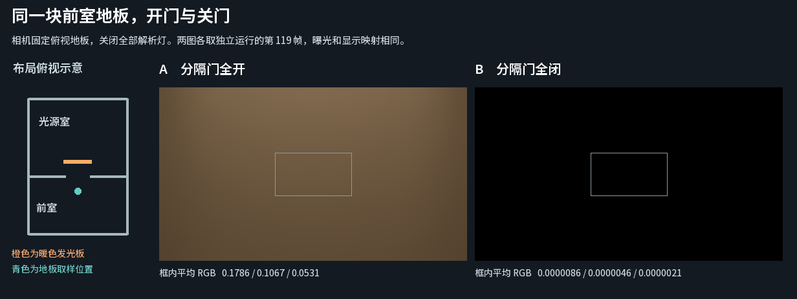

# 相邻两室的门洞遮挡与暖色反弹

Release102 在同一个统一示例内提供可切换的房间。按 F3 会回到近场，在原彩墙房前接入有地板、侧墙、顶棚和共用隔墙的前室；隔墙中央留有 2 × 2.8 米的真实门洞。O 让分隔门停在全开或全闭位置，再按 F3 返回原布局。WASD 为自由相机导航。[普通 Windows 版本](https://github.com/Ranko-sama/HybridLumenGI/releases/tag/release102-demo)

作者可打开标准验证场景生成的、已保存的普通统一示例，在 **Tools > Hybrid Lumen GI > Create Connected Rooms Copy of Unified Sample** 生成新的场景副本。生成器复用原 Floor 的 Cube、SDF、surface charts，以及原发光材质和已导出的分页组。附加布局默认不启用。原场景、材质和分页资产无需重烘焙。[生成入口](../../../Editor/HybridLumenGIConnectedRoomsBuilder.cs)

| 第 119 帧，同一前室地板区域 | 平均线性 RGB | 平均线性亮度 |
| --- | --- | ---: |
| 分隔门全开 | 0.178613，0.106659，0.053107 | 0.118090 |
| 分隔门全闭 | 0.00000859，0.00000464，0.00000207 | 0.00000530 |

相机固定在 (0, 1.3, −5.55)，向下看前室地板。中央区域列为 [240, 400)，行为 [135, 225)，两次均可见。源室里的暖色发光面继续工作；场景中启用的解析灯为零，环境输入为黑色。打开门时，暖色间接照明进入邻室；门移回共用隔墙后，同一地板区域接近黑色，剩余非零值保留在原始数据中。[线性读数与发布状态](readings.json) · [两张原始 EXR](linear-frames.zip)

Unity 6000.0.85f1、URP 17.0.4、RTX 2080 Ti、DX12，产品源码 `960caae`。两次 Editor Play 各采集 120 帧，使用公共房间控制入口、普通相机的 `IndirectOnly` 输出，640×360、半分辨率 GI、2 条射线、4 级滤波、反馈为 1。最后一帧均有 31 个已发布实例、186 张就绪卡、零待处理卡；附加布局的地板、门、隔墙和发光板均得到当帧发布记录。诊断报告实际 DXR、31 个硬件网格、零 fallback。捕获器将这两个有限序列标作 `incomplete-probe`，各自完成所请求的 120 帧且采集错误为零。[捕获设置](RoomsReviewEditor.cs)

普通 Release/None 构建使用保存的 `ConnectedRooms.unity`，无测量驱动。成品实际启动后观察到原彩墙场景；F3 进入两室、O 关闭分隔门、F3 返回原场景、Esc 退出。该对照覆盖这一处共享门洞和一个接收区域；其余多房间布局、新布局的性能和动态关门后的收敛时间仍开放。[普通构建结果](release-build-result.json)
