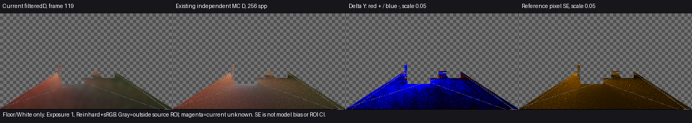

# 当前版本的有限颜色对照

当前源码`35fddaa`在保存场景frame119的Floor／White接收域仍比独立参考偏暗，平均D亮度偏差估计约为−28.9%／−33.4%，与旧记录一致。此前动态响应和局部资格修复没有在这个静止时点提供颜色改善证据。本轮关闭的是“颜色结论只有旧源码来源”的交付缺口，不是整体颜色验收；不能仅凭这些百分比调高全局强度。

图中仅显示既定Floor／White独立接收域，其他区域为灰棋盘；当前未知为洋红。两个辐射图共用曝光1、Reinhard和sRGB，未分别拉亮。误差图红为当前偏亮、蓝为偏暗，误差与SE固定量程0.05。数值保持原始行对齐，PNG仅垂直翻转。

| 源几何ROI | 源域／有效配对／未知点 | 当前平均D-Y | 参考平均D-Y | 均值偏差估计 | 参考像素SE均值* | 均值色向L1 |
| --- | --- | ---: | ---: | ---: | ---: | ---: |
| Floor | 13330／13328／2 | 0.05096342 | 0.07168874 | −28.9101% | 0.01099043 | 0.0270673 |
| White receiver | 86／86／0 | 0.15118381 | 0.22695730 | −33.3867% | 0.01763054 | 0.0696087 |

*SE为参考逐像素RGB标准误按亮度权重求和，再在有效配对域求均值；不是ROI均值置信区间或总误差界。未知点不作黑色，也不因排除未知而宣称整个ROI改善。White只有86点，不能代表整景。

## 比较量、输入与不确定性

双方均为`D=E/pi`，不是Final或乘过材质的IndirectOnly出射贡献。当前使用已有Capture接口直接读取真实320×180 filteredD及其有限RGBA／正alpha测量掩码；源纹理RGBA16F，按原接口读为RGBA32F。参考沿用已有独立CPU结果，256 spp、8次反弹，不读取当前颜色，也没有重新积分。

保存的V209物理场景和原0–119事件前史复用，未重新导出来源包。当前与旧捕获的invVP、GI尺寸、intensity相同；独立采样对应640×360的`(2x+1,2y+1)`全分辨率像素中心，Floor／White的实际捕获RGB／AO也相同。debug模式差异只影响合成显示，不把出射量拿来与D混算。这些限定核对支持本次复用，不构成全来源严格证明。

参考的有限采样与反弹次数、近零射线偏移、精确源三角求交和边界排除仍有噪声及模型误差；当前产品有有限偏移、屏幕步进、缓存插值／预算更新和时空滤波。这里双方均为硬阴影漫反射路径，不用完整Final的PCF或镜面差异解释D偏差。单个frame119不是稳态真值，也不能据此断言误差全部来自某个模块。

## 运行完成状态

只运行一次保存场景的0–119前缀，没有新构建。已有单帧Capture票据在logical119／engine123读回完成，保留的GPU资源字节为0。Sequence记录120个渲染帧、failures=0、backendMismatches=0。原720帧协议仍为`failed`，原生退出1；这是有意提前结束，**没有改写为整序列通过**。临时场景副本、捕获选择和QualitySettings已恢复／清理。

既有API固定附带support和输出摘要，原样保留；未新增哈希校验、参考积分、严格误差系统、性能测量或额外场景。数值见[comparison.json](comparison.json)，接线见[run.ps1](run.ps1)，原始信号见[本次捕获目录](<I:/Unity test/Comparison/Release81ColorFrame119/signals>)，独立参考见[既有参考目录](<I:/Unity test/Comparison/ValidationPackageV209-reference-frame0119-01>)。

## 四项问题与后续边界

- **颜色误差：**上述两个ROI在当前frame119仍偏暗；这是带采样／模型局限的偏差估计，不是整景精确误差或质量通过。
- **换色／关灯残留：**本轮未发生换色或关灯；保留[来源分离缓存](../cache-source-separation-01/result.md)的有限关灯改善，非空灯表换色及任意多跳残留仍开放。
- **运动拖影：**本轮未覆盖运动；既有相机／TAA显露点拒绝与Skinned发布结果保持原适用范围，不新增无拖影结论。
- **收敛时间：**只比较frame119，不能判定已收敛或给出准确帧数。不会自动延长窗口、重建参考或据单帧偏差盲调强度。

当前可运行版本保持Release81；本阶段没有改产品或重新构建。
