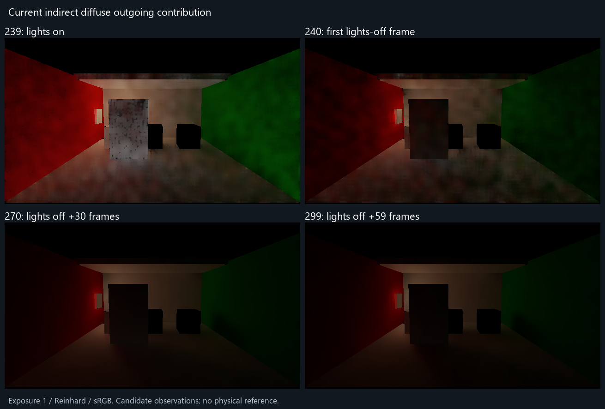

# 当前版本关灯后的有限画面对照

当前版本关灯当帧已明显变暗，但之后数十帧仍有可见变化。第270帧（关灯后30帧）与第299帧（后59帧）的平均绝对输出亮度差，相当于299帧全图平均输出亮度的17.3%。这支持继续关注动态响应，不能把全部变化认定为旧光残留，也不能据此认定299已经收敛。

画面量为普通`IndirectOnly`输出：滤波/上采样后的D乘接收面漫反射率、材质遮蔽和intensity。它是间接漫反射出射贡献，**不是D，不与旧D参考直接计算物理误差**。所有面板使用相同曝光1、Reinhard和sRGB；显示仅上下翻转，原始线性浮点数据不变。

| 逻辑帧 | 灯光状态 | 全图实际输出平均Y |
| --- | --- | ---: |
| 239 | 关灯前 | 0.03001419 |
| 240 | 关灯当帧 | 0.01013395 |
| 270 | 关灯后30帧 | 0.00440004 |
| 299 | 关灯后59帧 | 0.00376123 |

统计包含背景与没有输出的像素，描述最终输出，不能当作已知表面域的辐射误差。alpha仅观察到0–1范围，没有把它认证为独立有效掩码。270与299的逐像素Y绝对差均值为0.00065164，除以299全图均值为17.325%；299是候选观测，不是真值。四个时点无法证明中间无闪变或给出准确收敛帧，也不能由进程耗时换算响应秒数。

## 输入与完成状态

产品传输来源为6a4b5f8（与Release76相同的Runtime）；物理场景复用保存的V209场景/材质/管线和原0–299事件前史。仅把显示设为IndirectOnly、关闭referencePackage、改新输出路径；临时普通截图选择为239/240/270/299。原Host在300个已渲染帧后禁用Sequence，由原退出流程排空并恢复。没有新参考积分、来源哈希、观察器或Player构建。

300条收据的logical0–299、engine4–303、GI1–300连续；四帧均完成RGBAFloat读回，无非有限分量；run记录failures=0、backendMismatches=0，全程为报告的软件/精确软件路径。原run和Editor状态仍为`failed`，进程退出码仍为1，因为只完成了300帧，不满足原720帧及reference package门槛。**这些原状态没有改写，本次不是完整序列通过。**

关灯前选中5盏灯，关灯后为0；发光材质仍在，四点areaEmitterBytes均1152，不是零源黑室。四点相机、投影和门位姿相同，但GlobalSDF的pending在239/240/270仍为842/826/346，299才为0。该CPU计数不直接参与辐射计算：精确软件仍可走共享GlobalSDF远段空区加速，未就绪页回退详细查询；按其保守边界合同，页就绪不应改变几何命中结果。因此不能把pending下降当作残留原因，也没有继续扩展该诊断。

一次有界源码审查确认：全局变化标志逐帧清理，只在实际全局事件时置位；缓存替换标记跨预算等待与unknown保持，首次可信更新直接采用当前估计。该估计仍读取旧Jacobi缓存，随后缓存与屏幕重新进行时间累积。每帧实际调度256个patch，但没有逐patch结果可拆分预算等待、unknown保持和两层平均的影响比例。没有发现新的失效合同错误；下一产品方向是有界的全局照明突变响应策略取舍，不为此追加归因证明或传播体系。

完整原始输出：[运行目录](<I:/Unity test/Comparison/Release76LightOffPrefix>)；[数值与解释边界](observations.json)；[执行接线](run.ps1)。捕获源与QualitySettings已恢复原字节，仅删除本次新复制的场景目录；保存的原场景归档、独立参考及Release76保持。

颜色准确度继续采用[原独立对照](../dynamic-picture-comparison-01/report.md)的旧来源与不确定性，本次不更新其误差百分比。没有换色或运动的新结论。关灯后的当前变化已有上述有限依据，完整颜色/残留/拖影/收敛验收仍开放；不自动延长窗口或重跑。
