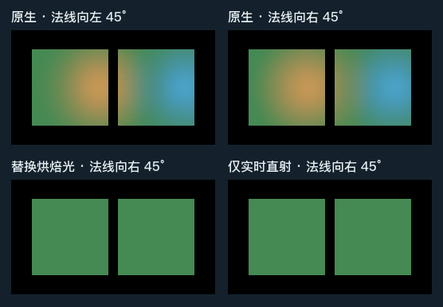

# 方向光照贴图随法线变化时，替换后保留多少直射光？

在这组普通 URP Lit 地面上，倾斜法线使暖、冷两块烘焙光斑都发生了可辨别的变化。启用 Replace 后，画面保留绿色实时直射。在两处 32×32 内部区域，与解绑贴图并关闭 HLGI 的独立直射画面相比，最大线性通道绝对差为 **0.000488**。

两盏向世界 +X 偏置的点灯烘入同一张 CombinedDirectional 图集，运行时关闭。相机固定，几何位置、UV2 与图集变换保持一致，只将接收面的世界法线从向左 45° 改为向右 45°。垂直的绿色实时方向灯与两种法线的夹角相等。后两张都采用向右的法线。替换时 HLGI 的间接强度为零，便于从最终相机画面辨认扣除的烘焙漫反射。

| 线性 RGB，区域均值 | 暖侧地面 | 冷侧地面 |
| --- | --- | --- |
| 原生，法线向左 | 0.353750, 0.363341, 0.096534 | 0.075971, 0.394644, 0.398423 |
| 原生，法线向右 | 0.578717, 0.385952, 0.097885 | 0.083786, 0.434682, 0.599705 |
| Replace，法线向右 | 0.062678, 0.334089, 0.094788 | 0.062510, 0.334108, 0.094959 |
| 解绑且关闭 HLGI，仅实时直射 | 0.062502, 0.334071, 0.094787 | 0.062502, 0.334071, 0.094787 |
| Replace 对比仅直射，最大单通道绝对差 | 0.00048773 | 0.00048564 |

暖侧取像素 `[58,90) × [56,88)`，冷侧取 `[166,198) × [56,88)`。在这两个区域，原生正倾角画面减去 Replace 后得到的实际扣除值均可用 FP16 精确表示。残差在对应烘焙通道值的一个 FP16 间隔以内，与实现中原生漫反射中间纹理的精度一致。读数未指向方向图绑定或法线解码错误。

**适用范围**　Release106 产品源码，Unity 6000.0.85f1、URP 17.0.4、D3D12 Editor Play、Forward Lit、软件 GI、无 MSAA／后处理。相机以 256×144 线性 RGBA32F 读回，图中四帧使用相同的 `x/(1+x)` 和 sRGB 显示转换。结果限于上述静态接收面和表面内部。动态贴图、混合灯光、APV、边缘像素和 HLGI 自身的多次反弹误差仍需各自的依据。

原始线性图像可逐像素查看。[原生向左 EXR](native-minus.exr) · [原生向右 EXR](native-plus.exr) · [Replace EXR](replace-plus.exr) · [仅直射 EXR](unbound-plus.exr)
