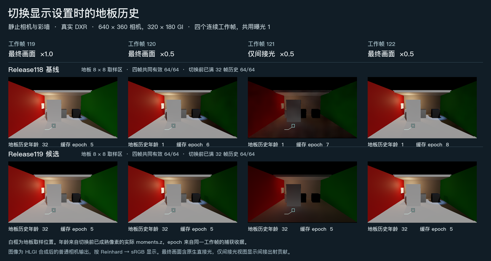

# 切换间接光显示与停止网格门形变

在统一示例中按 **F5** 可以单独查看间接光，再按一次回到原视图。Release119 保留调光和切换视图前已经积累的 GI。停止普通可读网格门的形变时，也会沿用末次姿态已有的捕获请求。

## 调光和切换间接光

在同一台机器上分别用 118、119 的可编辑工程运行保存的统一场景。固定相机查看彩墙近景，实际使用 DXR、640×360 相机、320×180 GI、每像素 2 条射线和 4 级滤波。两次运行都在第 119 个工作帧观察切换前画面。白框内的 64 个 GI 像素全程位于同一块地板，四帧都有可信读数，切换前均已达到 32 帧的历史上限。

| 连续工作帧 | 119 | 120 | 121 | 122 |
| --- | ---: | ---: | ---: | ---: |
| 操作 | 最终画面 | 强度减半 | 只看间接光 | 返回最终画面 |
| 118 地板历史年龄 | 32 | 1 | 1 | 1 |
| 119 地板历史年龄 | 32 | 32 | 32 | 32 |
| 118 光照缓存代次 | 5 | 6 | 7 | 8 |
| 119 光照缓存代次 | 5 | 5 | 5 | 5 |
| 119 同帧测得的合成强度倍率 | 1.000 | 0.500 | 0.500 | 0.500 |

旧版每次更改显示设置都会清除已积累的光照。新版只修改合成输出。强度倍率取普通相机的间接增量与该帧乘接收材质后的间接光之比，避开了相邻帧采样变化的影响。图中第三列只显示间接出射贡献，其余列同时包含原生相机颜色。[逐帧相机 RGB、间接光与历史年龄](result-display.json)

此项实测覆盖运行时修改合成强度，以及最终画面与间接光视图的切换。相机、几何和灯光保持静止。Inspector 修改资产引发的 Renderer 重建、运动中的重投影、GPU 预算反馈都在本次观测范围之外。

## 最后一次门姿态是否正常发布

两版都在相机开始渲染时调用普通空格键共用的停止操作。此时第 2 帧的可读网格顶点已被复制，后台作业还未发布。两版门的停姿相同。

| 同一停止时序 | Release118 | Release119 |
| --- | --- | --- |
| 第 2 帧停门后是否再请求捕获 | 是 | 否 |
| 实际发布正确终姿的引擎帧 | 16、27 | 16 |
| 发布几何版本 | 20、21 | 20 |

每次发布都逐点比较了不可变快照和停姿的 24 个顶点。两版都正确发布最后姿态，随后均观察到连续 9 个相机上下文没有挂起捕获。119 省去了旧版第 27 帧对相同姿态的再次发布。实测对象为普通可读网格门；蒙皮、运动阶段延迟与画面拖影仍按独立依据判断。[停止与发布的顶点、帧和几何版本](result-door.json)

## 运行版本

Release119 的普通 Win64 Player 来自同版可编辑工程 ZIP 的独立解压目录。Unity 6000.0.85f1 报告 Release 构建成功，0 个错误、6 条警告。上面两项行为对照取自两个版本各自工程中的 Unity Editor Play。运行包内的 `PictureComparison/index.html` 可离线阅读画册。[Windows 版与可编辑工程](https://github.com/Ranko-sama/HybridLumenGI/releases/tag/release119-demo)
