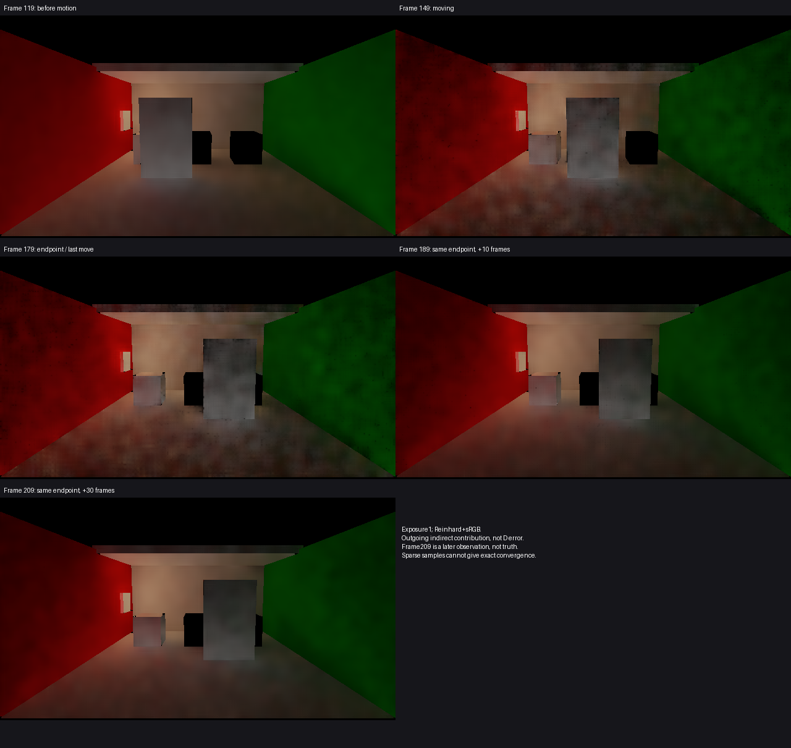
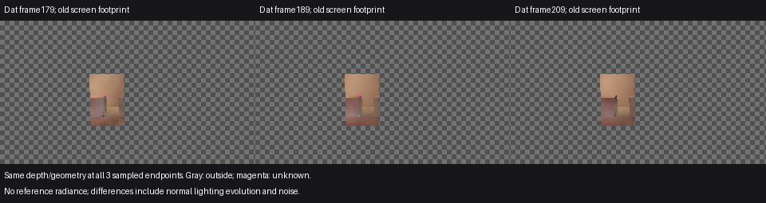

# 门到终点后的有限画面对照

2026-10-30，GI源码0181ef2，已包含在当前[Release84普通入口](<I:/Unity test/Comparison/Builds/LocalRelease84/Start-LocalRelease.cmd>)中。本次补齐原目标2／G3“当前门停止后缺少画面依据”的缺口，没有新增算法修复，也不关闭完整动态稳定性验收。

主线程目视：149帧运动中和179帧刚到终点时，门、地面及墙面都有明显颗粒／斑驳；189减少，209继续变平。旧门位置未见可辨认的完整门形残影。几个稀疏时点不能证明全过程无拖影，软斑驳和停止后的变化仍保留，不能把它们自动归因为历史错误。

## 范围和量

沿用原保存场景及原运动：119未动，149运动中，179刚到终点，180–209保持不动。相机和灯不变。普通图是640×360间接出射贡献，按曝光1、Reinhard+sRGB显示；D是320×180的间接入射量E/π。此次不是960×540普通Player性能运行，不按此前Present频率换算秒数。

旧119独立主射线owner网格只定位旧门的**屏幕区域**，不代表当前接收面身份，也没有读取独立参考辐射度。该区域2739点在179／189／209具有相同depth和geometry，三时点共同已知2737点。未知分别2／2／1，179的已知点在后两时点没有丢失。以下均在共同已知域计算：

| 时点 | 平均D亮度 | 历史长度中位 |
| --- | ---: | ---: |
| 179：最后一次位移 | 0.305993 | 2 |
| 189：其后10帧 | 0.288086 | 12 |
| 209：其后30帧 | 0.289247 | 32 |

179→189平均逐像素绝对D亮度变化0.031045；189→209为0.022465，均值变化分别−0.017907／+0.001162。后段平均亮度接近，逐像素仍有变化；历史长度增加只表明复用恢复，不能证明辐射度正确。209是晚期观测，不是真值；上述变化不等于旧影残留量或颜色误差，无法给出精确收敛时刻。

本项不新增独立颜色误差、换色或关灯结论，四项问题的最新有效来源汇总仍见[独立画面对照](../dynamic-picture-comparison-01/report.md)。现有颜色偏差、局部换色和重新开灯成果保留各自适用范围。

## 执行与收束

Astra先审必要性，只执行一次0–209短前缀；普通图119／149／179／189／209，既有Capture的D179／189／209。没有新探针、参考积分、哈希核验、阈值调参或补采。独立代理复核分析口径，未发现阻断性误用。

[原始结果](result.json)来自`I:/Unity test/Comparison/DoorStopResponse01/capture/20261030-054201-9675be357e90423daef96e8029fc7496`。210个连续逻辑／引擎／GI收据，渲染failures0、backendMismatches0；请求的D票据均complete、读回完成且retainedBytes0。原720帧协议仍为failed，native exit1，不能重标为完整序列通过。

Unity PID17276已退出；源码、QualitySettings及临时场景恢复，备份在`C:/Users/Administrator/AppData/Local/Temp/hlgi-door-stop-response-7e4aed326912404caf87d03a4734d4a0`。没有证据要求新增产品修复，保留Release84并结束该动停观察，不追加运行或参数候选。
