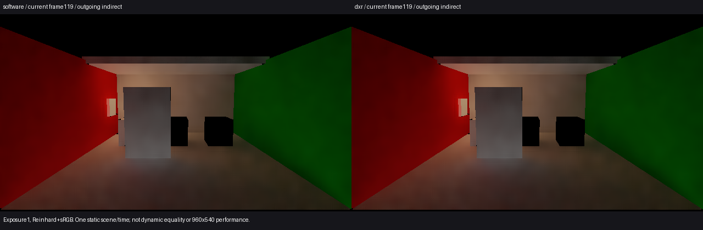
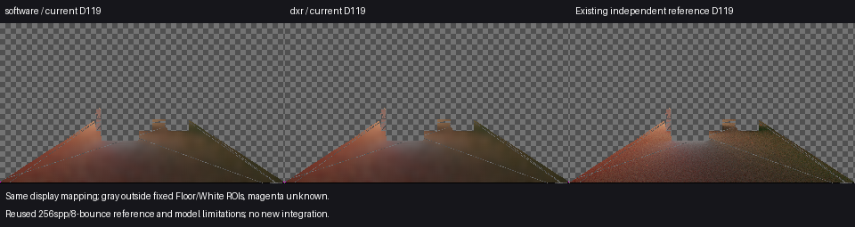

# 当前软件／DXR静止画面对照

2026-10-30，GI源码0181ef2，当前Release84所包含的传输实现。仅用于本机启动偏好的取舍，不能证明动态全过程等画质、全场等价或完整G4通过。

主线程及独立代理在同曝光图中未见DXR新增的明显缺损或轮廓异常。普通图640×360、D320×180，固定119帧，曝光1、Reinhard+sRGB；不冒充960×540普通Player图像。

当前软件119来自LightRestoreResponse01，本次只运行保存V209场景的DXR0–119。记录的传输设置仅`preferHardwareTracing`由false变true；相机、门、灯和材料支持匹配。119实际诊断为DXR，20硬件网格、0fallback、0材质unknown。Floor保留13328个软件已知点、White保留86点，未知各为2／0，没有丢失。

| 指标 | 软件Floor | DXR Floor | 软件／DXR White |
| --- | ---: | ---: | ---: |
| 相对独立参考的均值D亮度偏差 | −5.8417345% | −5.8410294% | −3.3623515% |
| 逐像素亮度MAE | 0.01019924678 | 0.01019947836 | 0.02011300027 |
| 平均色向L1 | 0.00421982208 | 0.00422696484 | 0.04611257389 |

两后端在Floor共同已知域的逐像素绝对D亮度差均值为0.00000324683，White为0。White均值RGB及所列误差指标一致；没有单独核验每像素RGB完全相等。独立参考沿用既有256spp、8次反弹CPU结果及模型限制，没有新增积分；其逐像素标准误不能当ROI置信区间。

## 原自定条件的结果

[采集前条件](scope.md)自设“三项指标均不得高于软件、没有容差”。该条件**未满足**：Floor的MAE增加约0.00000023157，色向L1增加约0.00000714276。原[result.json](result.json)的`numericAdoptionConditionsMet=false`保留，不能改写成通过。

上述微小数值增量不能仅因符号为正就解释为可见画质回退，也不能据此开启重复采样或阈值调参。启动配置决定另行记录，不把该自定条件改名为原计划验收标准。

## 本机配置取舍

Astra独立审查后支持撤除零容差规则作为本机配置的硬前置：原计划没有要求这三个数值逐项绝不增加。主线程接受该收敛建议，**原自动筛选未通过，本机采用DXR偏好属于独立产品决定**；不添加事后容差、不改变原数值和false结果。

有效域完整保留、图中无明显新增缺损，以及已记录的[DXR成本余量](../release83-dxr-cost-01/result.md)和[普通Present结果](../release84-dxr-present-01/result.md)支持本机960×540／30FPS方向。仅调整本机保存示例的启动偏好，保留按4返回软件和既有硬件准备失败回退；不改通用Feature默认、传输算法或采样参数。不能证明所有微小差异都是舍入误差，也不能声称动态等质量或完整G4通过。

## 可运行交付

[启动Release85](<I:/Unity test/Comparison/Builds/LocalRelease85/Start-LocalRelease.cmd>)现在直接请求DXR，保持960×540窗口、F2状态导出及原有交互。公开`HybridLumenGIPlayerBuild.Build`使用原保存示例，Release／BuildOptions.None，Succeeded、0 errors／23 warnings、native0。构建临时将示例Renderer的`preferHardwareTracing`设为1，随后恢复工程Renderer、QualitySettings和旧初始化器；通用源码未改。构建源码记录5e6b836，运行时仍为a3a570e／GI0181ef2。

唯一普通Player PID14612未按4／5，仅按F2确认：[启动ledger](startup-ledger.json)在engine2392报告请求prefer DXR、实际DXR，20硬件网格、0fallback、0材质unknown，13页就绪、无加载／释放／失败；计时、反馈与进程显存观察均关闭。该日志为前一引擎帧2391的最新CPU诊断，不是GPU完成或逐射线证明。随后Alt+F4正常关闭，native0、watchdog=false。没有截图、性能窗口或既有4／5功能重测；这次只确认新启动配置进入了成品。

原目标4／G4关闭“当前本机交付仍需手动选择已有低成本后端”的使用缺口，并补齐一个当前静止软件／DXR画面时点；不宣称新增算法加速、Release85新测79.22FPS或完整G4/G5放行。颜色、换色／关灯、运动拖影及收敛限制继续保留，不能把软件动停图重新标为DXR结果。

## 执行范围

唯一Unity PID16208已退出，原图像和票据完整。120个连续逻辑／引擎／GI收据，failures0、backendMismatches0；原720协议failed、native exit1保留。原始目录：`I:/Unity test/Comparison/DxrLocalDefault01/capture/20261030-054912-b7dedf0fb83742408eab7317b252a013`。

临时源码、QualitySettings和场景已恢复，备份：`C:/Users/Administrator/AppData/Local/Temp/hlgi-dxr-local-default-050d3f9e0b51468f887046e95fd3a654`。没有新成本／Present测量、哈希核验、参考积分或补采。
