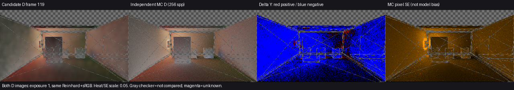
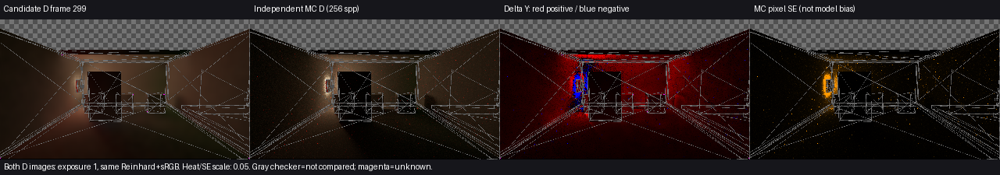
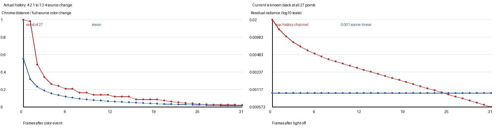
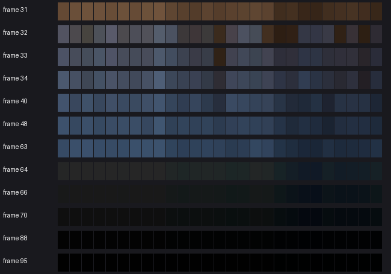
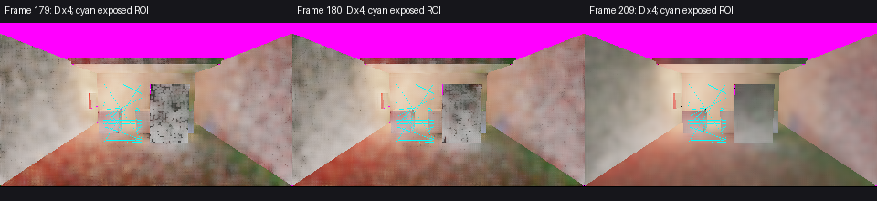
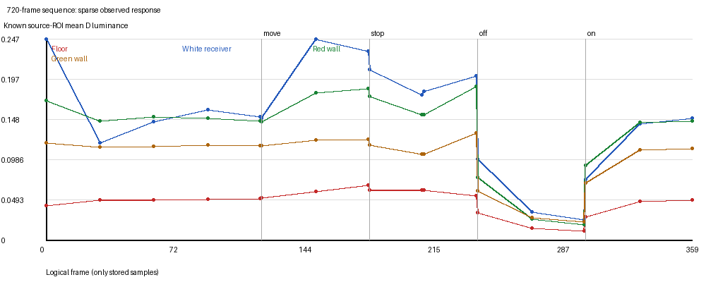
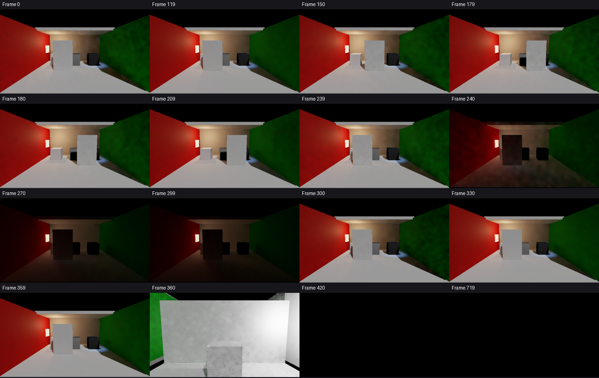

# 动态画面对照与当前开发结论

## 当前交付结论（Release93：静止颜色93／动停画面92分别标源，2026-10-30）

当前[93空回退遍历优化的静止成本窗口](../exact-no-fallback-traversal-01/result.md)保持960×540／GI480×270、filter4／2ray／DXR：GI三区间合计中位18.393ms、p95 19.298ms、p99 19.498ms，local／nonlocal采样峰值567.254／289.691MiB。相较既有92静止窗口，中位下降5.528ms，超过预定波动判据；满足25ms／1GiB起始门槛，不代表运动、整应用GPU或完整性能验收，没有新的Present测量。

[统一可运行入口](<I:/Unity test/Comparison/Builds/LocalRelease93/Start-LocalRelease.cmd>)仍为Release93，省去全精确覆盖时无候选的回退BVH遍历，filter4／2ray／DXR及时间历史保持。运动画质继续依据[92的同曝光四时点](../four-pass-local-quality-01/comparison.png)：门面、地板和绿墙云斑明显减弱，未见明显新增轮廓损坏、串色或持续旧门轮廓；代价是同平面明暗过渡更柔。其全图均值接近不能当颜色准确度证明；当前93单独的119颜色估计见下，历史filter3／1ray数据保留各自来源。

当前[93／filter4／DXR静止119独立D对照](../release93-color-frame119-01/result.md)已复用同一参考和ROI完成：Floor／White均值D-Y偏差−3.075%／−0.831%，Y-MAE为0.010529／0.018576，较历史软件filter3约增10.1%／6.6%，均值色向L1也略增。保持已明确的运动减云斑取舍，不能称颜色全面改善。结果限640×360／GI320×180参考网格，普通93未改或重建。

Release88沿用Release87的[短历史空间滤波](../short-history-spatial-filter-01/result.md)、F2和空场资源修复；启动优先DXR、按4回软件。后续[当前2射线DXR四时点对照](../release88-dxr-motion-01/result.md)未见相对软件新增明显回退，保留默认配置；画面与普通DXR成本仍是独立运行。**不同版本、时点和测量量不能合并成整景验收**；旧1射线颜色误差、残留与收敛数据保持原来源，不能当作88的新结论。

用户选择“优先减少运动颗粒，可适度变柔，但不能明显加重拖影”后，最新[Release87动停对照](../release87-motion-response-01/result.md)在相同软件前史的149／179／189／209帧未见明显新增持续轮廓：运动中和刚到终点的颗粒减少、画面略柔；停后10／30帧接近原基线，云斑仍在。只有四张普通HDR，不新增D误差或精确收敛数据。此前[门动停D对照](../door-stop-response-01/result.md)的189→209平均逐像素绝对D亮度变化0.022465保持其原来源，不当87新数据。

[局部换色接收面对照](../local-recolor-response-01/result.md)确认：红墙通过普通MPB改蓝后，材质未变的Floor／White在30帧已明显转蓝，59帧与119帧的平均色向L1差为0.005536／0.001583，没有丢失原有已知点。没有蓝墙独立参考，晚期观测不作正确颜色或绝对旧色残留；首帧颗粒、后续亮度变化和整体动态验收仍保留。

此前[Release83重新开灯对照](../light-restore-response-01/result.md)补齐恢复阶段：第30帧Floor／White平均D为本次开灯前观测的74.65%／65.68%，第59帧为98.36%／96.78%，未知不增；59帧相对既有独立亮灯参考偏差−7.39%／−6.48%。当前照明能恢复，但首帧颗粒及中间变化仍可见；不称精确收敛或全过程无闪变。该有限依据更新下表的恢复部分，关灯和运动结论仍保留各自来源。

| 用户问题 | 最近结果 | 适用范围与未解决项 |
| --- | --- | --- |
| 颜色误差 | [当前93／filter4／DXR119](../release93-color-frame119-01/result.md)：Floor／White平均D-Y偏差−3.075%／−0.831%，Y-MAE 0.010529／0.018576，均值色向L1 0.007976／0.033415，unknown为2／0。较旧软件filter3，Floor平均偏差扩大、White缩小，两处MAE约增10.1%／6.6%，色向指标略增。 | 限静止119、两个源ROI、640×360相机／320×180 GI和既有256spp／8反弹近似参考；不等于960×540或整景验收，不将跨后端／版本差异单独归因滤波。每像素SE均值不是ROI置信区间或误差阈值。 |
| 换色／关灯残留 | filter4本次未观察这两类事件。历史[Release78来源分离](../cache-source-separation-01/result.md)在上传解析灯表为空时移除旧解析份额并保留发光／环境；同一前缀240→299的出射画面变化降低92.18%。[当前局部换色](../local-recolor-response-01/result.md)使未改材质接收面更新反弹颜色，59帧与119帧平均色向接近。Release82无标记真变黑的有限32步仍留6.88%。 | 出射变化和相对晚帧色向差都不是独立物理误差；当前换色没有蓝墙独立参考，不称旧色完全清除。32步为有限WARP依赖更新，不是真实Unity帧。任意局部换色与变化域外多跳传播仍未关闭。 |
| 运动拖影 | [Release92／filter4的DXR四图](../four-pass-local-quality-01/comparison.png)在149／179／189／209较filter3明显减弱较宽云斑，边界仍清楚，未见明显新增持续旧门轮廓。 | 局部明暗过渡更柔；只限这四个时点，不证明全段或任意运动无拖影。旧D、相机/TAA及刚体历史专项保持原来源。 |
| 收敛时间 | filter4只有停止后10／30帧普通画面，不新增精确收敛量。历史1ray重新开灯后59帧恢复到开灯前98.36%／96.78%；旧门停止后10→30帧D变化0.022465，均保留原来源。 | **尚不能给出整景达到正确颜色的统一帧数或秒数。** 软化不等于收敛更快，旧响应数值不外推92，晚帧不是真值；原D240容量缺口及前缀未完成状态保留。 |

当前可直接查看的画面：[Release82同曝光静止出射对照](../stationary-history-01/static-outgoing.png)、[Release82有限独立D对照](../stationary-history-01/available-comparison.png)、[Release83同曝光运动门对照](../rigid-pose-history-01/comparison.png)。普通出射贡献为上采样D乘反射率／AO／强度，不能替代独立D误差；各图的来源、有效域和显示约定见链接报告。

[Release83本机性能基线](../release83-local-baseline-01/result.md)只测当前固定配置的成本、回调节奏和进程内存，没有新增画质或收敛证据，也不能把上述历史帧数按本次回调频率换算成实测响应时间。完整G1／G3仍开放。最新重新开灯观察独立报告其原图像配置，不能按性能基线换算响应时间。

## 历史独立画面与中间版本记录

以下正文保留原来源和原判断；其中“当前”和“下一项修复”指各段记录当时，不覆盖上面的最新汇总。

### 已有切镜、薄壁与封闭房间画面

复用 V209 原有数据整理的[六时点画面](historical-camera-cuts.png)来自历史软件 **Final** 输出，640×360，同一 exposure1、Reinhard+sRGB；不是 Release87 新采集、IndirectOnly 或独立 D 参考。原数据位于 `I:/Unity test/Comparison/ValidationPackageV209/capture/20261029-153518-90ad50e68d454b52b48135246a18dfa5`，该次原序列确实完成720帧、failures=0、backendMismatches=0，物理质量仍为 `reference-required`。本页其他阶段的提前结束前缀继续保留各自未完成状态，不能合并解释。

359为切镜前色墙区，360切入3cm薄壁区，419为该区后59帧；画面中未见旧门或旧色墙轮廓沿用，首帧颗粒较多、晚帧减轻。薄壁画面包含直接光和其他 Final 成分，没有匹配参考，不能由亮度判断穿墙能量是否正确。

420切入封闭灰白房间时，原记录全图平均亮度与最大RGB均为0；450的平均亮度为6.6711×10⁻⁷、最大RGB为2.2128×10⁻⁴，719分别为7.5605×10⁻⁷、3.5879×10⁻⁴。后两张在上述曝光下近黑，未见旧场景轮廓；它们并非精确零能量，也不证明任意几何封闭性、没有漏光或已达到物理稳态。

当前源码仍以位移超过3m或旋转超过45°拒绝切镜历史；严格静止重建例外仍依赖此前的有效历史门，Release87滤波不回写时间历史。未找到后续改动使这组既有切镜观察失效的具体理由，因此本线不新增Unity运行。Astra同意复用和收束；这些有限历史结果不升级为当前Release87整体G2/G3验收通过。

后续已补[当前源码35fddaa的frame119同量D对照](../current-color-frame119-01/result.md)：Floor／White均值偏差仍为−28.9%／−33.4%，与本报告旧记录一致；当前有效配对13328／86点、未知2／0。只有该时点和两个ROI的来源更新，不把下文旧动态序列重标为当前结果。

后续补充：[当前版本关灯四图](../current-lightoff-prefix-01/result.md)已包含全局屏幕/缓存响应修复。关灯当帧明显变暗，后30与59帧仍有变化；该新量是间接漫反射出射贡献，不是本报告的D，因此不更新下表旧来源的物理偏差估计，也不把新晚帧当真值。

后续[32次准备内提高缓存新估计权重的候选](../global-light-response-window-01/result.md)未达到既定采用条件，已撤回；没有改变当前Release76，也没有新增颜色、残留或收敛通过结论。

当前有两项可见问题：灯亮时漫反射间接光偏暗，换色和关灯后旧照明消退偏慢。相机新显露处的旧历史拒绝已在限定场景中有效；完整场景颜色准确度和多跳收敛仍未关闭。

## 1. 颜色误差

对比的是漫反射入射量 D=E/π，不是 Final 图。参考由源几何/材质/灯光独立 CPU 路径追踪产生（256 spp、8次弹射），不读取候选颜色。主要看非金属且非零漫反射的 Floor / White receiver；全图汇总不用于把金属/黑材质合法早退的 D=0 归为颜色错误。 灯亮静止到frame119时，Floor / White 的平均亮度分别比参考低28.9% / 33.4%；关灯后59帧则分别高95.9% / 147.1%。这些是同源、同相机的偏差估计，表中的采样误差与下述模型局限必须同时看。Floor有13330个源域点，其中2点未知；White有86点，全部已知，不能把这个较小ROI当作全场景。

| 状态 | 源几何ROI | 已知点数 | 候选 D-Y | 独立参考 D-Y | 均值偏差估计 | 参考像素SE均值上界* | 均值色向 L1 |
| --- | --- | --- | --- | --- | --- | --- | --- |
| 灯亮静止 | Floor | 13328 | 0.050963 | 0.071689 | -28.9% | 0.010990 | 0.0271 |
| 灯亮静止 | White receiver | 86 | 0.151184 | 0.226957 | -33.4% | 0.017631 | 0.0696 |
| 关灯后59帧 | Floor | 13328 | 0.010480 | 0.005351 | +95.9% | 0.001107 | 0.0487 |
| 关灯后59帧 | White receiver | 86 | 0.025003 | 0.010119 | +147.1% | 0.001709 | 0.1029 |

*SE 列是参考逐像素 RGB 标准误按亮度权重求和后的 ROI 均值，保守描述采样噪声，不是 ROI 均值置信区间或总误差界。此次 filteredD 的产品和参考都采用硬阴影、都不含镜面路径，不能用原生 PCF 或镜面缺失解释这里的 D 差异；这些只是与完整 Final 比较时的边界。实际差别有三项：产品按预算更新、插值世界缓存并保留历史，参考独立追踪8段路径；产品使用 rayBias=0.03、screenSteps=24、thickness=0.15、traceDistance=50、shadowDistance=200，参考使用近零偏移、精确三角形求交且不截断射线距离；产品使用1 rpp、时域累积和3轮空间滤波，参考为256 spp的逐点估计并带有蒙特卡洛噪声，近发光面尤其可能有高方差。可见偏差不能忽略，但百分比不能宣称为精确产品误差。色向 L1 比较归一化 ROI 平均 RGB，范围0到2，与亮度误差分开。

## 2. 换色与关灯残留

单反弹有限色墙：27个预定接收点都获得已知当前测量。4:2:1→1:2:4 换色后，历史平均色向距离仍为本次完整换色幅度的54.9%，31个后续帧后约1.30%。最坏点要16帧后低于10%、23帧后低于5%、31帧后低于2%；32帧观察窗内没有全体低于1%。这是实际色向残留，不是绝对辐射强度误差。

同一零源专项关闭唯一灯后，当前27点全部当帧已知黑，历史最高RGB仍为0.019989；2个后续帧降到0.009987，25帧后才低于0.001，31帧后为0.000573。60Hz仅作示意：25帧≈0.42秒、31帧≈0.52秒；这不是本次机器实测帧率。完整720场景关灯仍保留发光材质，不能要求黑。与同源参考相比，Floor/White在59帧后仍明显偏亮，且默认bounceFeedback=1，屏幕历史和当前多跳缓存估计必须分开处理。

## 3. 运动拖影

真实相机移动+TAA专项：57个由源几何选出的新显露点，第一帧 history RGB 与 current RGB 差全部为0、history age=1；561个持续可见控制没有被全局清零。该结论覆盖这些平面显露点，不证明所有运动、遮挡和空间滤波都无拖影。720场景门停止后，新显露ROI共2250点、2249点有配对已知值：停止帧179对帧209的D平均绝对变化为晚帧均值的8.8%，下一帧180为7.1%；画面仍有运动后的斑点/变化，但209是候选晚帧，不是独立无拖影真值。

## 4. 收敛时间与下一项修复

720序列有720个渲染收据，但只存32张HDR。静止场景相对候选晚帧119的平均绝对变化，从frame0的28.7%降为frame30/60/90的约7.0–7.6%；这说明早期画面变化下降，不能等同物理颜色已收敛。关灯只采239/240/270/299，恢复只采300/330/359：只能报告这些观测点或时间区间，无法给缺失中间帧伪造精确收敛时刻。 恢复灯光当帧，Floor / White 比独立参考低60.7% / 67.5%；30帧后为33.9% / 37.1%，59帧后仍为31.7% / 34.4%。因此可以说它在30–59帧的采样区间接近此前偏暗状态，不能说它已收敛到正确颜色；本次观测窗内没有证据关闭这个误差。

已提交给集成的最小修复：实际全局灯光版本变化时，若当前测量已知，清屏幕旧历史；unknown仍保留/限龄，静态帧及普通移动reactive保持。实际CSTemporal的WARP对照把已知黑的0.019989残留变为0、age1。此处展示的09图仍是修复前数据，不能称为Release74实机改善。该修复不自动解决局部MPB换色和多跳缓存里的当前估计残留；后续开发应优先处理这两个具体来源。

## 数据与显示约定

所有候选/参考辐射图共用曝光1和Reinhard+sRGB；没有各自自动拉亮。门停D对照统一乘4以看清结构。PNG仅垂直翻转方便观看，所有数值仍用原始矩阵/行对齐。灰棋盘=源域不比较（含边界/天空），洋红=未知，均不当作黑色；误差图红=候选偏亮、蓝=偏暗，固定量程0.05。

详细测量：[metrics.json](metrics.json)。独立参考对照：[关灯](reference-comparison-0299.json)、[灯亮](reference-comparison-0119.json)。脚本：analyze.py / compare_reference.py。未启动Unity或Player；旧数据不被改写。
