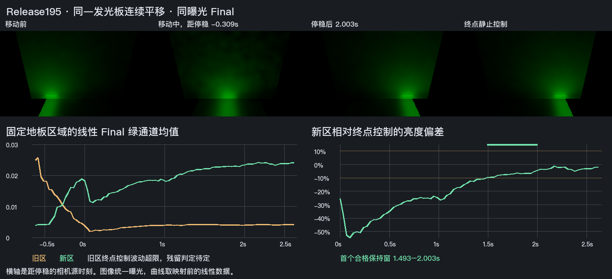

# 发光板连续平移后的新区恢复

Release195 实机观察取得固定移动路线的新位置供光和停稳恢复依据。原冻结取点描述偏差和旧区控制波动超限，整个发光体移动子项仍待验收。[事前范围和判据](contract.md)

在同一棕墙／白地板场景先预热终点静止控制，再预热起点。保持唯一隐藏绿光板的材质和光强，沿 Z 从 −1.65 连续移动到 +1.65，实际用时 0.608 秒。首尾 GPU 槽读回确认同一已发布发光体的新旧位置。墙和地板始终使用 DXR，光板为同一解析后备。Unity 6000.0.85f1、RTX 2080 Ti、DX12 Editor 显式相机请求，输出 960×540，半分辨率 GI、2 射线和 4 级滤波。两侧各保留 49 个事前固定像素。停稳后源节奏约 29.41Hz，最大间隔 35.26 ms。动画按同一曝光展示实际相机预览，曲线取线性 HDR 值。[同曝光动画](motion.gif) · [逐源帧读数](result.json) · [退出回执](native-exit.json)

新区终点控制的亮度波动为 3.806%，符合 5% 的参照资格。该区从切前线性绿均值 0.003937 增到 1.968853 秒时的 0.023225，较终点静止参考低 5.39%。亮度 ±10% 和色向 L1≤0.05 的首个合格窗口为 **1.493483–2.003178 秒**。末帧亮度低 1.91%，全部 98 个固定点的实际过滤结果有效。停稳后 0.101 秒有一次约 54% 的短时亮度低谷，逐帧曲线保留该变化。其具体来源仍待判定。

旧区参照的波动占切前与终点亮度差的 **1.559%**，高于原定 0.5%。保留两个截止点的名义差值，原旧光残留判定为证据不足。初版分析以 `Frozen floor domain differs` 结束。深度反投影确认两侧仍为同一地板上的相反 Z 区域，但实际 X 范围为 **2.076–2.753**，预定投影网格的 X 为 **0.8–1.6**。固定像素、读数、原门槛和初版错误均保留。Astra Max 同意只采用实际新区的独立结果。[固定点数据及实际坐标](signals.npz) · [原始本机回读](<I:/Unity test/Comparison/EmitterMotion229/readback>)

本次结论限于此固定路线的实际新区。旧位置残留、完整运动稳定性及普通 Player 继续按原条件验收。面积光 CDF 随姿态更新的依据来自源码审阅，当前解析发光板走均匀后备。[几何版本与分布复用条件](../../../Runtime/HybridLumenGIAreaEmission.cs#L57)
