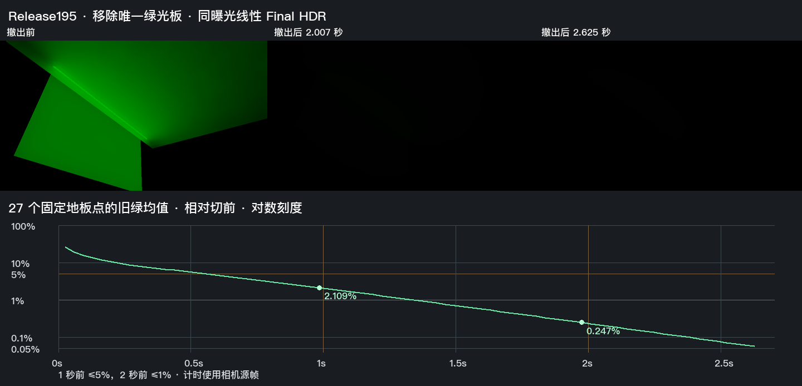

# 移除唯一发光体后的间接光恢复

Release195 在本机通过 G3 的固定发光体撤出子项。使用独立解压的 Release195 Unity 工程和已有 LightsOff127 的实际棕墙、白地板与 27 个预定地板采样点。Unity 6000.0.85f1、URP 17.0.4、RTX 2080 Ti、Direct3D 12，输出 960×540，GI 为 480×270、2 射线和 4 级滤波。墙和地板始终由 DXR 精确查询，隐藏的不可读绿色板原为唯一解析后备。解析灯、环境与烘焙贡献均为零。[事前范围](contract.md) · [同源版本](../shadow-pass-227/delivery.json)

工作帧 119 后停用整块发光板，保留原绿色材质值。首个响应源帧在 **26.285 ms** 到达，已发布对象由 3 降至 2、解析后备由 1 降至 0。两件 DXR 接收网格继续提交。末帧读回确认旧槽发布位为 0，两个接收面的发光为零。图中三张 Final 来自同次相机观察，使用相同曝光和 Reinhard＋sRGB 映射。曲线使用映射前的线性 HDR。

| 源时刻 | 地板旧绿均值占切前 | 最差点占该点切前 | 判据 |
| --- | ---: | ---: | --- |
| 0.983884 秒 | 2.1094% | 2.2521% | 1 秒前 ≤5%，之后的观测保持 |
| 1.973034 秒 | 0.24697% | 0.25677% | 2 秒前 ≤1%，之后的观测保持 |
| 2.624665 秒 | 0.05646% | 0.05924% | 末帧 27 个点的实际 `filteredD` 均有效 |

首个区域均值≤1%的合格窗口为 1.358174–1.870738 秒，持续 0.512564 秒。响应源节奏约 29.25Hz，间隔最大 35.39 ms。显式相机请求的首次完整采集至下一源帧约 75.43 秒，发生在预热和事件之前。上述响应节奏按事件源时钟计算。逐帧时域存储均有效，实际过滤掩码在末帧确认。中间过滤与当前 raw 新鲜度仍有各自的观察边界。[读数与曲线数据](result.json) · [固定点数据](signals.npz) · [进程回执](native-exit.json)

初版分析器额外要求非活动槽的发光字段清零，字面状态为 `terminal-withdrawal-miss`。实际 GPU 读回保留绿色字段，同时 `identity.w=0`。Scene 撤出该槽的 BVH 资格，回退遍历和 `ProxyRadiance` 在查询与供光前都检查发布状态。该板无图卡、无精确三角，且处于屏幕捕获掩码外。Astra Max 和独立源码复核同意按原合同采用实际几何和供光撤出，原状态及读数保留在结果中。[槽位撤出](../../../Runtime/HybridLumenGIScene.cs#L863) · [遍历与供光资格](../../../Runtime/Resources/HybridLumenGI/HybridLumenGITransport.hlsl#L144)

采用范围为固定机位、单一解析发光板的撤出和白地板的残留响应。发光体移动、运动拖影、普通 Player 和完整 G3 继续按原条件验收。现场完整输入及回读保存在本机独立工程目录。[本机相机回读](<I:/Unity test/Comparison/EmitterRemoval228/readback>)
