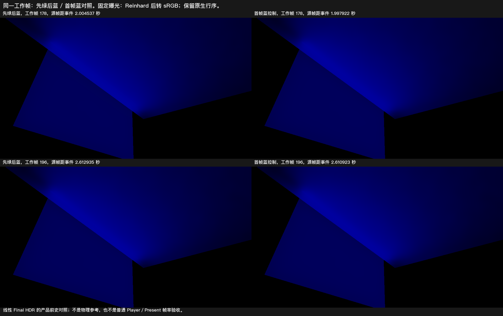

# 固定换色光路的最终状态恢复

**原 G3 中“这个固定换色光路的恢复用时未知”已有有限依据。** 相对同一工作帧、较长蓝色前史的产品对照，白地板固定域的区域均值从源时刻 **0.193958 秒**起满足既定亮度／色向目标，并在后续已观测源帧中保持到 **2.612935 秒**。这不是所有像素的精确首次收敛时间，也不证明物理颜色真值或整体 G3 通过。

图为工作帧 178／196；两程分别保留同一工作帧，固定曝光，统一 Reinhard 后转 sRGB，原生行序不变。约 2 秒和末帧未见明显旧绿色区或局部结构反例；没有新运动事件，不用本图判断门拖影。

## 恢复与残留

| 观察 | 结果 |
| --- | --- |
| 首个满足至少 0.5 秒的区域均值窗口 | 0.193958–0.708270 秒，跨度 0.514312 秒 |
| 该窗口最大平均亮度偏差绝对值／色向 L1 | 9.35198%／0.045253，低于预定 10%／0.05 |
| 窗口起点的最差单点亮度差 | 23.0491%；不能把区域均值合格写成每个像素已恢复 |
| 起点之后的现有源帧 | 均值指标未再次越线，观察到 2.612935 秒；不外推未观测呈现 |
| 约 2 秒，工作帧 178 | 平均亮度偏差 −0.0228535%，色向 L1=0.000425967；最差点亮度差 0.995368% |
| 末帧 196，2.612935 秒 | 平均亮度偏差 −0.00113861%，色向 L1=0.0000903213；最差点亮度差 0.262209% |

蓝色控制在全部配对响应帧中的区域平均亮度极差／均值为 1.39598%，色向无变化，满足运行前固定的有限控制稳定性条件（5%／0.025）。它是较长蓝前史的**产品输出**，不是独立物理参考或无限稳态证明。量为线性 **Final HDR 出射辐射**，不是 123 的 `filteredD`；两组数值不直接混比。

| 残留截止附近的实际源帧 | 旧绿均值占事件前均值 | 最差点占自身事件前值 |
| --- | ---: | ---: |
| 1 秒前：0.978545 秒 | 0.265508% | 0.509393% |
| 1 秒后：1.012862 秒 | 0.244054% | 0.467425% |
| 2 秒前：1.970665 秒 | 0.0229948% | 0.0429662% |
| 2 秒后：2.004537 秒 | 0.0211125% | 0.0394193% |

1／2 秒之前已有样点低于 5%／1% 的对应残留幅度目标；仍保留其真实时刻，不将晚到点冒充截止前数据，也不插值成数学连续的归零时间。这里仅改变发光色，没有新测关灯。

## 实际配置与时序

Unity 6000.0.85f1／URP 17.0.4，Windows D3D12，Release122 产品源码与发行质量：960×540、GI 480×270、2 射线、4 级滤波。白墙／地板采用精确 DXR，隐藏不可读单槽发光板采用既有解析回退；固定黑环境、零原生灯、SH、反射及烘焙光。域沿用既有 27 个白地板点的像素中心，运行前归一化映射至新分辨率，所有点保留，未按结果筛选。完整支持读回确认这些点的原生合成前 RGB 为零、接收材质为白色；独立反投影到地板的最大 |y| 为 0.00000843。

事件程先绿后蓝，在逻辑 119 渲染并提交点读回后，于**同一引擎帧**写蓝并打时钟；控制程首帧即蓝，在相同位置只记 marker。两程工作帧与样点一一对应，控制的末帧及约 2 秒整图帧在启动前由事件程的帧号固定。第 0 帧完整支持捕获及其排空属于准备阶段；0→1 有 7 个空转引擎帧、约 2.85 秒间隔，随后 1–119 连续预热，事件后引擎帧也连续，未由观测跳帧清除成熟历史。

| 节奏与观测负载 | 事件程 | 蓝色控制 |
| --- | ---: | ---: |
| 响应源帧平均频率 | 29.3773 Hz | 29.3998 Hz |
| 源帧间隔中位／p95 | 34.023／35.086 ms | 34.020／34.874 ms |
| 最大源帧间隔 | 35.500 ms | 35.013 ms |
| 异步读回完成延迟中位 | 40.281 ms | 40.226 ms |

时间取自提交渲染请求前的 `Time.realtimeSinceStartupAsDouble`，不是异步回调完成时刻。每个响应源帧都完成标准 Final 目标异步读回，窗口内不写文件、不同步读取 GPU 来源行；帧间隔均未超过预定的 2/30 秒连续窗口上限。读回仍有成本。这是实际约 29.4Hz 的显式渲染请求，**不是普通 Player、Present 或 30FPS 性能验收**；未新增 GPU／显存结论。

## 失败记录与采用范围

首个启动在零渲染请求时退出 1：临时 MonoBehaviour 把 `MaterialPropertyBlock` 放在字段初始化器，Unity 拒绝其 native 创建，随后属性块为空。主线程审阅遗漏了该初始化时机；事件未发生，控制程未启动。原输出与场景恢复记录完整保留。Astra Max 只允许一次已定位的入口纠正：移到 Start 初始化，原输入／阈值／节奏／停止规则不变，纠正输出单列 `Corrected`。随后首次实际两程比较均原生退出 0、读回排空，原场景和 Quality 恢复，没有额外采样。

执行前还纠正了按 Update 空转节流会打断 f-1 历史的问题：完整支持捕获移到最早准备帧，短暂等待放在同一 Update 内，连续引擎帧有硬约束。这是观测接线纠正，没有修改产品。若输入、控制或读回不足，原规则是保留不足并结束；没有为取得合格结果调参。

Astra Max 已复核数值和主线程图片判断，同意按固定域的有限恢复结论收束。早期最差点仍有差异，整幅早期画面未逐帧观测；物理颜色误差、其他光路、关灯／运动／形变、普通 Player 与完整 G3 仍保持各自范围。这里改变的是发光板颜色，不能当作 109 红墙反射率换蓝事件的直接重测或修复证据。没有新产品修复依据，不追加运行、构建或发版，当前成品仍为 Release122。

[冻结合同](contract.md) · [逐源帧数值](result.json) · [固定点原始线性信号](signals.npz) · [分析脚本](analyze.py) · [可复算数据与观察入口](comparison-data.zip)

完整原生输出：[事件程](<I:/Unity test/Comparison/FinalResponse126GreenToBlueCorrected>)、[蓝色控制](<I:/Unity test/Comparison/FinalResponse126BlueFromStartCorrected>)；[零请求准备失败](<I:/Unity test/Comparison/FinalResponse126GreenToBlue>)保留。数据 ZIP 含分析所需的三类 baseline 纹理、两程帧记录和保留的同帧 Final 原图，其余完整支持文件仍在上述原生目录。解压后可用 Python／NumPy 执行 `python analyze.py GreenToBlue BlueFromStart <新的输出目录>`，不需要重开 Unity。
