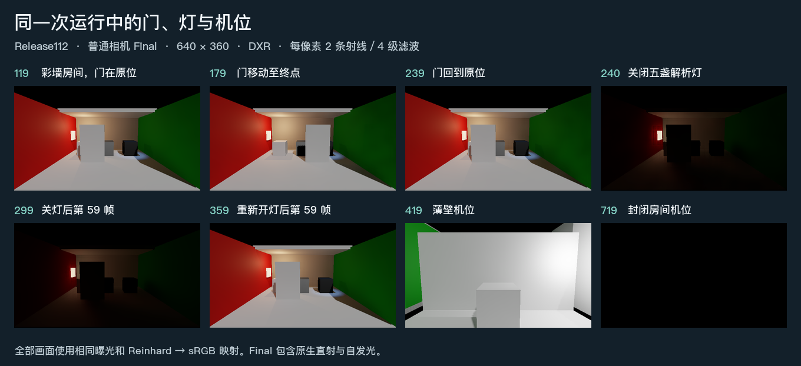

# Release112 的门、灯与相机连续路线

使用 Release112 渲染源码与原有固定场景，Unity Editor Play 在同一台相机上连续完成了门的往返运动、关闭和重新开启五盏解析灯、切换薄壁与封闭房间机位。引擎帧 4–723、GI 帧 1–720 连续，退出码为 0。每帧诊断报告硬件后端。图中各时点均报告 20 个硬件网格，软件回退为 0。

门在第 179 帧到达相距 2.2 个本地单位的终点，保持后于第 239 帧返回。第 240–299 帧的实际灯表为 0，此前及第 300 帧起均有 5 盏。关灯后左侧发光面仍然可见。第 360 帧切换薄壁机位，第 420 帧切换封闭房间机位。

| 同一彩墙机位 | 普通相机 Final 的全图平均线性亮度 |
| --- | ---: |
| 关灯前，第 239 帧 | 0.199461 |
| 关灯当帧，第 240 帧 | 0.010839 |
| 关灯后第 59 帧 | 0.010817 |
| 重新开灯当帧，第 300 帧 | 0.193057 |
| 重新开灯后第 59 帧 | 0.200863 |

**适用范围**　使用已保存的 `UnifiedRelease74/Generated/Scenes/Run/Validation.unity` 副本，运行原有 `HybridLumenGIValidationSequence`。普通相机输出 640×360 线性 HDR，半分辨率 GI、2 条射线、4 级空间滤波及实际 DXR。标准请求每逻辑帧渲染一次，32 个预定 HDR 时点均完成。此前的完整路线证据来自软件配置，后续 DXR 的短前缀各有其专项目的。这次补齐了当前配置从头至尾的功能记录。[帧、动作、机位与捕获时点](result.json)

Final 包含原生直射、自发光和 GI。表中全图均值能说明画面随灯开关响应，无法据此分离旧间接光、计算单个接收面的物理误差或确定精确收敛帧。上图也没有逐帧分离运动拖影。对应的独立估计和着色器对照见[四问画册](../picture-comparison.html)。
