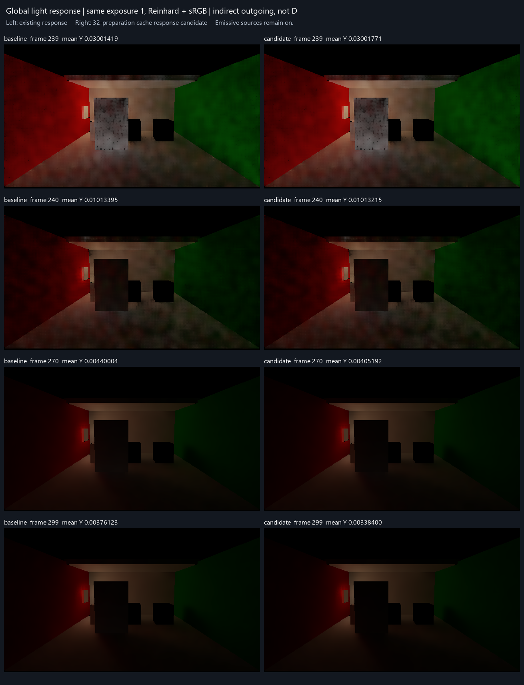

# 全局灯光暂态加速候选：未采用

把全局灯变化后32次相机准备中的缓存新估计最低权重从0.1提高到0.5，未达到预声明的响应筛选条件。产品源码与Unity工程中的四处候选修改均已撤回；当前运行入口仍为Release76。该方向结束，不延长窗口、不搜索参数、不重跑。

| 普通IndirectOnly输出 | 原响应 | 候选 |
| --- | ---: | ---: |
| 关灯前239：全图平均Y | 0.03001419 | 0.03001771 |
| 关灯当帧240：全图平均Y | 0.01013395 | 0.01013215 |
| 关灯后30帧270：全图平均Y | 0.00440004 | 0.00405192 |
| 关灯后59帧299：全图平均Y | 0.00376123 | 0.00338400 |
| 270→299逐像素Y绝对差均值 | 0.00065164 | 0.00067958 |

晚期两个时点的变化增加4.29%，没有满足减少至少20%的筛选条件；晚帧均值下降10.029%，亦超过预声明的10%可判读范围。旧299帧不是真值，亮度降低可能包含更快消退，不能直接认定为压黑错误。但本次不足以支持采用，也不据结果修改门槛。同曝光画面未见明显新增亮斑或缺失区域；四张静态图不证明帧间稳定，更不能给出收敛速度改善百分比。

候选只改变可信缓存估计的时间混合下限；unknown早退、pending首次替换、年龄/HLOD、预算与屏幕历史脉冲保持。32计数包含无预算或unknown的相机准备，非32次成功GPU更新。这是响应/噪声取舍，没有新增传播或诊断系统。[撤回的补丁](rejected-candidate.patch)仅保留思路，不属于当前产品。

沿用[基线](../current-lightoff-prefix-01/result.md)保存场景的0–299前史、同相机/门位姿/光事件以及239/240/270/299采样；只有一次候选Unity运行。原序列仍要求720帧，因此保持failed/native1；实际300条GI收据连续，四次读回完成，failures/backendMismatches为0。临时截图接线、场景副本和QualitySettings已恢复。未执行额外参考积分、性能测量、哈希或单元矩阵。

量为间接漫反射出射贡献（滤波D乘接收漫反射率、AO、intensity），包含背景；不是D或物理误差。发光源继续开启。展示统一曝光1、Reinhard+sRGB，仅上下翻转。没有更新旧颜色误差、换色、运动拖影结论；也没有关闭原计划G1/G3动态收敛缺口。

[预声明条件](criterion.json) · [数值与决定](comparison.json) · [原始候选输出](<I:/Unity test/Comparison/GlobalLightResponseWindow01>) · [运行接线](run.ps1)
