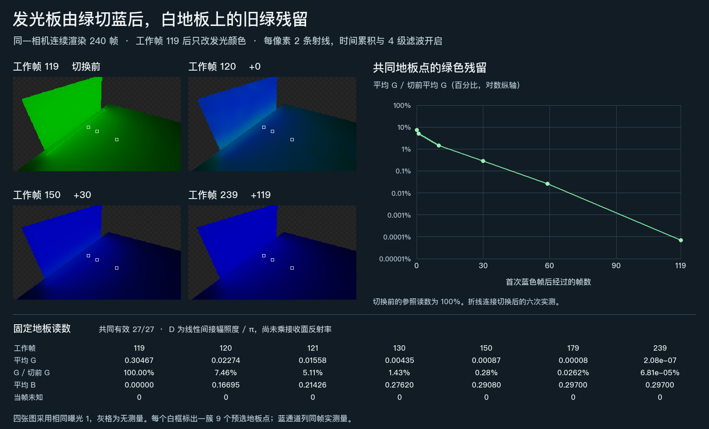

# 唯一发光源由绿切蓝后，旧绿色多久消退？

Release114 在切蓝当帧已把蓝光送到白地板，仍剩下切换前 **7.46%** 的绿色。第 +10 帧为 **1.43%**，第 +30 帧为 **0.285%**。第 +30 帧是此次采样中首次低于 1% 的时点。最后的 +119 帧仍测到 **0.0000681%**。

| 相对首个蓝色工作帧 | 平均 G | G 占切换前 G | 平均 B |
| --- | ---: | ---: | ---: |
| 切换前（工作帧 119） | 0.304674 | 100% | 0 |
| +0 | 0.0227412 | 7.4641% | 0.166947 |
| +1 | 0.0155809 | 5.1140% | 0.214256 |
| +10 | 0.00435116 | 1.4281% | 0.276202 |
| +30 | 0.000867791 | 0.28483% | 0.290796 |
| +59 | 0.000079839 | 0.026205% | 0.297002 |
| +119 | 0.000000207512 | 0.0000681% | 0.297002 |

场景使用黑环境、零解析灯，其余表面没有发光。遮板是唯一光源，第 119 个工作帧渲染完成后，其 Renderer 覆盖由纯绿改为纯蓝。七个时点的 GPU 代理常量均与当时的光源状态对应。在这个逐色道计算漫反射的场景中，新光路没有绿通道输入，所以仍读到的 G 可以作为旧绿残留。蓝光按实际读数单列。

使用同一机位、固定白地板上的 27 个 GI 像素，七次全部有效。数值取自 `filteredD` 的线性 RGB，即乘接收材质之前的间接辐照度除以 π。相机为 640×360、GI 为 320×180，采用发行配置的 2 条射线、4 级空间滤波、时间历史与递归反馈。板所在层从图卡捕获中排除，地板和墙面由 DXR 网格表示，板走解析回退。[完整设置、GPU 来源和读数](result.json)

**范围与不确定性**　该比例以切换前一帧的实测平均 G 为分母。采样只覆盖表中时点，未确定首次越过 1% 的精确帧数或彻底归零的时刻。没有独立的稳态蓝光参考，因此后两次平均 B 接近也不足以确定蓝光已收敛。不同几何、多个有色光源、运动接收面和其他后端的结果仍开放。
