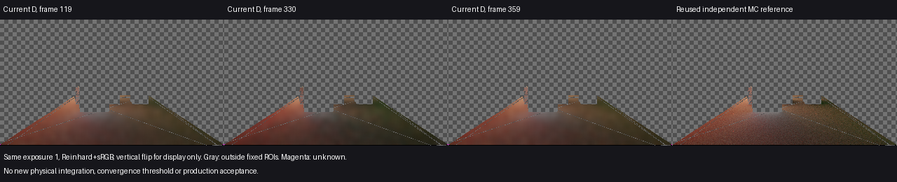
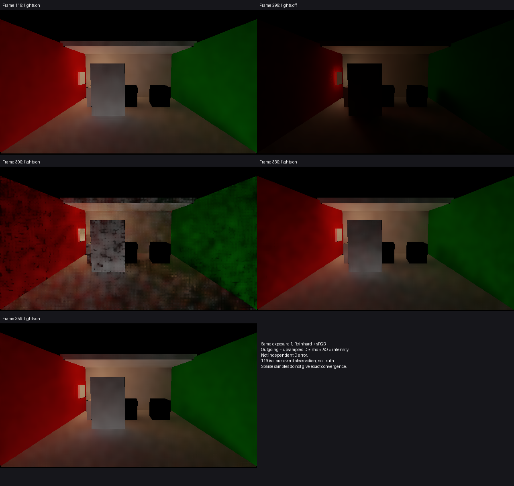

# Release83 重新开灯后的恢复

**当前版本能够重新建立灯亮时的间接照明，但恢复需要多个帧。** 在这一次固定场景中，重新开灯后第30帧，Floor／White平均D亮度分别为本次开灯前观测的74.65%／65.68%；第59帧为98.36%／96.78%。没有新增未知点。此结果补齐当前来源分离缓存及历史修复后的恢复阶段依据，没有新增产品修改或完整G3通过结论。

## 恢复程度与颜色偏差

同一次运行，原五盏选定解析灯在240帧关闭、300帧恢复；发光面始终保留。119是灯亮前史的观测，不是真值。119／330／359的相机、投影、门位置和灯启用状态相同。使用原Floor／White源ROI及三帧相同有效交集，分别13328／86点；Floor每帧另有2点未知，White为0，没有丢失任何119已知点。

| 观测 | Floor平均D-Y | 相对119 | White平均D-Y | 相对119 |
| --- | ---: | ---: | ---: | ---: |
| 119，开灯前基线 | 0.067501 | 100% | 0.219326 | 100% |
| 330，恢复后30帧 | 0.050391 | 74.65% | 0.144052 | 65.68% |
| 359，恢复后59帧 | 0.066394 | 98.36% | 0.212262 | 96.78% |

沿用已有119独立CPU参考（256spp、8次反弹），对应平均D亮度偏差：

| 观测 | Floor | White |
| --- | ---: | ---: |
| 119 | −5.84% | −3.36% |
| 330 | −29.71% | −36.53% |
| 359 | −7.39% | −6.48% |

原灯表、相机/门记录与已有样本矩阵、GI尺寸、材质支持相符，因此在原有限解释范围内复用参考；没有重新积分或建立更严格来源证明。既有helper对330／359的静态矩阵和材质支持使用旧299 capture，**不使用其关灯辐射作亮灯参考**。真正比较的参考始终是独立119亮灯结果。每像素MC标准误不是ROI置信区间；有限弹射、射线偏移、截断、缓存和滤波的原模型差异继续有效。

## 画面、残留与收敛边界

300帧照明已恢复，但有明显黑颗粒；330／359更加平滑，359整体亮度接近119。没有从这些时点观察到持续停留在关灯状态的异常。普通图是上采样D乘反射率、AO与强度，不能替代独立D误差。所有图采用相同曝光1、Reinhard和sRGB，仅显示时上下翻转。

330→359的逐像素平均绝对D亮度变化仍有Floor 0.016006、White 0.068209。只能说本场景在这些采样时点恢复到上述程度，不能说已经达到正确颜色、给出精确收敛帧数，或将帧数按30FPS目标转换为实测秒数。未采样帧的闪变、运动全过程、局部换色及关灯后White偏暗仍不由本次关闭。59帧与119仍有差异，本身不是足以归因的代码错误。

## 运行范围与收束

使用产品0181ef2／Release83、原保存场景、软件路径、640×360普通输出／320×180 D。该图像配置沿用原参考，**不是960×540性能验收**。只运行0–359，普通图119／299／300／330／359，现有Capture API票据119／330／359；没有扩大捕获容量或补采。

Unity PID16296／工具会话47309已终止，360个逻辑/引擎/GI收据连续，failures=0、backendMismatches=0。三份D读回完整；临时场景、QualitySettings、Scene/Kernels/Sequence源码已恢复。原720协议保持failed，native exit1按主动前缀保留，不能改写为完整序列通过。

本线到此结束；当前结果不支持再立项“重新开灯后无法恢复”的修复，不自动延长观察或调参。独立审阅确认采集接线和同有效域/未知口径没有阻断问题。数据见[result.json](result.json)，完整原始输出见[运行目录](<I:/Unity test/Comparison/LightRestoreResponse01>)。
