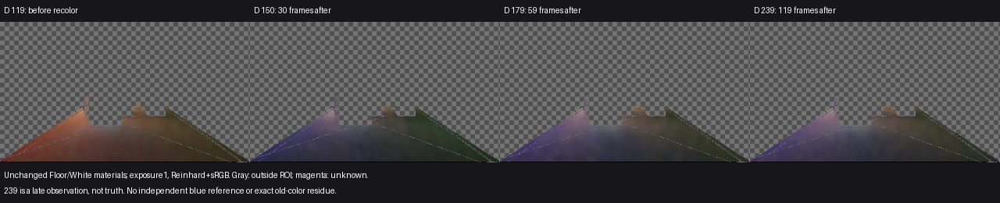
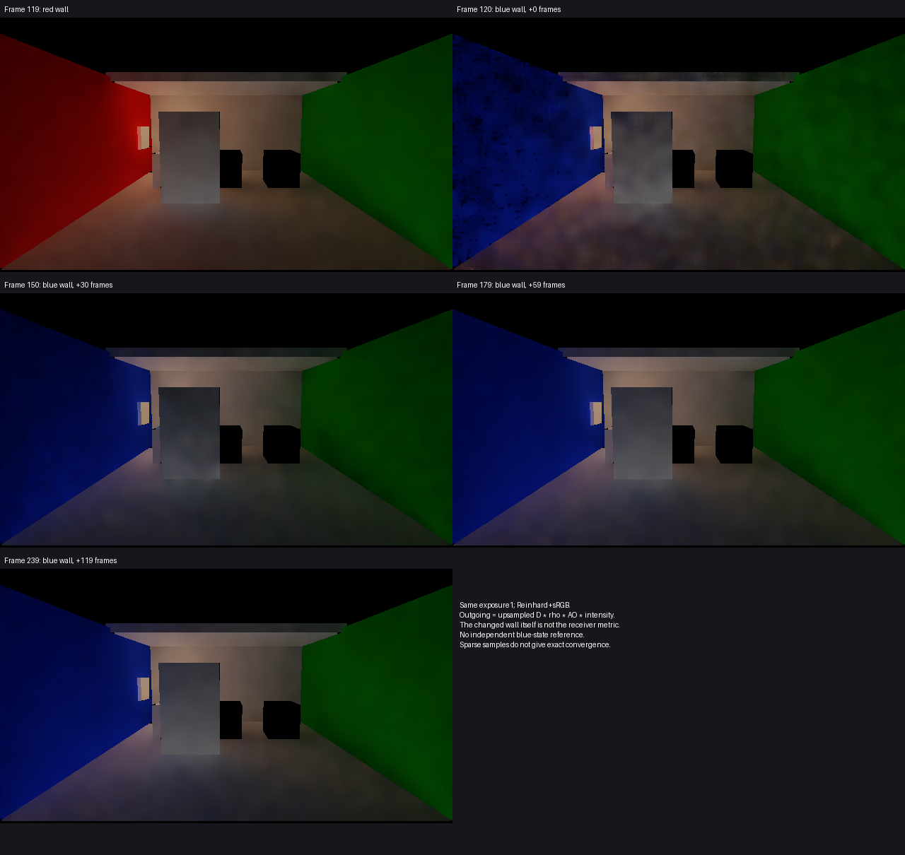

# Release83 局部墙面换色后的接收面响应

**局部墙面从红色改为蓝色后，材质未变的Floor与White接收面都更新了反弹颜色。** 第30帧已明显转蓝，第59帧与第119帧的平均色向接近，没有丢失原有已知点。此结果补齐当前版本的局部换色画面依据；没有发现足以立项的材质漏接或持续卡在旧色的反例，没有新增产品修改。

## 实际局部事件

使用与统一示例C键相同的普通操作：只给唯一Red wall的Renderer级MaterialPropertyBlock设置`_BaseColor`，从有效值(0.75,0.04,0.03,1)改为(0.05,0.15,0.8,1)。没有修改灯光、接收面材质，没有手动MarkDirty或清历史。

事件发生在逻辑119／引擎123渲染完成之后，逻辑120／引擎124开始之前。实际MPB读回与请求的R/G差小于3×10⁻⁸；分析采用1×10⁻⁶绝对容差确认这一源操作，不是辐射误差或画质放行阈值。相机、投影、门位姿和灯启用状态全程不变；门在临时采集场景固定于原位，不运行旧序列的门运动。

## 颜色如何变化

测量为D=E/π，不是被改墙面自身的最终颜色。使用既有几何导出的Floor／White源ROI和四帧共同有效域：13328／86点。Floor未知数为2／1／1／2，White均为0；没有丢失119帧的已知点，临时新增已知点不加入比较域。

下表R／B占比是ROI平均RGB分别除以RGB之和，用于描述色向，**不是旧色残留百分比**。

| 观测 | Floor R／B占比 | Floor平均D-Y | White R／B占比 | White平均D-Y |
| --- | ---: | ---: | ---: | ---: |
| 换色前119帧 | 58.66%／16.26% | 0.067501 | 54.31%／20.18% | 0.219326 |
| 换色后30帧 | 30.87%／39.15% | 0.044311 | 34.30%／38.61% | 0.128890 |
| 换色后59帧 | 33.82%／38.38% | 0.057292 | 36.81%／35.91% | 0.189172 |
| 换色后119帧 | 34.10%／38.36% | 0.058344 | 36.73%／35.94% | 0.193330 |

相对晚期239帧观测，30帧时的平均RGB色向L1距离为Floor 0.064610／White 0.053430；59帧时为0.005536／0.001583。并非简单从旧红色单调趋向最终值：30帧的蓝色占比还高于后续观测。不能据红通道不为零认定旧红光残留，场景还有其他反射与照明贡献。

## 画面与未解决范围

首帧120仍有明显颗粒和斑驳；30帧画面较暗，59／119帧更接近。59→119帧的逐像素平均绝对D亮度变化仍为Floor 0.004295／White 0.011584。平均色向接近不能证明每个像素稳定或中间无闪变。

本次没有蓝墙状态的独立参考。239只是晚期观测，不是正确颜色、绝对旧色残留或收敛真值；不为未采样帧插造精确收敛时刻，也不把帧数按30FPS目标换算成实测秒数。当前蓝墙颜色物理误差、多跳旧色的精确份额、任意局部变更及完整G1/G3仍未关闭。图中普通出射贡献是上采样D×反射率×AO×强度，与D分开解释；所有图同曝光1、Reinhard+sRGB，仅显示时上下翻转。

## 执行与收束

一次当前0181ef2／Release83产品、软件路径、原保存场景的局部换色变体，640×360输出／320×180 D；不是960×540性能验收。只运行0–239，D119／150／179／239与普通图119／120／150／179／239完整。没有增加捕获容量、参考积分、源码哈希或旧slot1专项。

Unity PID11588／工具会话81745已终止，240条逻辑/引擎/GI收据连续，failures=0、backendMismatches=0。临时源码、场景和Quality设置恢复。旧720协议仍failed/native exit1，旧门运动阶段标签只是继承字段，不能称原规定运动序列通过。

Astra事前认可范围，独立审阅未见采集时序及同有效域分析阻断问题。本线到此结束，不因缺少绝对蓝色参考或晚帧仍有差异而自动补采、调参。数值见[result.json](result.json)，原始数据见[运行目录](<I:/Unity test/Comparison/LocalRecolorResponse01>)。
