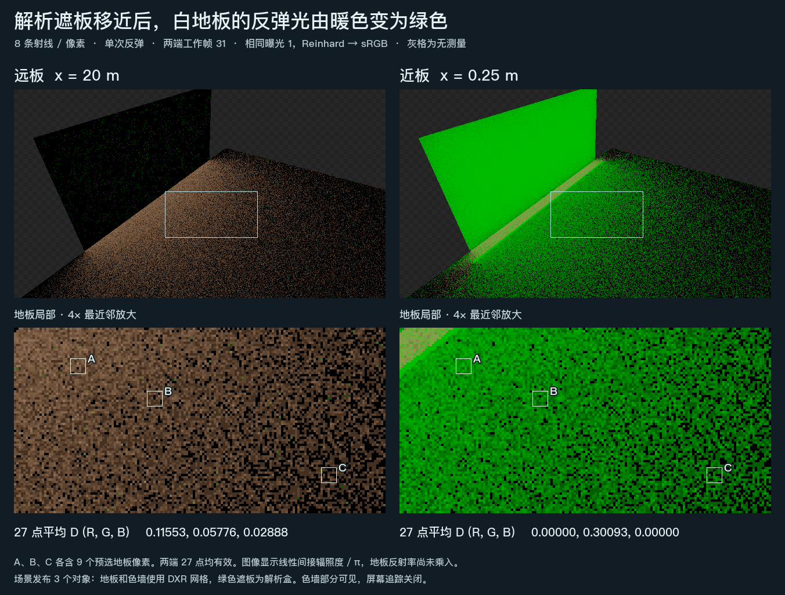

# 解析遮板能截住更远的 DXR 色墙

同一片白地板和暖色墙使用 DXR 网格。第三个对象是一块带绿色自发光的解析 Box，只有 BoxCollider 和 GI Proxy，普通相机无法直接画出这块板。把板移到地板和墙之间后，白地板上的间接光由暖色变为绿色。

| 遮板位置 | 固定白地板区域的平均线性 D（R，G，B） | 共同有效点 |
| --- | --- | ---: |
| 远板，x = 20 | (0.11553, 0.05776, 0.02888) | 27 |
| 近板，x = 0.25 | (0, 0.30093, 0) | 27 |

D 为间接漫反射辐照度除以 π，取自乘接收面反射率之前。三个采样簇沿用既有地板位置。近板和远板的材质、法线与深度读回在这些像素一致，两端各有 0 个未知点。近板位置红、蓝通道归零，绿色上升；这使板参与光路的结论有画面依据。[读数、取样位置与实际后端](result.json)

**适用范围**　Unity 6000.0.85f1、D3D12、640×360，每像素 8 条射线。两次独立 Play 使用同一机位和 GI 工作帧 31，各报告 3 个已发布对象、2 个硬件网格及 1 个回退对象。板为轴对齐长方体、黑色漫反射、线性绿色发光 (0, 1, 0)。暖色墙部分可见，屏幕追踪、递归反馈、时间累积和空间滤波均关闭。此次观察涵盖实际硬件网格与较近解析 Box 的相互遮挡。每条射线的命中身份、阴影射线、旋转遮板及 SDF 回退仍需要各自的依据。
