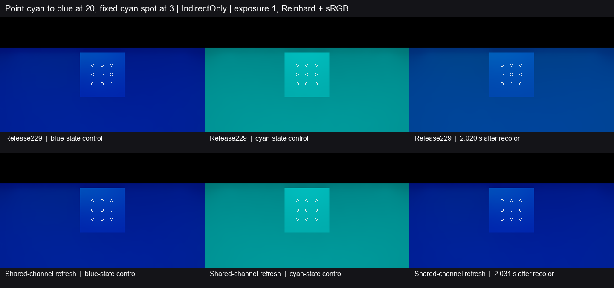

# 点灯切回蓝色时保留聚光灯的绿色

Release229 在比对点灯通道降幅时，遇到同通道的恒亮聚光灯就退出判断。旧点灯的绿色因此继续随缓存反弹。修复把同一通道及空间、投影、遮罩参数保持的伴灯计入原有比例判断，作为比例为 1 的光源。点灯的绿色退出时，受影响的局部解析光份额由当前光路重新计算。

| 固定九点间接光 | Release229 | 修复版 | 原门槛 |
| --- | ---: | ---: | ---: |
| 1 秒前最后一帧的旧绿增量 | 12.173% | **0.303%** | ≤5% |
| 2 秒前最后一帧的旧绿增量 | 6.069% | **0.014%** | ≤1% |
| 2 秒前相对终态的绿色偏差 | +120.93% | **+0.271%** | ±10% |
| 2 秒前相对终态的亮度偏差 | +39.57% | **+1.246%** | ±10% |
| 2 秒前相对终态的色向 L1 | 0.09677 | **0.00122** | ≤0.05 |
| 绿色全窗最小偏差／蓝色最大绝对偏差 | +79.27%／1.64% | **−0.93%／2.00%** | ≥−10%／≤10% |

旧绿以青色高态与蓝色终态的绿色差为分母。修复版在换色后 **0.840–1.349 秒**取得首个合格保持窗，随后至 **2.608 秒**末帧均在终态容差内。蓝态和青态控制的九点平均 RGB 在两侧一致。两侧源节奏约 29.36–29.50 Hz，数值的时间起点是换色调用。[基线读数](baseline.json) · [修复读数](fixed.json) · [沿用的判据](../point-light-shared-recolor-252/contract.md)

Unity 6000.0.85f1、RTX 2080 Ti、DX12 Editor Play、实际 DXR。两侧采用同一个七网格灰墙房间和固定正交机位，960×540、半分辨率 GI、2 条射线、4 级滤波。点灯强度为 20，从青色切回蓝色。伴随的实时青色聚光灯强度为 3，范围 10，外／内角为 120°／110°，方向与硬投影固定。实际 GPU 灯表保持两条，仅点灯绿色在事件后归零。开始与末帧捕获的缓存 epoch 均为 5。画面采用间接光、曝光 1、Reinhard 和 sRGB。

关闭 T3／G3 的固定 Point＋Spot 光路共通道换色残留。方向灯、变化中的非点灯、普通 Player 的整景动态画质和运动拖影各自验收。终态对照量化的是当前产品的恢复，物理颜色误差继续按原参考范围报告。
