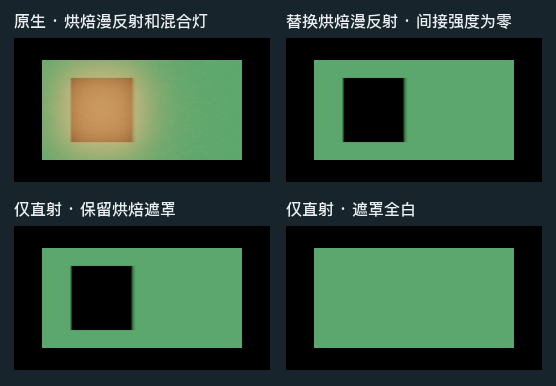

# 替换烘焙漫反射后，Mixed 灯的烘焙阴影仍然保留

同一个静态白色 Lit 接收面上，左侧区域受烘焙阴影遮挡，右侧区域被绿色 Mixed 主灯直接照亮。烘焙完毕后禁用了遮挡板，运行时没有它的实时投影。把 HLGI 的间接强度设为零并启用 Replace 后，两块内部区域都与单独保留遮罩直射的原生画面逐像素相符。

| 固定相机的平均线性亮度 Y | 左侧遮挡区 | 右侧受光区 |
| --- | ---: | ---: |
| 原生烘焙光与 Mixed 直射 | 0.634509 | 0.512354 |
| Replace，间接强度为零 | 0 | 0.488486 |
| 原生直射，黑色光照贴图与原遮罩 | 0 | 0.488486 |
| 原生直射，黑色光照贴图与全白遮罩 | 0.488486 | 0.488486 |

独立直射对照只把 `lightmapColor` 换为黑色，保留了 `shadowMask`、光源通道、接收面的图集索引及 UV 变换。再单独把遮罩换为全白，左侧重新亮起，右侧保持原值。这个变化确认了对照画面中的阴影来自烘焙遮罩。在两个 16×16 内部区域内，Replace 与保留原遮罩直射之间的最大 RGB 单通道绝对差均为 0。[逐区域 RGB 与绑定](result.json)

**适用范围**　Release110 渲染源码，Unity 6000.0.85f1／URP 17.0.4，Windows D3D12 Editor Play、Forward Lit、软件 GI。单一 Mixed 主方向灯使用 Shadowmask 模式和遮罩通道 0。相机固定为 256×144 线性 RGBA32F，范围分别是像素 `[80,96) × [64,80)` 和 `[160,176) × [64,80)`。显示图采用同一 Reinhard 和 sRGB 转换。这一项确认了相机最终颜色中受遮实时直射的保留；世界空间二次反弹读取烘焙遮罩、其他混合模式、动态接收体与遮罩边缘仍需独立依据。

原始线性画面可分别查看。[原生 EXR](native.exr) · [Replace EXR](replace-zero.exr) · [遮罩直射 EXR](masked-direct.exr) · [全白遮罩直射 EXR](white-mask-direct.exr)
