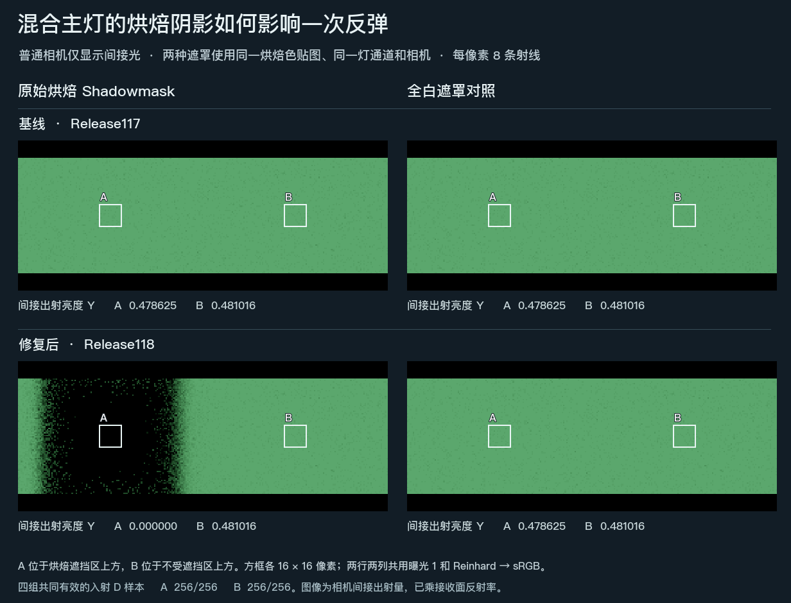

# 静态烘焙遮罩现会影响真正的反弹光

同一张烘焙过的白色地板，左侧在 Mixed 灯的烘焙阴影内，右侧受光。烘焙后移走遮板，在地板上方加一张朝下的白色接收面。Release117 即使把真实遮罩换成全白，两处反弹画面也逐像素相同。Release118 使用真实遮罩时，原遮区上方的间接亮度为 **0.000000**，换成白遮罩恢复到 **0.478625**。原受光区分别为 **0.481016** 和 **0.481016**。

| 普通相机间接出射亮度 Y，线性 | 真实烘焙遮罩 | 全白遮罩 |
| --- | ---: | ---: |
| Release117，原遮区上方 | 0.478625 | 0.478625 |
| Release117，受光区上方 | 0.481016 | 0.481016 |
| Release118，原遮区上方 | 0.000000 | 0.478625 |
| Release118，受光区上方 | 0.481016 | 0.481016 |

**如何区分烘焙遮挡与其他变化。** 两次冷启动 Play 保留同一地板网格、原光照贴图、UV2、图集索引、缩放与偏移，单一 Mixed 主方向灯使用烘焙通道 0。只替换 shadowMask。地板的图卡保留原网格的全部 121 个 UV2 坐标。新接收面没有实时投影，间接相机仰看它的下表面。图中两个预定的 16×16 区域在两版、两张遮罩下均有 256 个有效点。[颜色、有效域与实际资源绑定](result.json) · [地板原有的独立相机直射对照](../mixed-shadowmask-01/result.md)

**范围。** Unity 6000.0.85f1、Windows D3D12、RTX 2080 Ti、256×144，GI 为全分辨率，每像素 8 条射线，固定 GI 工作帧 31。两件网格均走 DXR，使用真实图卡。射程 1 个世界单位，环境、自发光、屏幕追踪、递归反馈、时间累积和空间滤波均关闭。亮度来自普通 IndirectOnly 相机。压缩文件中保留四个端点的原始线性相机 RGBA、乘接收材质之前的间接入射量及各自的有效掩码，数组使用原始纹理坐标。此次实测覆盖静态图卡命中的世界光路。屏幕命中、附加 Mixed 灯、遮罩边缘、动态探针和 Distance Shadowmask 的实机表现仍需各自的依据。[原始信号与有效掩码](signals.npz)

**交付。** 普通三室示例从同版可编辑工程独立解压目录构建，Unity 报告 0 个错误、6 条警告。普通三室仍采用原有实时灯配置；上图来自保存的 Mixed 专项场景。[Release118](https://github.com/Ranko-sama/HybridLumenGI/releases/tag/release118-demo)
