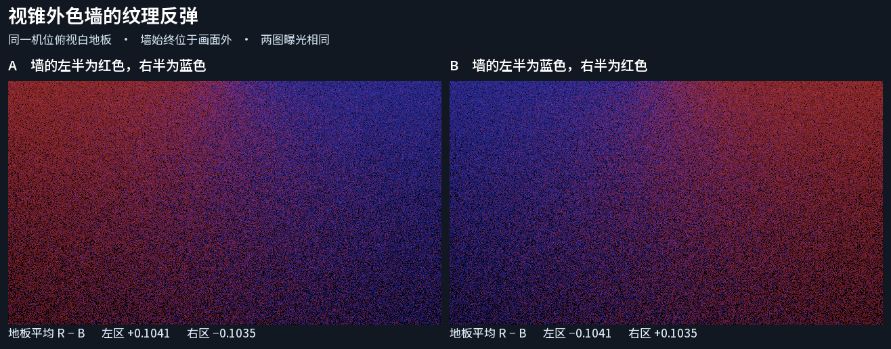

# 视锥外色墙的纹理反弹

把同一面墙上等面积的红、蓝纹理左右交换，可见白地板上的反弹色也随之交换。相机从头到尾只看地板，墙的包围盒始终在视锥外。本次关闭 G2 在这个固定场景中缺少离屏 Lit 纹理反弹画面依据的问题。

| 普通间接光图，第 30 帧 | 左地板平均 RGB | 右地板平均 RGB |
| --- | --- | --- |
| A · 墙的低 U 为红，高 U 为蓝 | 0.15898，0.01282，0.05491 | 0.05527，0.01283，0.15876 |
| B · 墙的低 U 为蓝，高 U 为红 | 0.05491，0.01282，0.15898 | 0.15876，0.01283，0.05527 |

预期色向来自原墙面的 UV 与相机朝向。低 U 一侧靠近左地板，高 U 一侧靠近右地板。左右固定取样区各含 28,800 个像素，列分别为 [80, 240) 和 [400, 560)，行均为 [90, 270)。上表是显示映射前的线性出射间接漫反射 RGB 均值。预览沿用相同的 Reinhard 与 sRGB 映射。[完整读数和构图](readings.json) · [两张原始线性 EXR](linear-frames.zip)

**输入与适用范围。** 复用已保存的有限色墙、白地板、两组原网格与 charts、单个白色方向光。仅为墙复制原有不透明 URP Lit 材质，并指定一张点采样、无 mip 的 8×2 线性底色图。两次都使用同样数量的红蓝纹素。光照到墙，方向平行于地板；环境为黑，表面无自发光。相机位于 (0.85, 1.5, 0)，朝下，屏幕向右对应世界 +Z。地板可见范围的最小 X 约为 0.15，而墙在 X = 0。两次都在渲染前检查墙与地板的包围盒，并确认所有记录帧的相机位姿相同。[源场景](../finite-wall-color-reference-02/instrumentation/post-run/Assets/FiniteWallReference01/Generated/FiniteWall.unity) · [对照设置](OffscreenWallEditor.cs)

Unity 6000.0.85f1、RTX 2080 Ti、DX12，产品源码 `7d7825a`。两个独立 Editor Play 过程均使用同一相机的普通 `IndirectOnly` 输出，640×360，满分辨率 GI，每像素 8 条射线，关闭屏幕追踪、反馈多跳、时域累积与空间滤波。因此图中保留了单帧颗粒。第 30 帧都报告两个已发布的 charted owner、DXR、两个硬件网格、零 fallback，未知材质记录为零。原采集器将短序列标为 `incomplete-probe`，两次均完成所请求的 31 帧且采集错误为零。

这组图验证了接收面随视锥外纹理排列而变色。每条射线的 UV 数值、绝对辐射误差、软件后端、动态纹理上传、高频纹理的 mip 行为及生产滤波配置的画质仍需各自的依据。
