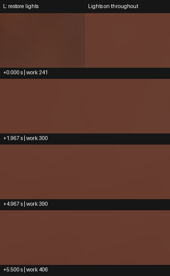

# 普通 Player 重新开灯后的地板间接光恢复

Release220 同源的普通 Win64 Player 关灯后重新启用五盏解析灯。固定地板约 **1.233 秒**进入恢复容差，并保持到 **5.667 秒**的观察末端。全局事件的 5 秒期限和后续 0.5 秒保持达到原目标，关闭 G3 的这条固定重新开灯子项。[逐源配对](result.json)

| 重开后的源时刻 | 工作帧 | 线性出射 Y | 相对亮灯控制 Y | 平均色向 L1 |
| --- | --- | --- | --- | --- |
| +0.000118 秒，首个恢复源 | 241 | 0.054008 | −24.332% | 0.037547 |
| +1.233288 秒，连续恢复起点 | 278 | 0.064450 | −9.567% | 0.042836 |
| +1.966712 秒，2 秒前读数 | 300 | 0.069388 | −2.666% | 0.008793 |
| +4.966750 秒，5 秒前读数 | 390 | 0.070216 | −0.577% | 0.000311 |
| +5.500004 秒，保持窗末 | 406 | 0.069748 | −0.494% | 0.000163 |

使用公开 Release220 工程 ZIP，产品提交 `0fc569978f33d2b8dff6c28b56fa6636a836ce95`。独立解压后只加入观察组件，保存场景及 Runtime 沿用发行版。Unity 6000.0.85f1、URP 17.0.4、RTX 2080 Ti、DX12 实际 DXR、960×540／GI480×270、2 射线、4 级滤波，对象身份历史按保存设置启用。普通 `NeutralThreeRooms` 近景、固定相机 `(-2.85, 0.75, -1.75)` 与 85° 俯角沿用 257，采集 F5 `IndirectOnly` 中央 84×54 线性 HDR 地板，关闭后处理。图两列均用曝光 1、Reinhard 和 sRGB。[同源工程](https://github.com/Ranko-sama/HybridLumenGI/releases/tag/release220-demo)

两程从五盏灯开始，其中一盏为方向光。事件程在工作帧 90 后调用普通 L 对应的 `SetLightsEnabled(false)`，下一源帧实际启用与选中灯均为 0。工作帧 240 后调用 `SetLightsEnabled(true)`，下一源帧两项均恢复为 5。发光面始终保留 RGB `(5, 3, 1.5)`。固定读回覆盖工作帧 211–411，每帧保持完整细节表示和 120 张就绪卡。以动作调用及相机源帧开始计时，两程约 30 个源帧／秒，最大源间隔 35.65 ms，配对相对时间最多相差 2.13 ms。

始终亮灯控制先完成并取得资格。全区有效，窗口平均 Y 为 0.070714，亮度极差占 3.125%，平均色向最大漂移 0.012916，分别低于事前 5% 与 0.025。重开前的有效暗态每源均比亮灯控制暗。5 秒前最近源到首个达到 5.5 秒的源全程满足亮度 ±10% 与色向 L1≤0.05，之后没有越线。同曝光地板上可见首帧整体偏暗，后三组未见明显新结构差。[原质量门槛](../../../Documentation/QualityAcceptance.md#判据)

采用范围是固定地板的区域平均间接漫反射出射，相对于同配置始终亮灯的终态。2 秒读数用于描述响应。257 的关灯终态控制资格及残留仍各自开放，其他光路、拖影、全画面精确收敛和实际显示帧率另行验收。[原关灯结果](../ordinary-player-lightoff-257/result.md) · [本机原始读回及退出收据](<I:/Unity test/Comparison/OrdinaryLightRestore269/paired>)
