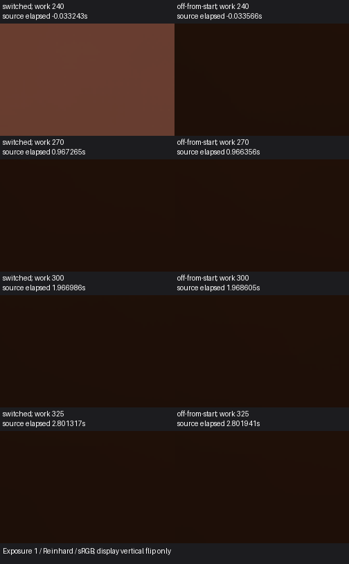

# 普通 Player 按 L 关解析灯的地板对照

Release213 的统一示例用公开 `SetLightsEnabled(false)` 执行 L 键动作。切换程在下一渲染源帧将场景启用解析灯及实际 DXR 入选灯从 5 降到 0。关灯对照在首个相机提交前走同一入口。两程的发光板均保持启用，发光 RGB 保持 `(5, 3, 1.5)`，关灯对照的地板间接光均值 Y 为 0.006638。

**画质判定为 `insufficient-control`。** 关灯对照亮度极差为均值的 3.074%，在原 5% 门槛内。色向相对首个控制帧的最大 L1 漂移为 0.03155，超过原 0.025 稳定门槛。开灯基线两项分别为 1.387% 和 0.00485，30 个预切换配对都有可分辨的正亮度增量。期限与保持读数可作为描述性结果，L 键的定量恢复验收保持开放。

| 切换程源时刻 | 相对同工作帧关灯对照的平均 Y | 色向 L1 | 旧灯正亮度增量估计 |
| --- | ---: | ---: | ---: |
| 首个关灯源帧，+0.000302 秒 | +0.938% | 0.00203 | 0.0975% |
| 1 秒前，+0.967265 秒 | −1.370% | 0.00042 | 0% |
| 2 秒前，+1.966986 秒 | −1.447% | 0.00475 | 0% |
| +1.966986 至 +2.500623 秒保持窗 | 绝对差最大 1.449% | 最大 0.00492 | — |

旧灯估计取切换程与匹配关灯程的正 Y 差，除以事件前的平均配对增量 0.064456。两个期限附近的差为负，所以正增量记为 0%。这是有限输出差，解析灯的物理残留量仍受对照波动约束。数值从首个关灯源帧到 +2.801317 秒均落在 ±10% 亮度和 0.05 色向范围内。源时刻以关灯调用为起点，在每次相机开始回调时读钟，GPU 完成和显示时间另计。

左列为切换程，右列为从起始关闭解析灯的对照。两处期限裁剪未见可辨的额外亮斑。裁剪内保留所有点，读回均有限，RGB 无全零点。以曝光 1、Reinhard 和 sRGB 显示，数值使用线性 HDR。输出为间接出射贡献，结论限固定地板区域。

两程来自 `8fe0d766b273b76357f1902f6c5570265cded920` 的同一 Win64 观察构建，使用保存的统一三室场景与普通相机渲染。960×540、半分辨率 GI、2 射线、4 级滤波，目标 30FPS。相机位置为 `(−2.85, 0.75, −1.75)`，俯角 85°，分析事前固定的中央 84×54 地板裁剪。两程实际约 29.98Hz，最大源间隔小于 36ms，完整细节和 120 张就绪图卡贯穿工作帧 211–325。两程的同工作帧相对源时刻相差最多 2.372ms。首次观察沿用了 90° 探针姿态，与普通导航的 85° 上限冲突，在取得样本前退出。完成的两程使用修正后的同一姿态。

本项补齐普通 Player 的 L 键实际灯表与保留发光面的直接观察。关灯期限验收、其他接收域、运动画质及完整 G3 仍开放。 [逐帧配对结果](result.json) · [本机线性读回和退出记录](<I:/Unity test/Comparison/OrdinaryLightsOff257>) · [L 键入口](../../../Runtime/HybridLumenGIUnifiedSampleInteraction.cs)
