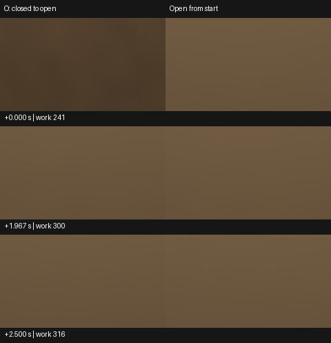

# 普通 Player 开门后的地板照明恢复

Release218 同源的普通 Win64 Player 在固定两室场景中，开门后约 **0.634 秒**进入原亮度和色向容差，并保持到 **2.800 秒**的观察末端。2 秒前最后一个渲染源帧比从首帧开门的匹配控制低 **3.82%**，平均色向 L1 为 **0.00160**。从该帧到 +2.500084 秒的连续保持窗符合亮度 ±10% 和色向 L1≤0.05。此项关闭原 G3 的普通两室固定开门恢复子项。[逐源配对结果](result.json)

| 事件程源时刻 | 工作帧 | 线性出射 Y | 相对开门控制 Y | 平均色向 L1 |
| --- | --- | --- | --- | --- |
| 首个开门源帧，+0.000113 秒 | 241 | 0.053905 | −53.154% | 0.002938 |
| 连续恢复起点，+0.633960 秒 | 260 | 0.103789 | −9.788% | 0.001648 |
| 2 秒前，+1.966880 秒 | 300 | 0.110493 | −3.816% | 0.001597 |
| 保持窗末，+2.500084 秒 | 316 | 0.111293 | −3.002% | 0.001555 |
| 末源，+2.800074 秒 | 325 | 0.111574 | −2.798% | 0.001565 |

左列为闭门转开，右列为匹配的开门控制。两列使用曝光 1、Reinhard 与 sRGB，数值使用线性 HDR。首帧照明达到终态同源读数的 46.85%，仍可见整体偏暗。2 秒前最后一帧的最大单像素亮度差为控制区域均值的 4.18%，保持窗末为 3.34%。两处同曝光地板均未见局部残缺或新结构差。控制均值为 0.115034，亮度极差占 0.6904%，平均色向最大漂移 0.000330，满足事前 5% 与 0.025 资格。

使用产品提交 `d9277f79c3baa82ee3e4668eb45dde0e308f66e0` 的公开工程 ZIP，独立解压后仅加入普通 Player 观察组件。Unity 6000.0.85f1、URP 17.0.4、RTX 2080 Ti、实际 DXR，960×540／GI480×270、2 射线、4 级滤波，保持保存工程已启用的对象身份历史。两程都沿普通 F3 入口进入未转折的两室，解析灯表始终为空，暖色发光板保持 RGB `(5, 3, 1.5)`。固定相机使用 138 的前室机位 `(0, 1.3, −5.55)` 和中央 240×135 区域，俯角保持普通导航允许的 85°。工作帧 240 后调用 O 键对应的 `SetPortalOpen(true)`。门 X 从 0 到 2.2，首个响应源帧已经发布该姿态。

每程覆盖连续工作帧 211–325。两程均为 29 个 DXR 网格、0 网格回退和 174 张就绪图卡。区域全窗读回有限，合成输出的 alpha 最小值为 1，开门后无全零 RGB 点。两程源节奏均约 30 次／秒，最大源间隔 35.10 ms。同工作帧相对事件源时刻最多相差 1.762 ms。时间取公开动作调用和相机源帧开始，实际显示呈交另行验收。

首次控制在工作帧 211 的首次读回前退出。观察器误按关闭对象身份历史的缓冲计账判断，保存工程实际开启。保留空样本和退出码 1 后，仅修正观察门到实际 32,140,800 B。随后同一观察构建完成两程并正常退出。公开 Release218、产品代码和作者场景沿用原版。

结论适用于固定前室地板的 `IndirectOnly` 漫反射出射贡献，相对于同配置的匹配终态。独立物理颜色误差、可见门轮廓拖影、其他光路、性能与完整 G3 继续验收。[原关门结果](../portal-recovery-138/result.md) · [本机原始读回与退出收据](<I:/Unity test/Comparison/OrdinaryPortalOpen266>)
