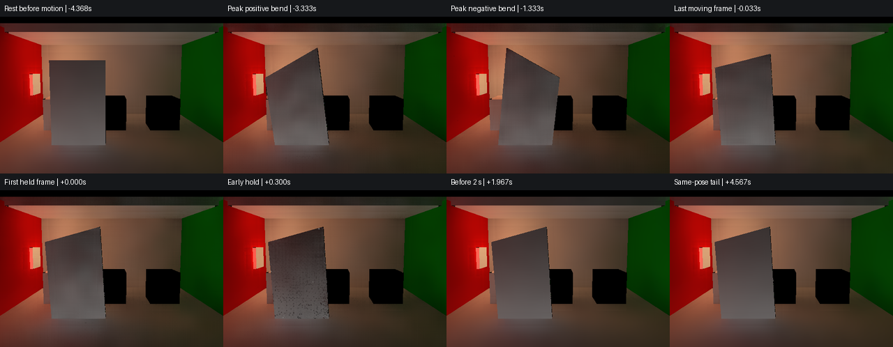

# Release250 两骨门的连续形变与停稳

原计划 T3／G3 的普通 Player 画面对照。用 Release250 工程构建普通 Win64 Player，仅加入本机观察组件。沿用统一示例默认近景、五盏解析灯和已有发光面，通过 K／Space 使用的同一公开接口启动两骨蒙皮、开始形变和停稳。画面采用 F5 仅间接光视图和线性 HDR 目标，保存原 960×540 机位的固定裁剪，预览使用相同曝光。[Release250 同源交付](../card-parallax-312/delivery.json)

Unity 6000.0.85f1／URP 17.0.4，RTX 2080 Ti／DX12，GI 480×270、2 射线、4 级滤波，时间反馈关闭。第 71–340 源帧均记录 DXR、完整近景细节和五盏解析灯。实际源节奏约 29.995 Hz，最大间隔 35.669 ms。两骨 24 顶点门运动 4.334 秒，经过约 −20° 和 +20°，在 +10.018° 停稳并保持 4.600 秒。Player 正常退出。

| 预先确定的固定地板采样 | 实测结果 |
| --- | --- |
| 停后 4–4.6 秒同姿态参考尾段 | 亮度波动范围 2.010%，色向 L1 最大 0.00302，符合稳定条件 |
| 首个持续合格的观察时刻 | 停后 **1.334 秒**，亮度偏差和色向进入 ±10%／L1 ≤0.05，并保持到 4.600 秒观察结束 |
| 2 秒前最后一个源帧 | +1.967 秒，亮度相对尾段低 0.643%，色向 L1 为 0.00664 |

固定地板采样为底部起算的源像素 x=393–448、y=112–139。参考来自同一次采集的稳定尾段，恢复数字描述该地板区域相对同姿态产品输出的变化。[原画质判据](../../../Documentation/QualityAcceptance.md)

主线程和独立图审在所示运动及停稳时点未见持续可辨认的第二道门形或明显几何错位。门面中下部在停后约 **0.167 秒和 0.300 秒**有短暂暗颗粒，随后减弱。两次峰值分别出现在第 207 和 211 源帧，分列 CPU 最新快照更新的第 208 帧前后。仅凭画面和 CPU 记录仍无法确定颗粒成因。本轮采用限该固定路线的可见动停对照和地板局部恢复，逐帧弱拖尾、原生显示帧率、GPU 首次消费延迟和完整 G3 继续各自验收。完整源帧、线性裁剪和退出回执保存在本机 `I:/Unity test/Comparison/OrdinarySkinMotion313`。
