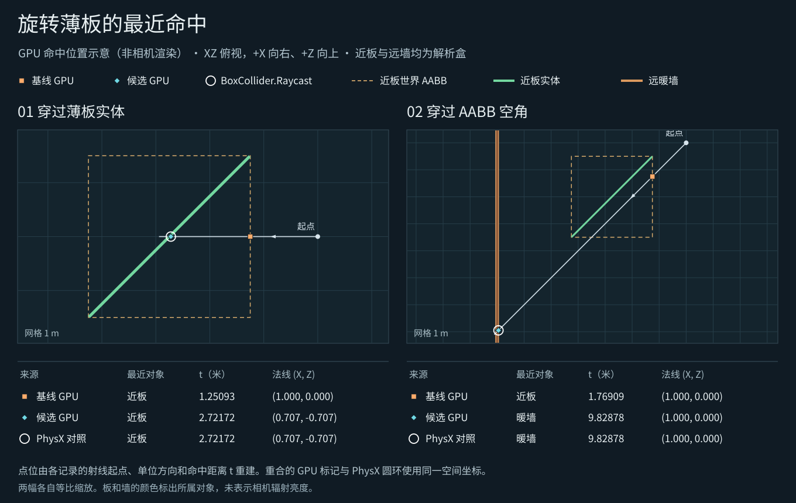

# 旋转遮板的实体与空角

一块厚 0.04、宽 4.2 个世界单位的绿色遮板绕 Y 轴转了 45°。两条射线都进入它的世界包围盒。沿板身方向穿过空角的射线与实体平行，应该继续到达后方的暖色墙。Release114 在空角报告近板命中，Release115 到达后墙。独立期望来自同一姿态下 Unity 对两个 BoxCollider 的最近碰撞查询。

| 光路 | Release114 GPU 最近命中 | Release115 GPU 最近命中 | Unity Collider.Raycast |
| --- | --- | --- | --- |
| 穿过板身 | 近板，1.25093 | 近板，2.72172 | 近板，2.72172 |
| 穿过包围盒空角 | 近板，1.76909 | 后墙，9.82878 | 后墙，9.82878 |

距离以世界单位计。板身命中处的世界法线从沿 +X 改为约 (0.7071, 0, −0.7071)，与碰撞查询一致。空角路径的最近数据行也从近板的绿色发光切换为后墙的暖色发光。[Release114 原生读回](baseline.json) · [Release115 原生读回](candidate.json)

**适用范围**　Unity 6000.0.85f1、Windows D3D12、RTX 2080 Ti。两件对象均只有 BoxCollider 和 GI Proxy，无 Renderer、图卡或网格 SDF。实际产品场景 BVH 和解析求交在 GPU 上运行。图按每条射线的起点、单位方向和读回距离绘制，表示命中位置。此次没有测接收面的反弹亮度、DXR 三角命中或运动拖影。

Box 解析代理在无 Renderer、碰撞体启用且自身轴与有效变换可对应时使用其定向表面。带 Renderer 的回退、剪切或退化变换仍使用原有世界包围盒。全局距离场合并也读取同一轴系，此次直接观察覆盖最终求交。普通三室示例使用原可渲染滑门。
