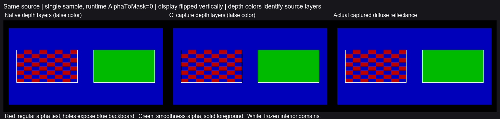

# 普通 Player 的 alpha／smoothness-alpha 联合轮廓

**原 Validation 这组联合裁剪的限定 Player 合同已取得通过依据。** 原生 URP 中，普通分支呈 checker 孔洞，smoothness-alpha 分支保持全实；GI 捕获在固定域内与原生深度逐像素一致，前景／后板材质来源也正确。Astra Max 与独立只读审阅均同意采用收束，没有产品修复或公开新版本。

前两图将实际深度所对应的源层设为红／绿前景、蓝后板，**是深度假色图，不是原生照明画面**；第三图为实际捕获漫反射率。白框是事前固定域。展示垂直翻转、Reinhard+sRGB；数值使用原始回读，不按图像颜色选点。

## 关闭的原条款及独立判断

51已有实际HLSL联合逻辑，124已有regular cutout同帧覆盖，130已有其他workflow Player结果；它们不能互相替代本次改变轮廓的语义。安装的 URP17.0.4 `SurfaceInput.hlsl::Alpha` 在普通分支使用 BaseMap.a*BaseColor.a，在 SMOOTHNESS_TEXTURE_ALBEDO_CHANNEL_A 分支只用 BaseColor.a，然后裁剪。因此同一checker、BaseAlpha=.75、cutoff=.5时，普通输入应半数裁空，smoothness输入应全实。

这次先按固定源几何、UV和checker像素独立判定原生结果，然后分别核对GI重绘；没有仅凭两份深度彼此相等就通过，也没有把两侧共同漏绘当正确。

## 实际输入与结果

2026-11-04，Unity6000.0.85f1／URP17.0.4、RTX2080Ti／DX12，专项普通 Win64／Mono／Release／None Player。沿用122质量2ray／filter4／半GI，960×540、正交、单采样、普通Forward Base，无后处理／动态分辨率。两个正面Quad位于z=0、蓝后板位于z=1，普通Lit、M=0、AO1、Cull Back；RGB分别纯红、纯绿、纯蓝。

两个front共享8×8 linear RGBA32、Point／Clamp／无mip checker，RGB白、alpha为0或255。两者均AlphaClip1／ALPHATEST_ON，BaseAlpha=.75；regular的smoothness channel0／keyword关闭，另一面channel1／keyword开启。运行时材质副本仅将AlphaToMask改为0，维持124单采样范围；源作者导入可保持flag1，未修改作者资产，也不据本次放宽A2C支持。

原始full域固定为regular x=77..432、smoothness x=527..882，均y=175..364，包含内部alpha边界。实际camera矩阵与原生深度反投影到源Quad，独立UV奇偶给出checker预期；没有按输出或有效性改选。

| 固定域 | 原生实际来源 | 独立预期 | Native／capture深度最大差 | 未知材质点 |
| --- | --- | --- | ---: | ---: |
| regular | 33,820前景、33,820后板 | checker孔洞，逐点吻合 | 0 | 0 |
| smoothness-alpha | 67,640前景、0后板 | 全实，逐点吻合 | 0 | 0 |

原生和capture对独立z=0／1来源的最大世界位置误差均约1.49×10⁻⁵米，小于冻结.0025米。捕获材质和DiffuseReflectance显示的最大通道差约.00078438，符合独立.96倍红／绿／蓝及固定2/255存储容差。保留Alpha=.75不会额外把Opaque RGB乘.75；该显示仅用于来源判读，不作为新的照明误差参考。

source0／engine3／work0对齐，Capture完整排空，Final完成；普通Build0错误／23警告、Player退出0，准备工程恢复。构建沿用开发工程旧Resources，警告保留，不称零警告构建。没有失败重试或额外变体。

## G1 关卡增量判断

130／131补上此前明确提出的workflow及联合裁剪实际链路缺口。按Astra复核，**G1第6节基础合同在已有本机代表输入上取得有限通过依据**；白炉、黑／金属、色墙、烘焙合成和关断衰减继续按各自原来源复用，本轮不再顺次寻找关键字组合。

这不是完整G1当前全域放行。实质边界仍是拟声明支持域的静态颜色／能量准确性：93只证明其原版本、区域和参考网格，材质传递和恢复曲线不能替代物理颜色参考。同时，部分原300帧、Editor／Player双端记录及指定输出形式尚未完整执行；保留这些协议状态，不能直接判产品缺陷或自动补跑。未覆盖A2C、Replace等也不反过来否定本次限定通过。

## 适用边界与交付

仅限stock Lit、Point／无mip、单采样、runtime AlphaToMask0及本次两个输入的普通Player覆盖。未推广到身份历史、射线遍历、A2C／MSAA、Replace、任意材质／平台或全部G1。域内未知材质为零不等于全帧filteredD没有未知。

[原始判断](analysis.json)及[data-and-source.zip](data-and-source.zip)包含实际源输入／纹理／keyword、同帧原生与capture平面、执行入口、冻结合同和解释器、构建与退出记录；包内README给出离线重放。原数据 `I:/Unity test/Comparison/AlphaSmoothness131`，准备与日志为同级 `AlphaSmoothness131Setup`，专项Player为 `I:/Unity test/Comparison/Builds/AlphaSmoothness131`。本项结束，不改Runtime、重建公开122或展开其他关键字排列。
