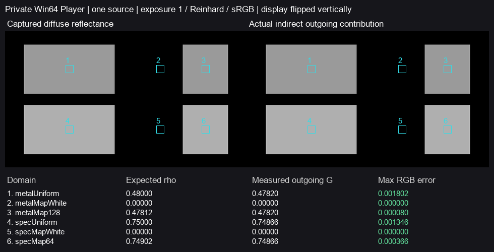

# 普通 Player 的 metallic／specular 材质工作流

**原计划材质网格的这组 Player 捕获／合成合同已取得通过依据。** 普通 Lit 的标量／贴图选择、metallic／specular 工作流和非零漫反射能量均按冻结输入传到实际出射；白贴图区域确为有覆盖的已知零，没有把漏绘或 unknown 当黑。Astra Max 与独立只读审阅同意按该范围采用并结束，没有产品源码改动，公开 Release122 保持。

图左是实际捕获的漫反射率，右是同一源帧普通 Feature 的 IndirectOnly 出射。曝光1、Reinhard+sRGB；仅展示垂直翻转，数值按原始回读行序取样。蓝框为固定内部域。两张近似相同符合单位环境 D=1 的解析关系；图黑本身不作为零值资格。

## G1 增量复核结论

G1 **仍未整体放行**。白炉、黑／全金属、有限色墙参考、环境／烘焙合成和封闭室关灯衰减已有各自来源，直接复用；不能将不同版本的有限域拼成当前全部承诺输入通过。本次只补原 Validation 已列的 slider／map 和两种 workflow：此前51／52证明实际 HLSL 固定函数算术，V209证明全金属端点，未直接给出这个非零材质网格的构建后普通相机链路。

原承诺材质输入的组合适用范围尚未完整闭合，例如 alpha／smoothness-alpha 联合合同仍只有函数级联合结果。它保留为 G1 剩余要求，不因为本次通过就自动追加下一个材质行，也不把 G3 全部动态质量或 G4 全部规模验收增加为 G1 前置。

## 固定输入与独立参考

2026-11-04，Unity6000.0.85f1／URP17.0.4、RTX2080Ti／DX12，专项 Win64／Mono／Release／None Player。Editor只准备和构建，没有另一次Play。沿用122产品与管线质量：960×540、半GI、2射线／4级滤波；仅设置 GI 常量单位环境、intensity1、IndirectOnly。原生环境／SH／反射／烘焙／灯／发光全部为零，空世界无Proxy，实际为软件逃逸路径，未执行世界材质命中或DXR材质比较。

独立规则来自安装的 URP17.0.4 `LitInput.hlsl::SampleMetallicSpecGloss` 与 `BRDF.hlsl::InitializeBRDFData`。启用 map 时读取 map，替代 slider；白底时 metallic 的 rho=.96*(1-M)，specular 的 rho=1-max(S.rgb)。单位环境的半球积分 D=E/pi=1，因此出射参考直接由源输入的 rho 给出，**没有使用捕获 rho 反推参考**。

四个普通 Lit 面均为白底、不透明、Cull Back、AO1，Metallic=.5；两张8×8 linear RGBA32 map均为Point／Clamp／无mip，左半白、右半分别RGB128和RGB64。specUniform 用 Renderer MPB向量明确设置shader-space SpecColor=(.25,.25,.25)，不证明任意作者颜色转换。六域每域固定16×16个GI中心；实际矩阵和原生／捕获深度确认各域位于正确平面及对应纹理半区，未按结果改选。

## 实际结果

| 固定域 | 独立 rho／出射各通道 | 实际出射均值，约 | 最大通道绝对差 |
| --- | ---: | ---: | ---: |
| metallic uniform .5 | .48000 | .47820 | .00180224 |
| metallic map white | 0 | 0 | 0 |
| metallic map128 | .47812 | .47820 | .00008011 |
| specular uniform MPB .25 | .75000 | .74866 | .00134611 |
| specular map white | 0 | 0 | 0 |
| specular map64 | .74902 | .74866 | .00036573 |

RGB三通道相等。非零域实际材质捕获对独立rho的最大通道差约.001569，小于固定1/255；实际出射对独立参考均小于固定2/255。实际 filteredD 各域均约.99951，所有采样域无 unknown；非零域满足单位D资格。白map域的实际捕获rho和出射精确为零，同时原生／捕获深度、已知材质和AO资格成立；没有因合法零rho短路而额外要求无须消费的D必须为1。全图合成前原生RGB为零。

部分独立输入值经R8材质存储后会落到同一数值，例如.48和.47812；不能据此宣称二者无限精度相等，也不将相近值之间的差异单独归因于某一步。报告均值取约五位小数；本项不是新一轮严格误差证明。

构建记录为0错误、23警告，含既有弃用API、Composite提示和开发工程旧ComparisonHarness资源的着色器警告；不称无警告构建。实际使用的变体已由该Player的材质／出射结果覆盖，运行期错误列表为空。唯一源帧engine3／work0，同源Capture及Final回读全部完成，Player退出0，准备工程恢复。没有失败重试、额外种子、延长观察或新参数候选。

## 采用范围与交付

关闭的是这次固定四面、六域、实际构建后普通相机捕获／合成的 workflow 合同及所用变体资格。它不关闭世界hit、DXR材质、法线、smoothness-alpha、Cull、任意ShaderGraph／作者颜色、其他平台、动态或性能验收。原协议的其余条款继续保留，G1和完整G0–G5未整体通过。

[逐域指标](analysis.json)与[data-and-source.zip](data-and-source.zip)包含原始实际输入、同源平面、Final、执行入口、冻结合同／解释器与构建／退出记录。包内README给出离线重放；没有打包新的公开演示。原始数据在 `I:/Unity test/Comparison/MaterialWorkflow130`，准备与日志在同级 `MaterialWorkflow130Setup`，专项本机Player在 `I:/Unity test/Comparison/Builds/MaterialWorkflow130`。本项按Astra复核结束，无需改Runtime、重建公开122或追加其他材质行。
