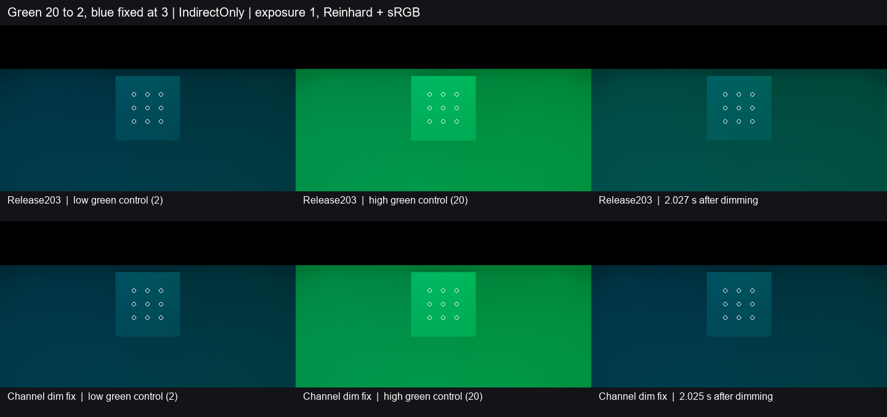

# 第二盏灯保持点亮时的间接光恢复

Release203 在灯表有两条时跳过调暗修正。固定蓝灯和调暗的绿灯照亮同一灰墙房间，旧缓存仍让接收面明显偏绿。修复按通道比较上一次成功录制与当前准备的灯表。同一缓存代次内，灯数及同槽点光的传输和投影策略须一致，且该通道非零的所有光源都须按同一正比例降低。世界更新按比例调整合格通道的旧解析光份额。蓝通道以及发光、环境份额沿用原更新路径。[灯表与比例](../../../Runtime/HybridLumenGIRendererFeature.cs) · [缓存读写](../../../Runtime/Resources/HybridLumenGI/HybridLumenGITransport.hlsl)

上排为 Release203，下排为修复版。蓝点光一直保持强度 3。三列为低亮控制末帧、高亮控制末帧和 2 秒后的首帧。白圈标出固定九点。图像统一用曝光 1、Reinhard 和 sRGB。下表取线性 `IndirectOnly` 出射贡献。[Release203 读数](baseline.json) · [修复版读数](fixed.json)

| 观测点 | Release203 | 修复版 | 原目标 |
| --- | ---: | ---: | ---: |
| 1 秒前最后一帧旧绿增量 | 12.6747%（0.971 s） | **0.2262%**（0.971 s） | ≤5% |
| 2 秒前最后一帧旧绿增量 | 6.2345%（1.992 s） | **0.1191%**（1.990 s） | ≤1% |
| 2 秒前最后一帧的绿通道低亮偏差 | +55.4777% | **+1.0600%** | ±10% |
| 同一帧的总亮度偏差与色向 L1 | +48.7715%／0.20832 | **+1.1937%／0.00507** | ±10%／≤0.05 |
| 响应窗口内的最大蓝通道低亮偏差 | 2.3945% | **2.2795%** | ≤10% |

旧绿增量相对高、低绿控制的均值差归一。两程的低亮控制线性绿均值均约 0.08005、蓝均值约 0.11400，控制稳定性合格。修复版在 **0.2533–0.7673 秒**形成首个合格保持窗口，2 秒前最后一帧至末帧均在恢复范围内。九点的时域存储有效，末帧另确认了过滤结果的有效性。

两程从 Release203 的同一可编辑 ZIP 独立解压。修复版仅覆盖所列的 C# 与 HLSL。复用单灯对照的七网格封闭灰墙房间、正交相机和固定接收点，另加一盏不同位置的纯蓝点光。Unity 6000.0.85f1、RTX 2080 Ti、D3D12 Editor Play、实际 DXR，960×540／半分辨率 GI、2 射线和 4 级滤波。两条实际 GPU 灯记录在低亮、高亮、首降和末帧分别核对。绿色由 2 升至 20，再降回 2。末端约为源事件后 2.60 秒。

本次关闭固定双点光下，调暗绿光时的旧色残留与低亮恢复缺口。共用同一通道但变化倍率不同、升亮和普通 Player 的动态画质继续按原条件验收。
