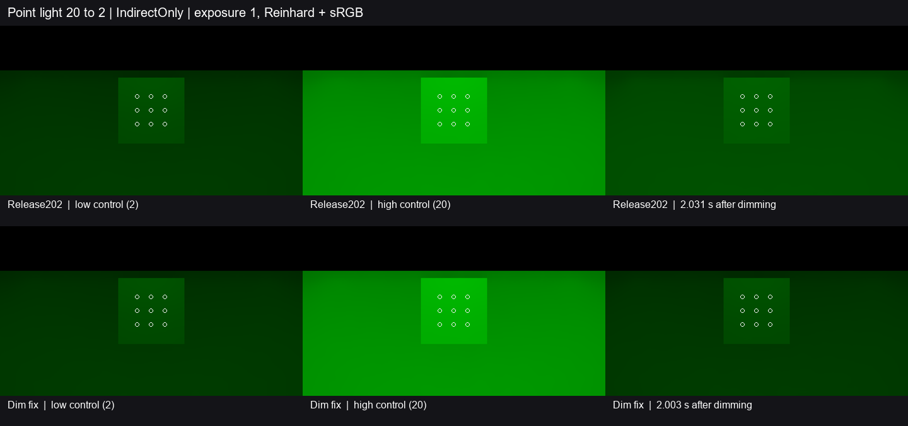

# 唯一点光调暗后的间接光恢复

Release202 的固定点光从 20 降至 2 后，封闭灰墙房间仍被此前的高亮间接光照亮。修复根据连续录制的灯表识别同一缓存代次内、传输条件相同的唯一无烘焙通道点光正比例调暗。世界缓存更新按该比例调整保留的解析光份额，发光面与环境沿用各自的估计。此帧聚合读取调整后的缓存。[灯表与比例](../../../Runtime/HybridLumenGIRendererFeature.cs) · [世界缓存传输](../../../Runtime/Resources/HybridLumenGI/HybridLumenGITransport.hlsl)

上排为 Release202，下排为修复版。三列为低亮控制末帧、高亮控制末帧和 2 秒后的首帧。白圈标出九个固定接收点。所有图像用曝光 1、Reinhard 和 sRGB，读数取线性 `IndirectOnly` 出射贡献。[Release202 读数](baseline.json) · [修复版读数](fixed.json)

| 观测点 | Release202 | 修复版 | 原门槛 |
| --- | ---: | ---: | ---: |
| 1 秒前最后一帧的旧亮增量 | 12.6685%（0.975 s） | **0.2253%**（0.977 s） | ≤5% |
| 2 秒前最后一帧的旧亮增量 | 6.2285%（1.998 s） | **0.1192%**（1.969 s） | ≤1% |
| 2 秒前最后一帧相对低亮控制的偏差 | +55.445% | **+1.061%** | ±10% |
| 末帧相对低亮控制的偏差 | +37.794%（2.611 s） | **+1.214%**（2.616 s） | ±10% |

旧亮增量相对高低控制之差归一。两程低亮和高亮的线性均值分别为 0.05723962 和 0.56677948，控制满足预定稳定性。修复版在 **0.2595–0.7716 秒**形成首个满足低亮偏差与色向门槛的持续窗口，随后保持到观测结束。色向 L1 在两程均为 0，灯全程为绿色。九点的时域存储有效，末帧另确认了过滤结果的有效性。

两程从同一 Release202 可编辑工程解压，修复版仅覆盖所列产品源码。Unity 6000.0.85f1、RTX 2080 Ti、D3D12 Editor Play、实际 DXR，960×540／半分辨率 GI，2 射线与 4 级滤波。实际上传的灯表依次为 `(0,2,0)`、`(0,20,0)`、`(0,2,0)`，低亮与高亮控制各取 16 帧。约 29.25 Hz 的显式渲染请求用于计算源时间。

本次关闭固定单点光正比例调暗后的旧亮残留与低亮恢复缺口。多灯、升亮、同时移动或更换照明策略以及普通 Player 动态画质继续按原计划验收。
