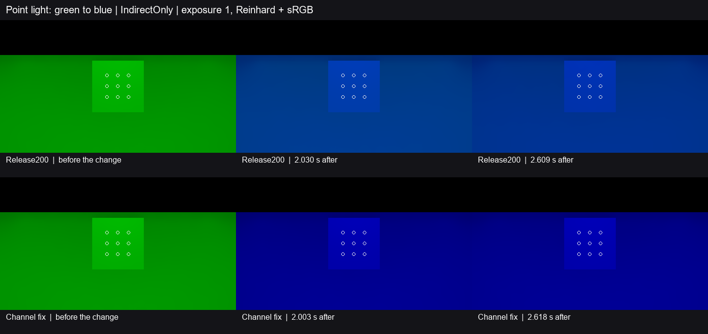

# 点光从绿变蓝后的旧色消退

Release200 的唯一点光换色后，封闭房间的固定灰色接收面仍保留明显旧绿。灯表维持一条，原缓存只在灯表清空时剔除解析光。修复按实际灯表逐通道判断。当某通道的所有解析源分量均为零，世界缓存的读取和写回沿用该通道独立累积的发光与环境分量，阻止旧解析光继续参与反弹。[相机灯表绑定](../../../Runtime/HybridLumenGIRendererFeature.cs) · [缓存读写](../../../Runtime/Resources/HybridLumenGI/HybridLumenGITransport.hlsl)

上排为 Release200，下排为修复版。两排显示换色前、2 秒后首帧和末帧。旧版在换色后仍偏青。固定九点的读数使用线性 `IndirectOnly` 出射贡献，归一到各次换色前的旧绿均值。图像统一用曝光 1、Reinhard 和 sRGB。[Release200 逐源读数](baseline.json) · [修复版逐源读数](fixed.json)

| 观测点 | Release200 旧绿均值 | 修复版旧绿均值 | 原残留目标 |
| --- | ---: | ---: | ---: |
| 1 秒前最后一帧 | 11.8402%（0.976 s） | **0.04603%**（0.979 s） | ≤5% |
| 2 秒前最后一帧 | 6.0233%（1.996 s） | **0.004056%**（1.969 s） | ≤1% |
| 末帧 | 4.0605%（2.609 s） | **0.000807%**（2.618 s） | 保持 ≤1% |

修复版首次满足 ≤1% 的连续观测窗口为 **0.05530–0.57102 秒**，其后保持到 2.61790 秒。新蓝末帧线性均值为 0.773475，Release200 为 0.774346。两程末帧的过滤结果九点均有效，时域读数也无未知点。完整的新颜色收敛时间仍需匹配的蓝光参考。

两程分别从 Release200 的可编辑 ZIP 解压，修复版只覆盖报告所列的两份产品源码。复用已保存的七网格封闭灰墙房间、正交相机及九点，使用 Unity 6000.0.85f1、RTX 2080 Ti、D3D12 Editor Play、实际 DXR、960×540／半分辨率 GI、2 射线与 4 级滤波。唯一点光在工作帧 119 后从 `(0,20,0)` 切到 `(0,0,20)`，强度、范围及位置固定。换色前、首个换色帧和末帧均读取了实际 GPU 灯表。无发光、环境或烘焙绿色来源，末端原生画面只含蓝色。两程源间隔均不超过 35.66 ms，正常退出并恢复工程。

Astra Max 同意关闭 G3 的这一固定点光换色残留缺口。结论适用于旧色通道已失去全部解析来源的这个光路。仍有同色解析源的换色、任意场景收敛及普通 Player 动态画质继续按原计划验收。
