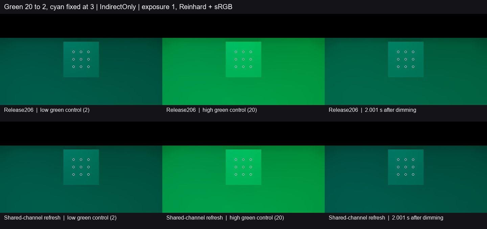

# 双点光共用绿色通道时的调暗恢复

Release206 的固定绿灯从 20 降至 2 时，同一通道还接收固定青灯的绿光。不同降幅无法用统一比例调整旧缓存，旧解析光继续参与递归反弹。修复将受影响的解析通道标为待替换。预算延后或当前样本未知时，画面可继续使用旧值。世界迭代改用当前光路重建受影响通道，可信估计完成后替换旧解析份额。发光、环境份额与其他通道沿用现有估计。

青灯在另一位置持续以强度 3 点亮。三列依次是低亮控制、高亮控制和 2 秒后的首帧。画面统一曝光 1、Reinhard 和 sRGB。下表采用固定九点的线性间接漫反射出射贡献，旧绿增量相对高低控制之差归一。负值表示实际绿均值略低于两灯共同形成的低亮控制。

| 指标 | Release206 | 修复版 | 采用门槛 |
| --- | ---: | ---: | ---: |
| 1 秒前最后一帧的旧绿增量 | 12.985%（0.977 s） | **−0.848%**（0.973 s） | ≤5% |
| 2 秒前最后一帧的旧绿增量 | 6.636%（1.966 s） | **−0.520%**（1.967 s） | ≤1% |
| 2 秒前同一帧的绿均值偏差 | +24.381% | **−1.910%** | ±10% |
| 2 秒前同一帧的亮度偏差与色向 L1 | +23.127%／0.08996 | **−1.697%／0.01783** | ±10%／≤0.05 |
| 响应期间蓝通道最大偏差 | 2.146% | **2.170%** | ≤10% |
| 响应期间绿均值相对低亮的最小偏差 | +16.414% | **−3.304%** | ≥−10% |

修复版在 **0.191–0.702 秒**形成首个合格恢复保持窗口，2 秒截止前已稳定在范围内，并保持至 2.615 秒末帧。九点的时域存储有效，末帧另确认实际过滤值有效。青灯的独立蓝通道检验稳定性，共用绿色另以两灯低亮控制检验。[基线读数](baseline.json) · [修复读数](fixed.json) · [采用条件](contract.md)

两程使用 Release206 同一可编辑工程，复用七网格灰墙房间、固定正交相机与九个接收点。Unity 6000.0.85f1、RTX 2080 Ti、DX12 Editor Play、实际 DXR、960×540／半分辨率 GI、2 射线和 4 级滤波。两程源节奏约 29.28 Hz。首次候选的低亮控制有 78.829 ms 源帧间隔，响应也有一处略超 66.667 ms，按原时钟门槛弃用。Astra Max 建议在首次证据不足时收束，建议送达时一次同条件复核已启动。复核使用相同源码和观察入口，复用候选的已编译着色器缓存，响应最大间隔 36.439 ms，原门槛通过。

本项关闭固定双点光共通道且一盏调暗时的残亮和恢复缺口。其他灯路、普通 Player 动态画质和完整 G3 继续按原条件验收。
