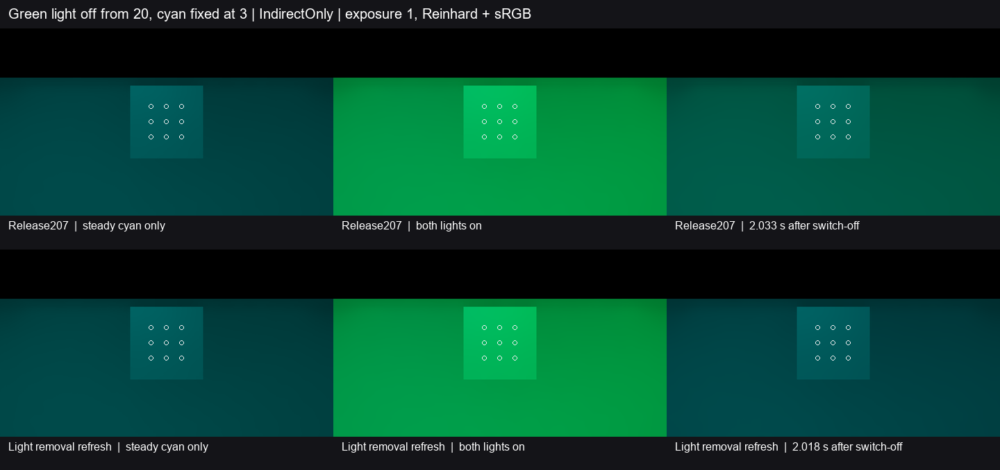

# 共用绿色通道时单独关灯的恢复

Release207 关掉固定绿灯后，有效灯表从两条减为一条。稳态青灯继续供应绿色，旧绿解析光因此沿原缓存继续参与递归反弹。修复比较当前灯表和上一次成功录制的完整灯表。确认其余灯的整条记录一致，且移除的是无烘焙通道的点灯后，继续有源的受影响通道进入已有的局部待替换流程。

固定青灯在另一位置全程以强度 3 点亮。三列依次是只剩青灯的控制、两灯点亮的控制和关灯 2 秒后首帧。画面统一曝光 1、Reinhard 和 sRGB。下表采用九个固定点的线性间接漫反射出射贡献。旧绿增量以两控制的绿差归一，负值表示读数略低于只剩青灯的终态。

| 指标 | Release207 | 修复版 | 采用门槛 |
| --- | ---: | ---: | ---: |
| 1 秒前最后一帧的旧绿增量 | 12.785%（0.974 s） | **−0.288%**（0.968 s） | ≤5% |
| 2 秒前最后一帧的旧绿增量 | 6.365%（1.999 s） | **−0.212%**（1.984 s） | ≤1% |
| 2 秒前同一帧的绿均值偏差 | +44.225% | **−1.473%** | ±10% |
| 2 秒前同一帧的亮度偏差与色向 L1 | +40.364%／0.17095 | **−1.171%／0.01644** | ±10%／≤0.05 |
| 响应期间蓝通道最大偏差 | 2.287% | **2.186%** | ≤10% |
| 响应期间绿均值相对终态的最小偏差 | +29.949% | **−2.451%** | ≥−10% |

修复版在 **0.262–0.767 秒**形成首个合格保持窗口，并保持至 2.631 秒末帧。两版低亮和高亮控制的九点均值一致。九点时域存储及末帧实际滤波均有效。实际 GPU 灯表确认选中数依次为 1、2、1、1，四个时点的青灯记录均为 (0, 3, 3)。[基线读数](baseline.json) · [修复读数](fixed.json) · [采用条件](contract.md)

两程从 Release207 的同一可编辑工程独立解压，候选只覆盖 C# 的灯表处理。复用七网格灰墙、固定正交相机与九个接收点。Unity 6000.0.85f1、RTX 2080 Ti、DX12 Editor Play、实际 DXR、960×540／半分辨率 GI、2 射线和 4 级滤波。源节奏分别约 29.29 和 29.49 Hz。

本次关闭固定双点灯共用颜色通道且单独关掉一盏时的残亮与终态恢复缺口。其他灯表变化、普通 Player 的动态画质和整体 G3 继续按原条件验收。
