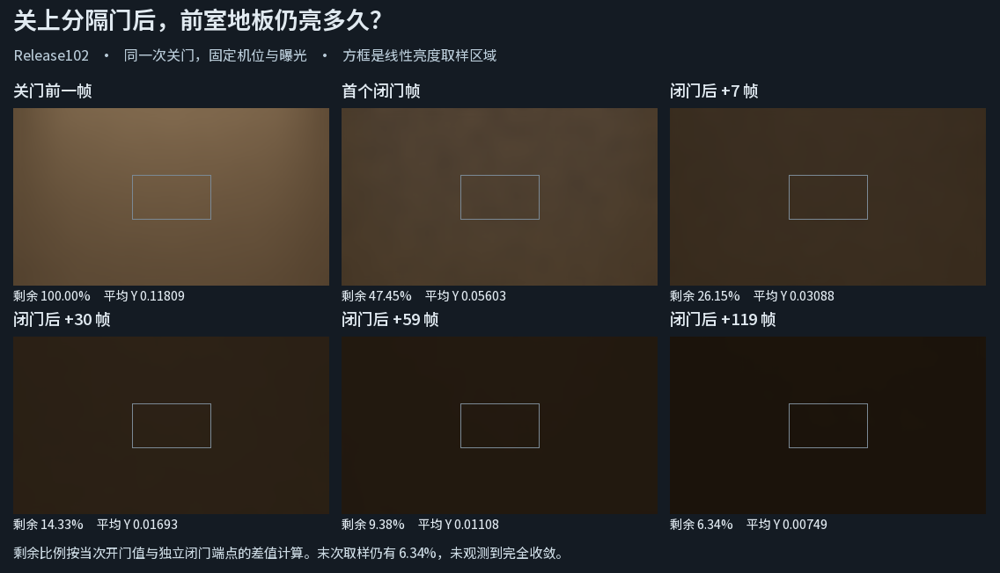

# 同一次关门后的暖光残留

在 Release102 的两室布局中，固定相机看前室白地板。先开门运行 120 帧，再调用普通 O 键使用的 `SetPortalOpen(false)`。逻辑帧 120 是第一个实际渲染的闭门帧，分隔门的 X 已由 2.2 变为 0。此帧还保留开闭亮度差的 **47.45%**。第 +30 帧为 **14.33%**，第 +59 帧为 **9.38%**，第 +119 帧仍有 **6.34%**。到最后一个取样点尚未回到独立运行的闭门端点。

| 相对首个闭门帧 | 本机记录的经过时间 | 中央区域平均线性亮度 Y | 剩余开闭差 |
| --- | ---: | ---: | ---: |
| 关门前一帧 | — | 0.118090 | 100.00% |
| 0 | 0.000 s | 0.056032 | 47.45% |
| +7 | 0.119 s | 0.030883 | 26.15% |
| +30 | 0.380 s | 0.016931 | 14.33% |
| +59 | 0.687 s | 0.011080 | 9.38% |
| +119 | 1.420 s | 0.007495 | 6.34% |

剩余比例为 (当前 Y − 静态闭门 Y) / (本次关门前 Y − 静态闭门 Y)。静态闭门 Y 为 0.00000530。首次观测到低于 10% 的点是 +59 帧；稀疏读数不能确定精确穿越时刻。秒数来自本次 Editor 发起相机渲染的墙钟时间，含采集开销。曝光、相机位姿与中央 160×90 像素区域固定。各取样点均确认零解析灯、实际 DXR、门的物理位置，以及接收地板、门、暖色发光板的当帧发布状态。[逐点线性 RGB、时间及状态](result.json) · [静态端点原始图](../connected-rooms-01/result.md)

普通 `IndirectOnly` 出射贡献，640×360，GI 半分辨率、2 条射线、4 级滤波、多跳反馈 1。240 个请求帧全部完成，采集错误为零。末点的暖光仍在衰减，不能由此确定存在永久漏光，也不能分摊世界缓存与屏幕历史各自的贡献。[分析入口](analyze.py) · [本机原始 HDR 和渲染记录](<I:/Unity test/Comparison/PortalCloseResponse01/run/>)

**候选处理。** 当静止接收面的缓存只收到邻近变化标记时，首次可信更新会将新估计与年龄为 1 的旧估计混合。在同一刚体的旧、新 AABB 分离且与缓存入射导引方向相交时，尝试让首次可信更新替换旧平均值。按相同输入复核后，六个时点的地板平均 RGB 与普通版本逐项相同，候选已撤回。这个对照未定位慢尾的主因，不能据此宣称残留已修复。[候选实测](candidate.json) · [已撤回的改动](displaced-guide-candidate.patch)
