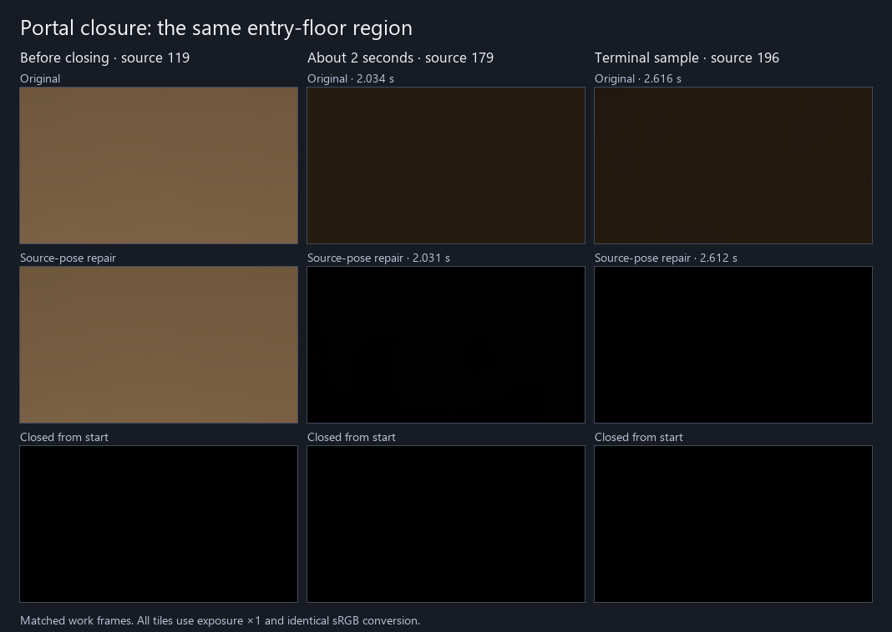
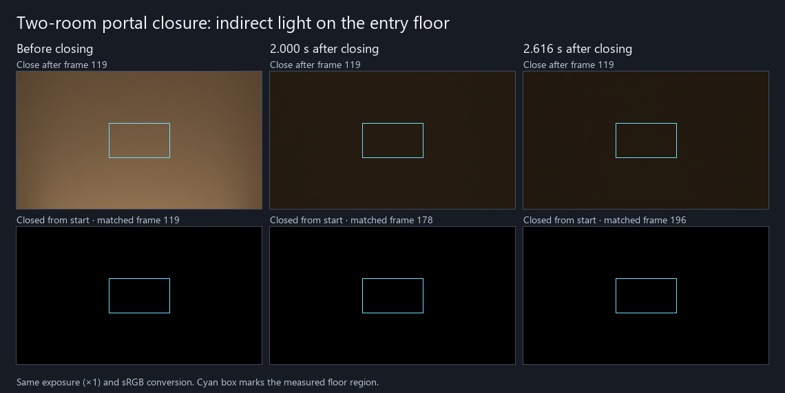

# 两室关门后的暖光恢复

**2026-11-08 已采用修复，关闭原 G3 的固定两室关门恢复子项。** 修复后，关门 0.967741 秒的地板残留为开闭亮度差的 **2.637%**，1.997346 秒为 **0.214%**。两个期限前最后记录及后续保持窗均符合原目标。首个 ≤1% 的连续保持窗为 1.373118–1.893918 秒，后续至 2.612143 秒维持目标，末点剩 **0.0455%**。

修复以同源网格范围识别不相交的纯姿态变更。已有保守影响域内的旧照明留给画面显示，并被排除在世界缓存下一轮的递归输入之外。缓存获得已知的新估计后替换旧平均，再参与递归。工程配置、实际帧源、配对工作帧与有效性均通过原合同，标记仅在首个闭门工作帧 120 触发。闭门控制沿用原静止场景，候选分支的姿态变化条件在该控制中不存在。关门前修复与原版的地板 Y 均值为 0.117720 和 0.118328。相同曝光下，两个后续时点地板均接近闭门对照。Astra 同意采用这次实际运行的 8 个源文件，结论限于该两室配置与地板域。[修复逐源读数](repair-result.json)

## Release122 原始结果

Unity Personal 授权恢复后完成两程实际观察。Release122 同源 Runtime 在这处固定地板上未满足关门后的 1 秒和 2 秒恢复目标。关门后 2.000132 秒，地板平均亮度仍比同工作帧的闭门控制高出切换前开闭差的 10.33%。到 2.616006 秒，仍剩 8.87%。本次观测窗内没有形成 1% 的合格保持窗口。

| 事件源时刻 | 工作帧 | 地板剩余开闭亮度差 | 区域最差点的绝对差 |
| --- | ---: | ---: | ---: |
| 1 秒前邻点 0.974979 s | 148 | 15.676% | 16.025% |
| 1 秒后邻点 1.008486 s | 149 | 15.334% | 15.661% |
| 2 秒前邻点 1.964961 s | 177 | 10.429% | 10.631% |
| 2 秒后邻点 2.000132 s | 178 | 10.334% | 10.522% |
| 末端 2.616006 s | 196 | 8.865% | 9.004% |

亮度为 `IndirectOnly` 线性出射贡献的 Y。两程工作帧 119 的地板均值分别为 0.11832759 和 0.00000228。以其差值 S 归一化各同工作帧的事件减控制差，避免以接近零的闭门亮度作分母。闭门控制的区域均值极差只占 S 的 0.00622%，低于事前 0.5% 的控制资格。1 秒目标为 5%，2 秒目标为 1%，并要求实际后续源保持至少 0.5 秒。表内为截止前后邻点，原始读数保留有符号差和全部像素。[逐源线性读数](result.json)

## 适用范围与当前定位

- 复用原两室 O 键动作、作者资产与观测设置，改用 960×540、480×270 GI、2 射线、4 级滤波。固定相机只看前室地板，解析灯关闭，场景原发光面保留。事件在工作帧 119 返回后关闭门，匹配控制从首帧闭门。响应窗两程约 29.31 和 29.33 源帧每秒，最大间隔分别 35.17 和 35.40 毫秒。用户告知并行运行游戏，本次实际源钟满足冻结的 2/30 秒上限。读数用于该事件恢复，应用帧率及 GPU 成本另有验收口径。
- 固定地板域有 32,400 个全分辨率点，独立的时域域有 8,160 格。初末深度和接收面核对合格，测量窗的存储时域及末端实际滤波 D 均无未知格。实际测量帧为 31 个 DXR mesh、31 个已发布实例，回退与未知材质为零。CPU 前后快照保留全部 32 个唯一路径，其中 31 个可查询，唯一不可查询的是未选中的流式聚合体。首个离线分析误将 CPU 总数要求为 31，保留失败收据后只更正计数口径，再用已有数据比较全部 32 个物理描述。可查询状态可包含预热，实际发布数以同期渲染诊断为准。
- 两程末帧的事件减控制差在时域 D 中为 0.02093563，滤波后 D 为 0.02089744，空间滤波只改变约 0.182%。合成前的原生画面在该域为零。同曝光图的暖光是整片地板残留。
- 两程已真实排空读回并正常恢复工程。原计划 G3 的这一固定场景从“2 秒未知”转为“已测未满足”。整体 G3 仍开放。旧 640×360 结果保留其原采集节奏和范围。[旧画面与读数](../portal-close-response-01/result.md)

本机原始数据在 `I:/Unity test/Comparison/PortalRecovery138Resumed/`。记录使用 Release122 同源 Runtime `7c08327`。

## 时域前的输入

按 Astra 审查，只在一次相同事件的 2.031 秒和 2.611 秒补读 Gather。两个点的当前 D 平均 Y 为 0.02128766 和 0.01889622，各占同源时域 D 的 90.33% 和 92.55%，8,160 格全部有效。相对归档同工作帧的闭门控制，Final 仍剩 10.03% 和 8.68%。暖光在进入时域之前已经存在，因此调屏幕历史权重无法独立解决这两个点的残留。现有数据未分摊递归照明的具体条目，也未读取闭门控制的 raw D。临时读回入口、源文件及工程设置已恢复。[两点读数](gather-result.json)

代码上，门的旧新位置与受光地板的边界分离，地板获得的是邻域变化标记。世界缓存的旧非解析辐射能在受影响的静止表面之间继续作为下一次递归输入。此机制成为本次候选的目标。旧按导引方向选点的候选仍保留原裁决。[旧候选结果](../portal-close-response-01/result.md)

## 遍历范围触发候选的裁决

候选的事件程完成并排空读回，编辑器退出码为 0，原安装源文件和工程设置已恢复。工作帧 120 的不相交姿态标记未触发，整程都没有触发源。本次候选因此按触发资格不足撤回，原图和 1 秒／2 秒未满足的判断继续有效。

具体错误出在候选选择的包围盒。门网格的 X 半宽为 1.09 米，位移 2.2 米，网格包围盒之间约有 0.02 米间隔。场景的 `GetTraversalBounds` 把网格范围和变换后的 SDF 局部范围合并。该 SDF 的 X 半宽为 0.5714286，乘原门 X 缩放 2.18 后约为 1.245714 米，使两端遍历范围仍重叠约 0.291429 米。用保守遍历范围判断实际几何跳变，漏掉了这次关门。该次记录不能判断隔离递归旧光是否有效。[候选实际收据](candidate-trigger-result.json)

## 先前入口与授权阻碍

- 首次 `PortalRecovery138` 在进入 Play 前由观察器准入检查停止。观察器误将运行时 31 个已发布对象当成作者场景全部 Proxy 组件数；原作者场景实际有 36 个组件。退出码 1，Editor 收据记录 `restored=true`；没有渲染或关门事件。
- Astra Max 同意只将作者组件计数更正为 36，保留实际 DXR／发布 31 个来源的要求，以及其他输入、时间和响应判据。前次失败保留，新输出为 `PortalRecovery138Corrected`。
- 更正后的启动在加载项目、执行 Editor 观察入口之前，由 Unity 授权检查退出，退出码 **198**。日志明确为 `No valid Unity Editor license found. Please activate your license.`。没有场景收据、渲染数据或匹配控制运行。启动器的恢复与临时观察资产归档已执行；没有产品代码改动。
- 当时官方 CLI 确认尚未登录且无激活许可证。首次浏览器登录超时。用户于 2026-11-08 完成登录后，CLI 确认现有许可证 `active=true`，原定实测得以恢复。

本机原始记录分别保留于 `I:/Unity test/Comparison/PortalRecovery138/`、`I:/Unity test/Comparison/PortalRecovery138Corrected/`；授权日志仅留本机，不将账号或机器标识发布到仓库。
