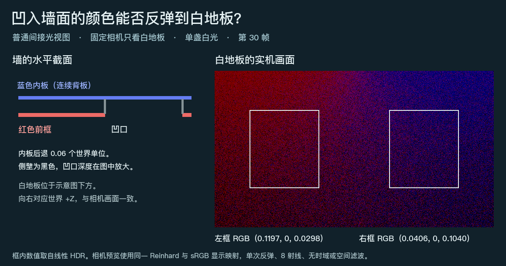

# 同一面墙的红色前框与蓝色凹面

**相机只看白地板时，视锥外的蓝色凹面仍能产生可辨认的反弹。** 靠红色前框一侧的地板以红光为主，靠凹口一侧以蓝光为主。墙的三个材质槽分别是纯红前框、纯蓝内板和黑色回边。内板比前框后退 0.06 个世界单位，并延伸到前框背后。墙体使用同一份网格和同一个 MeshRenderer。

| 白地板取样区 | 平均线性 R | 平均线性 G | 平均线性 B |
| --- | ---: | ---: | ---: |
| 左侧，靠红色前框 | 0.11972 | 0 | 0.02984 |
| 右侧，靠蓝色凹面 | 0.04056 | 0 | 0.10396 |

**怎样读图。** 两侧区域的位置沿用较早的离屏墙实验，每区 28,800 个像素。白地板可同时接收两块表面的光，因此两个区域都有红、蓝分量。图中读数取自普通相机 `IndirectOnly` 的线性出射 RGB，先于显示映射。[取样坐标、材质和逐帧设置](result.json) · [原始线性 EXR](frame-0030.exr)

**实测条件。** Release120 产品源码、Unity 6000.0.85f1、RTX 2080 Ti、D3D12。复用保存的离屏墙场景、俯视相机、白地板、白色方向灯以及原有画面采集入口。黑环境、无自发光；前框和内板是红、蓝漫反射的唯一有色来源。墙有 42 个三角形，正常烘焙出 6 张表面卡。第 30 帧报告两个带图卡的网格、7 张就绪卡、DXR、零硬件回退。640×360 满分辨率 GI、8 条射线，关闭屏幕追踪、递归反馈、时间累积与空间滤波。捕获完成所需 31 帧、零采集错误，原采集器保留短序列状态 `incomplete-probe`。

**范围。** 这一画面确认了该凹口上不同材质的实际反弹。网格使用单位缩放和常量材质；没有记录每条射线的材质槽或接缝两侧的图集纹素。纹理 UV 接缝、负或非均匀缩放后的采样误差，以及发行版默认滤波下的运动颗粒仍按各自证据判断。
