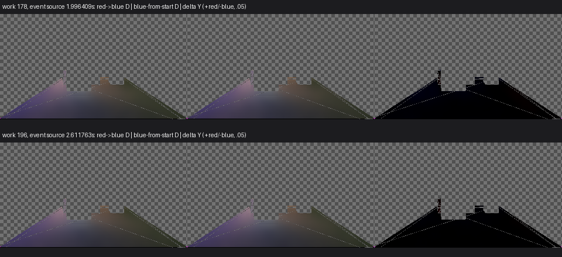

# 红墙反射率换蓝：地板恢复与白块控制不足

**原G3这条材质事件的Floor有限恢复依据可以采用，两个接收域的完整合同仍不足。** 相对首帧即蓝的产品控制，地板区域均值在事件后1.142–1.654秒形成首个合格保持窗口，随后观测至2.612秒未再越线。White控制自身波动超过冻结资格，不能给出其恢复通过结论。整体状态保留`insufficient-control-stability`；Astra Max同意部分采用并结束，没有产品修复、补采、调阈值或新版本。

每行依次为先红后蓝、首帧即蓝及亮度差，工作帧178／196由事前“最接近2秒／末帧”规则选取。量为filteredD＝E_indirect/pi，未乘接收面rho／AO；曝光1、Reinhard+sRGB、显示垂直翻转，数值用原生行序。灰棋盘为原ROI之外、洋红为各程未知；差异红正蓝负、量程.05。约2秒及末帧的地板未见明显持续旧色结构，图不能证明较早各像素已收敛。

## 必要性、输入和时钟

109红墙改蓝只有+30/work150与蓝前史的差异，没有源秒钟，也没有控制稳定性资格；不能直接把当时约12%的亮度差判成两秒失败。126改变的是发光板发光项，不能替代这条反射率／解析灯事件。本次直接沿用原V209／109物理场景、相机、20个owner、5原实时灯与固定门ApplyFrame(0)，没有重烘或重建夹具。

当前Release122同源产品7c08327，Unity6000.0.85f1／URP17.0.4、RTX2080Ti／D3D12／Linear；原640×360／GI320×180，2ray／filter4／DXR、cache8、bounceFeedback1、guide.35、history32、IndirectOnly，计时／反馈关闭。事件程119渲染返回后，同引擎帧普通renderer MPB将唯一Red wall的_BaseColor设为(.05,.15,.8,1)，不MarkDirty；蓝程首帧前同色，在119后仅记marker。slot0无MPB遮蔽，两程实际蓝色读值一致。其他物理输入不变，缓存和屏幕历史自然演化。

复用109已有的临时观察接线，只固定门、抑制普通HDR及保存原API的D／有效性，不改变传输／时域求值；结束后恢复两份观察源码和工程状态。每个119–196源帧都有原D票据。两个197帧前缀均实际DXR、引擎／GI连续、failures0／backendMismatches0、读回终止、原生退出0。原720协议仍为未完成前缀，不能称整段通过。观察121 pending／512MiB只是有限所有权额度，不是产品GPU预算。

源时刻取匹配begin-camera回调内节流之后的realtime钟；不是RenderRequest返回、GPU完成或异步回调时刻。事件程／蓝程响应源均约29.31／29.40Hz，最大间隔35.202／35.180ms，均小于事先2/30秒窗口上限。单次事件观察至首个≥2.6秒源帧196；控制严格到同工作帧。该节奏不等于普通Player、Present或性能放行。

## 固定域、控制资格与读数

源域沿用原参考119的独立Floor／White几何owner，完整点数13,330／86。两程119的共同已知域在事件前锁定为13,328／86点，地板2个unknown单列；响应没有新增unknown，也没有按结果删除点。原filteredD的finite／alpha>0有效性不是fresh raw资格证明。

| 事前控制资格 | Floor | White receiver |
| --- | ---: | ---: |
| 蓝控制平均Y极差／均值，要求≤5% | 1.87535%，通过 | 9.03109%，**不足** |
| 蓝控制均值色向漂移L1，要求≤.025 | .00921391，通过 | .02545491，**不足** |

控制稳定性按全部对应响应帧判断。没有通过删去早帧、放宽标准或延长蓝前史使White合格。蓝程是有限产品控制，不是物理真值或无限稳态。

| 同工作帧差异 | Floor亮度偏差／色向L1 | White亮度偏差／色向L1 |
| --- | --- | --- |
| work178，事件源1.996409秒 | −.98588%／.00283502 | +.77012%／.03363461 |
| work196，2.611763秒 | −.35840%／.00199990 | +1.52332%／.02550047 |

Floor控制合格，区域均值首次满足±10%／.05并保持至少.5秒的已观察窗口为work153–168、1.141710–1.654460秒，跨度.512750秒；窗口内最大平均Y偏差9.53899%、色向L1 .03711745，其后现有源帧未再越线。窗口起点最差像素亮度绝对差仍有.0229421（D单位），不能把均值达标写成全像素恢复。它不是数学首次时刻，也不分离世界缓存、屏幕历史或旧红光物理份额。White表中只是两程差异：即便数值较小，控制不合格仍不能给恢复通过结论。机器记录中的相对差异窗口与控制资格已分开，联合窗口`adoptable=false`。

## 解析更正、进度与交付

首次离线解释器误用float32逐位等于字面蓝值，实际普通MPB SetColor/GetColor读为(.049999982,.149999976,.800000012)，因此停止为“Actual wall input differs”。初判保留。随后仅将请求蓝的读值核对改为1e−7浮点回读范围，仍要求每个蓝源和两程实际RGB精确相同；这是事后输入解释器修正，没有改变恢复／控制门槛或重跑GPU。原始数据、质量目标和White不足结论均保留。

本轮关闭T3中**当前Runtime、原红墙反射率事件、固定Floor均值恢复用时未知**的子缺口。White仍是控制不足，不能称整个材质事件、物理颜色或完整G3通过。门运动、形变、其他光路、960×540普通Player及整体性能继续保持原范围，不顺次展开其他材质事件。

[最终数值及资格](result.json) · [冻结合同](contract.md) · [离线复算源码](analyze.py) · [数据与观察入口](data-and-source.zip)。原数据为`I:/Unity test/Comparison/ReflectedColor134/{RedToBlue,BlueFromStart}`，准备、原文件备份和归档资产在同级`Setup`，日志以`ReflectedColor134`为前缀。本项到此结束，Release122不变，原计划整体尚未完成。
