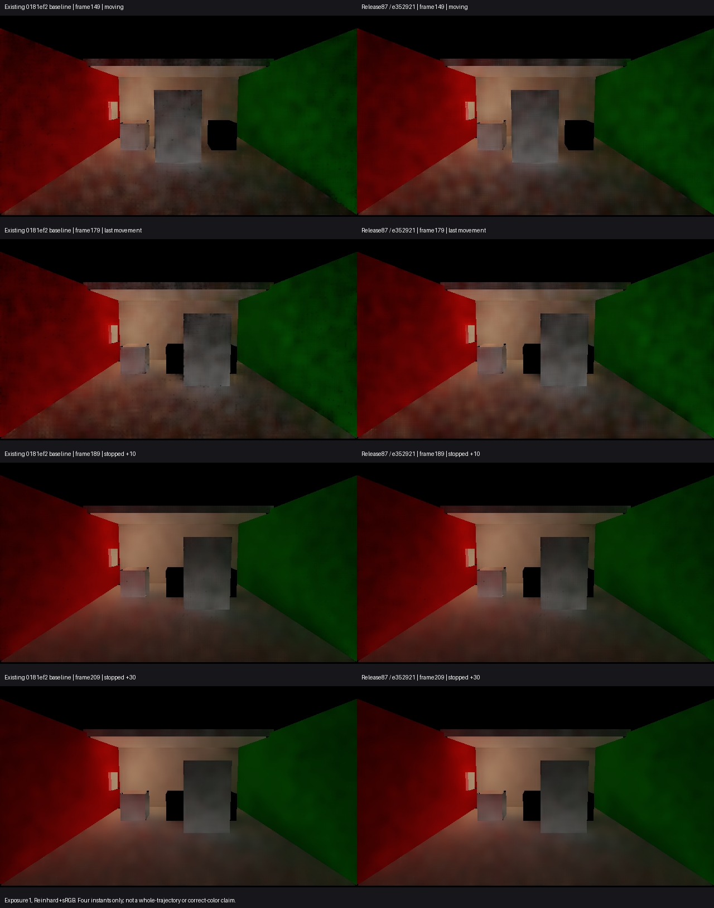

# Release87运动与停止后的有限对照

**保留Release87。** 针对用户选择的“减少运动颗粒，可适度变柔，但不能明显加重拖影”，主线程、独立视觉审阅和Astra在下列四组同曝光图中均未见阻断。149／179帧门面及墙地细黑颗粒减少，画面略柔；189／209帧接近原基线，未见可辨的新持续旧轮廓。云状软斑仍在。

只支持**该软件场景四个时点未见明显加重拖影**。这不是全过程、任意相机运动、DXR动态或精确收敛验收。189／209的全图RGB均值相同仅按均值记录，不据此宣称逐像素一致；其余均值变化也不作为物理颜色准确度。数据见[comparison.json](comparison.json)。

产品e352921，与已交付Release87一致；沿用DoorStopResponse01基线、保存原场景前史及精确软件。149为运动中，179为最后一次位移，189／209为保持姿态后10／30帧。仅四张640×360普通IndirectOnly HDR，相机／门姿态及后端对应。显示使用曝光1、Reinhard与sRGB并竖直翻转；量是间接漫反射出射贡献，不是独立D。没有附加D票据、探针、参考积分、成本测量或新参数。

Unity PID16240已结束，210渲染帧、failures0、backendMismatches0；原720协议保持failed，native exit1按主动前缀保留。临时Sequence、Quality和场景副本恢复，产品未改。用户明确取舍后的这项有限画面依据已补齐，未重建或再次启动Release87；此观察线结束，不补帧或扩展矩阵。

四项问题中，本次只新增上述**运动拖影**边界；**颜色误差、换色／关灯残留及收敛时间**继续保持[总报告](../dynamic-picture-comparison-01/report.md)中各自实际来源和未解决项，没有将旧结果升级为本次通过。
