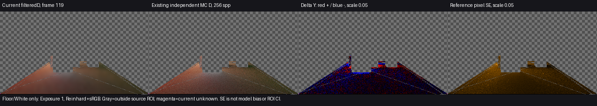

# Release88：限定119帧的独立颜色对照

当前2射线配置在该静止时点的Floor／White亮度偏差和逐像素亮度误差，小于已有1射线结果；**Floor平均色向偏差增加，不能称所有颜色指标改善**。保持已交付Release88的运动颗粒取舍，不调整强度，不追加时点或构建。本次关闭的是“当前配置只有变亮观察、没有同量参考估计”的有限缺口，不是整景颜色或动态验收。

## 颜色误差与适用范围

产品Runtime仍为e352921，仅采用Release88的2射线配置。复用原保存场景和0–119前史，软件后端、640×360相机、320×180 GI；cacheRaysPerFace=8、filterIterations=3。比较量为 **filteredD＝E_indirect/π**，不含接收面反射率、AO和合成强度，不把普通IndirectOnly出射图当作D。此画质输入与960×540普通DXR成本窗口分别解释。

复用既有256spp、8次反弹CPU参考和源几何Floor／White ROI。已有工具确认相机invVP、GI尺寸、强度及原采样位置的材质RGB/AO匹配；保存场景和前史由本次运行提供，没有新增来源证明系统。

| ROI | 当前已知／源域点数 | unknown | 平均D-Y | 参考平均D-Y | 平均Y相对偏差 | 逐像素Y-MAE | 平均色向L1 |
| --- | ---: | ---: | ---: | ---: | ---: | ---: | ---: |
| Floor | 13328／13330 | 2 | 0.069699 | 0.071689 | **−2.776%** | **0.009566** | **0.007884** |
| White receiver | 86／86 | 0 | 0.224830 | 0.226957 | **−0.938%** | **0.017423** | **0.032816** |

MAE为当前已知源域内`mean(abs(Y_current − Y_reference))`；色向L1比较归一化ROI平均RGB，不是逐像素感知色差。unknown排除并单独报告，不当黑色。完整[同量结果](comparison.json)和[复用既有公式的MAE](pixel-mae.json)保留原值。

历史[Release82／1射线119结果](../stationary-history-01/result.md)中，Floor／White偏差为−5.84%／−3.36%，MAE为0.010199／0.020113，色向L1为0.004220／0.046113。当前两个亮度指标减小，White色向改善，Floor色向变差；known／unknown计数相同不证明点集位置完全相同。这些是各自版本结果的背景比较，不将差值全部归因于射线数量，也不称严格同点A/B或统计显著。

共同曝光1、Reinhard+sRGB；PNG仅垂直翻转显示。灰棋盘为ROI之外，洋红为unknown；差异图红正蓝负、量程0.05。主线程查看图后，当前D比参考更平滑，局部明暗差仍在；ROI平均值接近不代表逐点正确。

参考每像素保守亮度SE的ROI均值为Floor **0.010990**、White **0.017631**，不是ROI均值置信区间、误差上界或通过阈值。参考的有限采样、8层截断、源几何／射线偏移和产品距离截断、缓存／滤波的差别仍在。参考只含漫反射和发光、黑环境，不代表完整Final的软阴影、镜面、透明等语义；产品D也采用硬可见性，不能把URP PCF差异当成本次D误差的归因。White仅86点，不能代表整景。

## 换色、关灯、运动与收敛

本次只有静止119，没有新换色／关灯事件、运动或恢复时序。Release88已有[149／179／189／209软件动停图](../two-ray-local-quality-01/result.md)颗粒和暗斑减少，未见明显新增持续轮廓，仍有软斑；这些时点没有同量独立参考，本次119不能解释其全部7.9–23.1%的亮度变化。

换色／关灯残留继续保持[四项问题表](../dynamic-picture-comparison-01/report.md)中的原版本来源；旧1射线响应不重标为当前2射线。单时点不提供收敛时间，晚帧不作真值，也不证明当前配置无偏、全过程无拖影或DXR动态等画质。

## 本次执行与收束

唯一Unity进程PID15884完成0–119共120个渲染帧，failures=0、backendMismatches=0，119 Capture完整。原720序列未完成，原failed及native exit1保留，不改称全序列通过。临时场景、捕获选择源和Quality设置已恢复，产品shader未改；原始输出为`I:/Unity test/Comparison/Release88ColorFrame119`。

直接使用未改动的`current-color-frame119-01/compare.py --signals ... --output ...`生成图和均值结果；[pixel-mae.py](pixel-mae.py)只从同一次捕获调用既有`stationary-history-01/analyze.py:measures`补齐预定MAE，没有新参考积分、阈值或采样。原始[范围](scope.md)、[运行](run.ps1)和退出记录保留。本线至此结束，当前可运行版本仍是[Release88](<I:/Unity test/Comparison/Builds/LocalRelease88/Start-LocalRelease.cmd>)。

独立结果审阅确认数值、量合同与色向取舍，无阻断问题。Astra阶段审查同意保留Release88并结束本线：不事后添加“所有指标必须同时改善”的门槛，也不以G0–G5仍开放为由自动派生新测试。
