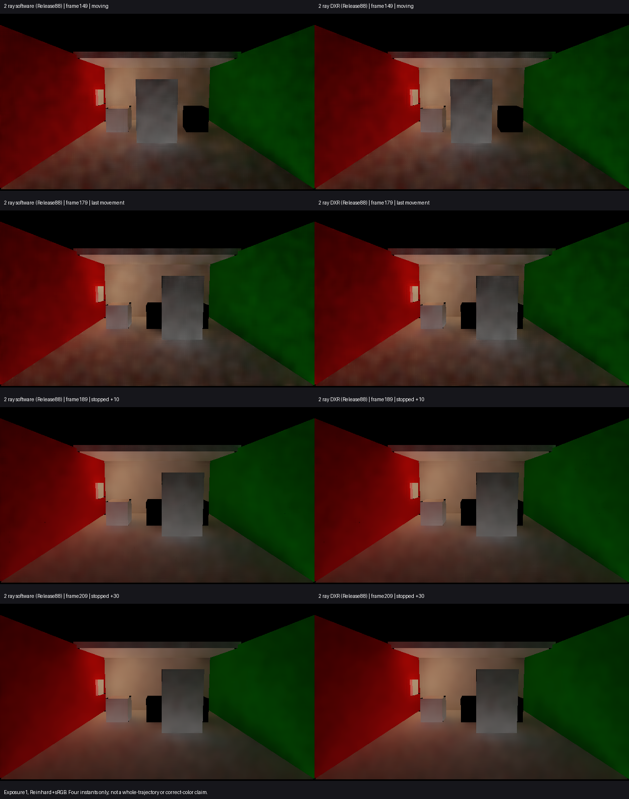

# Release88：默认DXR的有限动停画面对照

**保持Release88默认DXR。** 与已采用的软件2射线画面相比，当前DXR在149／179／189／209四个时点未见明显新增缺失、颗粒回退、边缘异常或持续旧轮廓。主线程、独立图审及Astra结论一致，门面和地面的云状软斑两边仍在。

本次关闭原G4中的一个具体交付依据缺口：当前默认2射线DXR配置此前只有运行成本与端点状态，运动画质依据来自软件。现在补齐相同四时点的直接画面对照；不把它扩大成完整G4放行或全过程后端等价。产品未改，仍使用[Release88统一入口](<I:/Unity test/Comparison/Builds/LocalRelease88/Start-LocalRelease.cmd>)，没有重建。

## 画面与实际输入

左列复用`TwoRayLocalQuality01`的软件2射线图，右列为本次`Release88DxrMotion01`。Runtime e352921、原保存场景及0–209前史保持；两侧raysPerPixel=2、cacheRaysPerFace=8、filterIterations=3、IndirectOnly。当前捕获Feature记录preferHardwareTracing=true，Sequence要求Hardware；没有仅凭偏好开关认定后端。

| 时点 | 场景状态 | 当前后端记录 | 目视结论 |
| --- | --- | --- | --- |
| 149 | 运动中 | reported-hardware，20 mesh／0 fallback | 颗粒和斑驳接近软件，无明显新增缺失 |
| 179 | 最后运动帧 | reported-hardware，20 mesh／0 fallback | 门面和接触边缘接近软件，无明显回退 |
| 189 | 停止后10帧 | reported-hardware，20 mesh／0 fallback | 未见新增持续旧轮廓，软斑仍在 |
| 209 | 停止后30帧 | reported-hardware，20 mesh／0 fallback | 未见新增持续旧轮廓，软斑仍在 |

两侧相机位置、旋转、投影、门位置和灯开关匹配；既有逐帧GI计数新鲜、后端诊断与HDR读回完成。它们支持原有有限后端口径，不是逐射线或独立GPU完成证明。详见[原始比较结果](comparison.json)。没有要求像素完全相等，也没有把全图均值接近当作图像相等证明。

普通HDR为640×360，GI为320×180；显示统一曝光1、Reinhard+sRGB，PNG仅垂直翻转。这是含接收反射率、AO与强度的间接漫反射出射贡献，**不是filteredD或物理真值**。它与960×540普通DXR Present成本来自不同运行；不冒充普通Player的新截图、性能或同一运行中的完整质量与成本验收。

## 四项问题的边界

- 颜色误差：本次没有独立参考；[当前119的D误差](../release88-color-frame119-01/result.md)仍来自软件静止时点，不能据本图近似把其数值重标为DXR。
- 换色／关灯残留：本次没有这两类事件，既有结论保持各自版本和配置来源。
- 运动拖影：这四个DXR时点未见相对已采用软件观感的明显回退；不证明整段无拖影或任意运动等价。
- 收敛时间：停止后10／30帧只是观察点，不是到正确颜色的收敛时刻；软斑仍未关闭。

## 执行与结束条件

唯一Unity PID19232完成原0–209前缀，210渲染帧、failures=0、backendMismatches=0。原720协议仍为failed、native exit1，不能称全序列通过。临时场景、捕获选择源和Quality已恢复，产品shader未改。原输出为`I:/Unity test/Comparison/Release88DxrMotion01`，日志`I:/Unity test/Logs/Release88DxrMotion01.log`。

沿用既有四图[运行](run.ps1)与[并排显示](compare.py)流程；跨后端检查分别要求软件／硬件，保留其余输入资格。Astra在执行前批准[范围](scope.md)，结果审查同意结束。本线不追加时点、参考、性能、1射线DXR或新构建。
