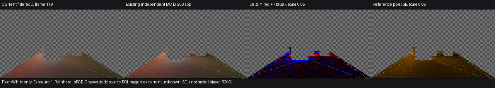

# Release93：filter4／DXR的限定119颜色对照

当前配置的Floor／White平均D亮度偏差为−3.075%／−0.831%。相较历史软件filter3，Floor平均偏差略扩大、White略缩小，两个ROI的逐像素Y-MAE约增加10.1%／6.6%，均值色向L1也略增。保留已授权的减云斑／适度柔化取舍，同时明确颜色代价；不称所有指标改善，也不将不同后端／版本结果差异全部归因于第4级滤波。

本次关闭“当前filter4仅有普通画面、缺少同量独立颜色估计”的有限信息缺口。产品与普通Release93保持，原G1整景颜色、动态残留和收敛仍未关闭；没有据此调强度、改参数或重新构建。

## 当前量与适用范围

源码ae035d3（Runtime修复aeb6ba2），复用原保存场景和0–119前史：2ray／filter4／cache8／实际DXR、640×360相机／320×180 GI。比较量是filteredD＝E_indirect/π，未乘接收面反射率、AO或合成强度。它是当前配置在既有参考网格上的单时点估计，不是960×540普通入口的颜色验收，也不把普通IndirectOnly出射图冒充D。

原样复用既有256spp／8次反弹CPU参考、独立源几何Floor／White ROI、compare.py及MAE helper。相机invVP、GI尺寸、强度与原采样位置的材质RGB／AO通过既有匹配检查；没有新增来源证明系统、参考积分、阈值或哈希。

| ROI | 已知／源域点数 | unknown | 当前平均D-Y | 参考平均D-Y | 相对平均Y偏差 | 像素Y-MAE | 均值色向L1 |
| --- | ---: | ---: | ---: | ---: | ---: | ---: | ---: |
| Floor | 13328／13330 | 2 | 0.069485 | 0.071689 | −3.074517% | 0.010529235 | 0.007975760 |
| White receiver | 86／86 | 0 | 0.225072 | 0.226957 | −0.830583% | 0.018575717 | 0.033414727 |

MAE是当前已知源域内逐像素亮度绝对差的均值；色向L1比较归一化ROI平均RGB，不是逐像素感知色差。unknown单列，不作黑色。完整数值见[comparison.json](comparison.json)及[pixel-mae.json](pixel-mae.json)。

历史[88软件filter3](../release88-color-frame119-01/result.md)的Floor／White平均偏差为−2.775719%／−0.937511%、Y-MAE为0.00956604／0.01742321、均值色向L1为0.00788427／0.03281579。当前并非全面更准；两次已知计数相同也不证明点集完全相同，不据此给严格同点因果结论或统计显著性。更平滑的普通运动画面与参考误差是不同问题。

显示统一曝光1、Reinhard+sRGB，PNG只垂直翻转。灰棋盘为ROI之外，洋红为unknown；亮度差红正蓝负、量程0.05。当前图较有限MC参考平滑，局部正负差仍在；图的平滑程度不是物理正确性判据。

参考每像素保守亮度SE的ROI均值为Floor0.010990、White0.017631，**不是ROI均值置信区间、误差上界或采用阈值**。保留有限MC采样、8层截断、源几何／射线偏移、产品距离截断与缓存／滤波模型差异。参考只含漫反射与发光、黑环境，不覆盖镜面、透明或完整Final；其硬可见性不是URP PCF。White只有86点，不代表整景。

## 其余三项与收束

- 换色／关灯残留：没有新的事件观察，旧响应仍保持原版本／配置来源。
- 运动拖影：继续依据[92／filter4四时点](../four-pass-local-quality-01/result.md)未见明显新增持续旧轮廓的有限结果，本次静止119不扩大该结论。
- 收敛时间：单时点不能提供达到正确颜色的统一帧数，晚帧也不作真值。

唯一Unity PID21164完成120渲染帧，failures=0、backendMismatches=0；119 Capture完整、readbacksCompleted，普通帧诊断为reported-hardware。原720未完成的failed／native exit1保留，不改称完整序列通过。临时场景、捕获选择及Quality已恢复。原始数据在`I:/Unity test/Comparison/Release93ColorFrame119`，运行及[退出](native-exit.json)记录保留。

独立结果审阅确认量、输入条件、数值及上述取舍，无阻断。Astra同意保留Release93：这组混合指标变化不足以推翻已明确的运动减云斑收益，但须并列保留MAE和色向代价，不以参考平均SE把差异说成可忽略。本线不补时点、后端、参考、强度调参或构建；普通[Release93](<I:/Unity test/Comparison/Builds/LocalRelease93/Start-LocalRelease.cmd>)保持。
