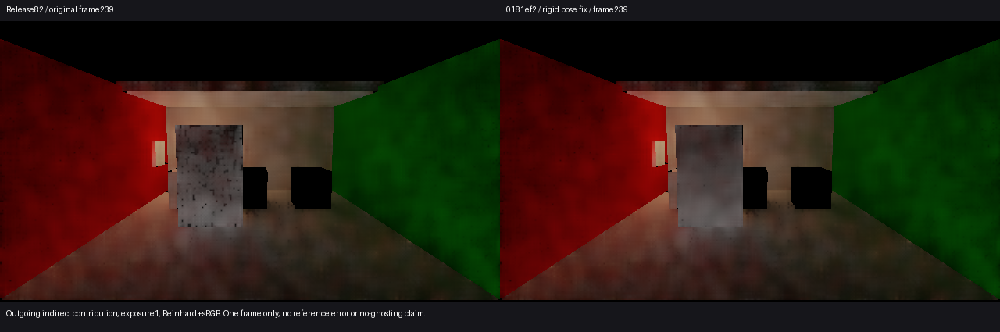

# 刚体同帧重传的历史恢复

2026-10-30。采用源码 **0181ef2**。关闭原目标2／工作流6的一项具体缺口：已通过对象与几何对应的刚体接收面，仍被同帧重传附加的 `Added` 误判为新几何，无法复用自身历史。完整G3、任意运动画质和收敛仍开放。

左为Release82，右为修复；量是间接漫反射出射贡献，曝光1、Reinhard+sRGB，仅显示时竖直翻转。主线程和独立代理均看到门面黑颗粒明显减少，仍有软斑驳；没有发现足以阻止采用的新增旧位置轮廓。单帧不能证明运动全过程没有拖影，也不能代替独立参考误差。

## 原因及修复范围

既有Release82的239帧门面2739点均为已知D、已知几何法线，历史长度却全为1。经Astra先审必要性，唯一一次临时观察在真实Temporal的239帧将已有资格链编码到moments.w，未改变0–238帧；复用现有Capture，结束恢复Runtime。

[实际门控结果](../door-history-gate-01/gates.json)：2739点对象row、身份及位姿有效；2724点继续通过primitive和几何／材质匹配，随后全部被change.x拒绝。另15点在primitive门即被拒绝，未扩大研究。后续零位是上游资格已失效，不能解释成后续门独立失败。观察器改变了239帧的空间方差，因此该次图像不作为画质依据。

源码主审和独立复核找到同一调用链：Scene先记录Transform，清除旧slot等待更新，同帧成功重传又记录Added；按slot/id合并后成为Transform|Added。ChangeRegions和SdfAtlas均不允许这类事件使用自身pose豁免。

修复只在已有同slot/id、同目标revision、完整旧／新bounds、纯Transform（可附Lighting）事件时，省去后续重传重复附加的Added。首次新增、跨帧延迟上传、删除、Representation、Topology、Material、Manual不命中此例外。真实上传、readiness失效、世界缓存更新和全部屏幕对应门继续执行；没有放宽阈值或修改滤波器。

## 有限结果

一次已有 `Tests/Validate-SceneResidency.ps1` 通过，新增必要断言要求即时运动保持准确pose分类、延迟上传仍为Added；原新增、删除和slot复用等检查也保持。它执行真实Scene源码及Unity API适配器，不是实际GPU画质依据。

随后经Astra审查，仅运行一次保存场景0–239的正常产品前缀，使用原始shader、只采239，没有新增探针或补帧。[读回比较](comparison.json)：

| 门面采样 | Release82 | 0181ef2 |
| --- | ---: | ---: |
| 已知D | 2739 | 2739 |
| 历史长度1 | 2739 | 15 |
| 历史长度2 | 0 | 2724 |

现有reactive规则仍将历史限制为2，不能把“恢复复用”称为成熟历史或正确辐射证明。相机、门位置、后端及合成配置与旧239匹配；ROI沿用已有119主射线对象网格，此时门回到初始位置。没有239的独立物理参考。

正常运行来源：`I:/Unity test/Comparison/RigidPoseHistory01`，logical/work frame239、engine243；240帧完成，渲染failures0、backendMismatches0、读回complete且retainedBytes0。原720协议的failed、Editor incomplete及native exit1原样保留。Kernel观察器、临时Sequence／Quality及场景副本均已恢复。没有把进程时长作为GPU性能。

## 四项画质回答

| 问题 | 本节点结论与不确定性 |
| --- | --- |
| 颜色误差 | 本修复没有新的独立误差测量。保留Release82的119帧Floor／White平均D偏差−5.84%／−3.36%，299为+0.144%／−18.06%；限各自ROI、时点及近似参考，不转称当前全场景误差。 |
| 换色／关灯残留 | 本次不改变这些机制。已采用灯表清空移除旧解析份额；局部换色仍未关闭。Release82静止例外在无标记真变黑的有限32步中仍留6.88%，不是本次Unity收敛测量。 |
| 运动拖影 | 已修复受保护刚体的错误全量历史拒绝；239门颗粒明显减少。仍有软斑驳，单帧无明显新增轮廓不足以证明全过程无拖影；未知／不匹配对应仍拒绝。 |
| 收敛时间 | 本次只能确认239帧恢复短历史复用。没有新增收敛时间结论，仍不能给出整景达到正确颜色的统一帧数。 |

本项定位和验证结束。Astra同意有限采用及整合统一可运行入口，不追加Player、性能窗口、哈希校验或完整回归。

## 可运行交付

[启动Release83](<I:/Unity test/Comparison/Builds/LocalRelease83/Start-LocalRelease.cmd>)：公开 `HybridLumenGIPlayerBuild.Build` 复用保存的UnifiedRelease74场景，Release／BuildOptions.None，产品0181ef2，构建Succeeded、0 errors／23 warnings、native exit0。构建后未追加Player或图像运行；工程保留修复后的Scene源码，临时QualitySettings及原初始化器已恢复。
